# CRM UI Behavior & Logic Blueprint
## Complete Functional Logic, Screen Workflows, State Transitions, and Infographics

> **Document Classification**: System Logic & UI Behavior Specification  
> **Target Audience**: Product Leadership, Engineering, Operations, and Business Analysts  
> **System Scope**: Single-Tenant Admission Consultant CRM & Super Admin Platform  

---

## Table of Contents
1. [Executive Overview & Macro System Architecture](#1-executive-overview--macro-system-architecture)
2. [Global Navigation & Information Architecture](#2-global-navigation--information-architecture)
3. [Persona 1: The Admission Consultant Workflows](#3-persona-1-the-admission-consultant-workflows)
   - [3.1 Authentication & Onboarding (`/login`, `/signup`)](#31-authentication--onboarding-login-signup)
   - [3.2 Executive Dashboard Cockpit (`/dashboard`)](#32-executive-dashboard-cockpit-dashboard)
   - [3.3 Candidate Leads Management (`/leads`, `/leads/[id]`)](#33-candidate-leads-management-leads-leadsid)
   - [3.4 Admissions Kanban Pipeline (`/pipeline`)](#34-admissions-kanban-pipeline-pipeline)
   - [3.5 Follow-Up & The 2-Delay Alarm Engine (`/follow-ups`)](#35-follow-up--the-2-delay-alarm-engine-follow-ups)
   - [3.6 Hybrid College Catalogue & Custom Builder (`/catalogue`, `/colleges/[id]`)](#36-hybrid-college-catalogue--custom-builder-catalogue-collegesid)
   - [3.7 Public Shareable College Profiles (`/share/[token]`)](#37-public-shareable-college-profiles-sharetoken)
   - [3.8 Form Studio & Dynamic Lead Intake (`/forms`)](#38-form-studio--dynamic-lead-intake-forms)
   - [3.9 WhatsApp Communication Hub (`/whatsapp`, `/templates`)](#39-whatsapp-communication-hub-whatsapp-templates)
   - [3.10 Broadcast Campaigns & Targeted Groups (`/campaigns`, `/groups`)](#310-broadcast-campaigns--targeted-groups-campaigns-groups)
   - [3.11 Deals & Commission Reconciliation (`/deals`, `/commission`)](#311-deals--commission-reconciliation-deals-commission)
   - [3.12 Analytics & Funnel Intelligence (`/analytics`)](#312-analytics--funnel-intelligence-analytics)
   - [3.13 Consultant Profile & Workspace Customization (`/profile`)](#313-consultant-profile--workspace-customization-profile)
4. [Persona 2: The Super Admin Control Center (`/admin`)](#4-persona-2-the-super-admin-control-center-admin)
   - [4.1 Security Barrier & Access Control](#41-security-barrier--access-control)
   - [4.2 Tab 1: Overview Command Center](#42-tab-1-overview-command-center)
   - [4.3 Tab 2: Main Users Management](#43-tab-2-main-users-management)
   - [4.4 Tab 3: Subscription Plans Catalog (INR ₹)](#44-tab-3-subscription-plans-catalog-inr-)
   - [4.5 Tab 4: Coupons & Promotional Discounts](#45-tab-4-coupons--promotional-discounts)
   - [4.6 Tab 5: Unified Activity & Audit Logs](#46-tab-5-unified-activity--audit-logs)
   - [4.7 Tab 6: Platform Health & Telemetry](#47-tab-6-platform-health--telemetry)
5. [Cross-Cutting Logic & State Machines](#5-cross-cutting-logic--state-machines)
   - [5.1 Candidate Lead Lifecycle State Machine](#51-candidate-lead-lifecycle-state-machine)
   - [5.2 Follow-Up Alarm & 2-Delay State Machine](#52-follow-up-alarm--2-delay-state-machine)
   - [5.3 Hybrid Catalogue Matchmaking Flow](#53-hybrid-catalogue-matchmaking-flow)
   - [5.4 Public Ingestion & Auto-Advancing Pipeline Flow](#54-public-ingestion--auto-advancing-pipeline-flow)
6. [UI Feedback, Safeguards & Error Handling Standards](#6-ui-feedback-safeguards--error-handling-standards)

---

## 1. Executive Overview & Macro System Architecture

The CRM is designed as a **purpose-built, single-operator admission consultancy operating system** backed by a **centralized Super Admin governance platform**.

Unlike generic B2B CRMs, its behavioral logic reflects the real-world operational journey of education counseling:
- High volume of incoming student inquiries (WhatsApp, intake forms, portals).
- Time-critical counseling interactions where missing a callback loses a student to a rival consultant.
- Deep catalog matching with universities, degree courses, management/merit seat availability, and fee negotiations.
- End-to-end closing from initial discovery to fee token payment and university commission payout.

```mermaid
flowchart LR
    subgraph Lead_Acquisition["1. Acquisition & Intake"]
        A1["Public Intake Form (/forms)"] --> L["New Candidate Lead"]
        A2["Manual Fast Entry"] --> L
        A3["Excel / CSV Import"] --> L
        A4["WhatsApp Inquiry (/whatsapp)"] --> L
    end

    subgraph Counselling["2. Tele-Counselling & Pipeline"]
        L --> P1["Stage 1: Lead Received"]
        P1 -->|Note Added / Call Made| P2["Stage 2: Tele-Counselling"]
        P2 -->|Colleges Matched| P3["Stage 3: Colleges Shortlisted"]
        P3 -->|Visit Booked| P4["Stage 4: Campus Visit Arranged"]
        P4 -->|Fee / Seat Block| P5["Stage 5: Seat Booking"]
        P5 -->|Admission Invoiced| P6["Stage 6: Admission Confirmed"]
    end

    subgraph Alarm_Engine["3. Time-Critical Follow-Ups"]
        P2 -.-> FU["Scheduled Follow-Up"]
        FU --> AL["Alarm Triggered"]
        AL -->|Delay 1 (+15m)| FU
        AL -->|Delay 2 (+30m)| FU
        AL -->|Mandatory Note| DONE["Follow-Up Completed"]
    end

    subgraph Conversion["4. Revenue & University Settlement"]
        P6 --> D["Won Deal Recorded (/deals)"]
        D --> C["University Commission Ledger (/commission)"]
        C --> P["Commission Paid ₹"]
    end
```

---

## 2. Global Navigation & Information Architecture

The UI is mobile-first, designed for high-speed operation on smartphones, tablets, and desktop workstations.

### 2.1 Navigation Structure
- **Mobile Workstations**: A persistent **Bottom Navigation Bar** fixed at the bottom with 5 high-frequency anchor tabs:
  1. **Dashboard** (`/dashboard`): Daily pulse, today's due calls, key metrics.
  2. **Leads** (`/leads`): Master candidate directory, search, filters.
  3. **Pipeline** (`/pipeline`): 6-stage Kanban board with visual drag/drop.
  4. **Catalogue** (`/catalogue`): 10,000+ college database & custom university builder.
  5. **Profile** (`/profile`): Consultant identity, workspace preferences.
- **Secondary Hub Bar**: Sub-navigation tabs embedded directly within pages (Follow-ups, Deals, Campaigns, WhatsApp, Commission, Forms, Analytics).
- **Super Admin Quick-Access**: An elevated **Crown Icon (👑)** visible in the profile/header when a Super Admin is logged in, granting 1-click access to `/admin`.

---

## 3. Persona 1: The Admission Consultant Workflows

---

### 3.1 Authentication & Onboarding (`/login`, `/signup`)

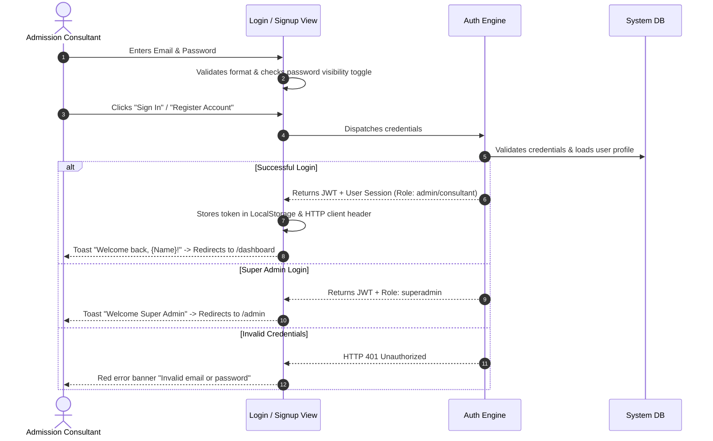

#### UI Behavior & Rules:
1. **Password Visibility**: An eye icon allows the user to toggle password masking to prevent typos on mobile keyboards.
2. **Instant Sanitization**: Email addresses are auto-trimmed and lowercased before submission.
3. **Role-Based Forwarding**:
   - `superadmin` role users are redirected directly to `/admin`.
   - Regular admission consultants are redirected to `/dashboard`.
4. **Session Persistence**: If a valid token exists upon revisiting `/login`, the screen auto-forwards to `/dashboard` without requiring re-entry.

---

### 3.2 Executive Dashboard Cockpit (`/dashboard`)

#### Intent & Purpose:
The consultant's daily morning command center. It answers three questions in under 5 seconds:
1. *How many leads need my attention right now?*
2. *Who must I call or WhatsApp today before they choose another consultant?*
3. *What is my admission pipeline and revenue trajectory this month?*

```
+--------------------------------------------------------------------------+
| Good morning, Priya Sharma ☀️                        [+ New Lead Button]  |
| Admission Consultant - Delhi NCR Region                                  |
+--------------------------------------------------------------------------+
|  [ Total Candidates ]  [ Due Follow-Ups ]  [ Campus Visits ]  [ Won Deals ]|
|        142                    8                   3                12    |
|     +12 this week         ⚠️ Overdue: 2       Scheduled       ₹18.4 Lakh |
+--------------------------------------------------------------------------+
| ⏰ TODAY'S ACTION AGENDA (Due Follow-ups)                                 |
| ------------------------------------------------------------------------ |
| 🔴 10:30 AM | Rahul Verma (NEET 480) - MBBS Counseling  [📞 Call] [💬 WA]|
| 🟡 02:00 PM | Ananya Gupta - B.Tech CSE at VIT          [📞 Call] [💬 WA]|
| 🟢 04:30 PM | Karan Singh - MBA Management Quota        [📞 Call] [💬 WA]|
+--------------------------------------------------------------------------+
| 🚀 QUICK LAUNCHPAD                                                       |
| [ 📋 Intake Form ]  [ 🏛️ Hybrid Catalogue ]  [ 📊 Funnel ]  [ 💬 Chat ]  |
+--------------------------------------------------------------------------+
```

#### Key UI Interactions:
1. **Dynamic Time Greeting**: Automatically displays `Good morning`, `Good afternoon`, or `Good evening` based on local device time.
2. **KPI Card Navigation**:
   - Clicking **Total Candidates** filters the `/leads` list to all active leads.
   - Clicking **Due Follow-Ups** jumps straight to `/follow-ups?tab=today`.
   - Clicking **Won Deals** navigates to `/deals?tab=won`.
3. **1-Click Call & WhatsApp Triggers**:
   - **Call Button**: Triggers `tel:+91...` launching the device phone dialer.
   - **WhatsApp Button**: Opens official WhatsApp Web/App pre-populated with a personalized greeting: *"Hello {Name}, following up regarding your college admission inquiry..."*
4. **Live Follow-Up Resolution**: Clicking the checkmark on any agenda item opens the **Complete Follow-Up Modal** directly from the dashboard.

---

### 3.3 Candidate Leads Management (`/leads`, `/leads/[id]`)

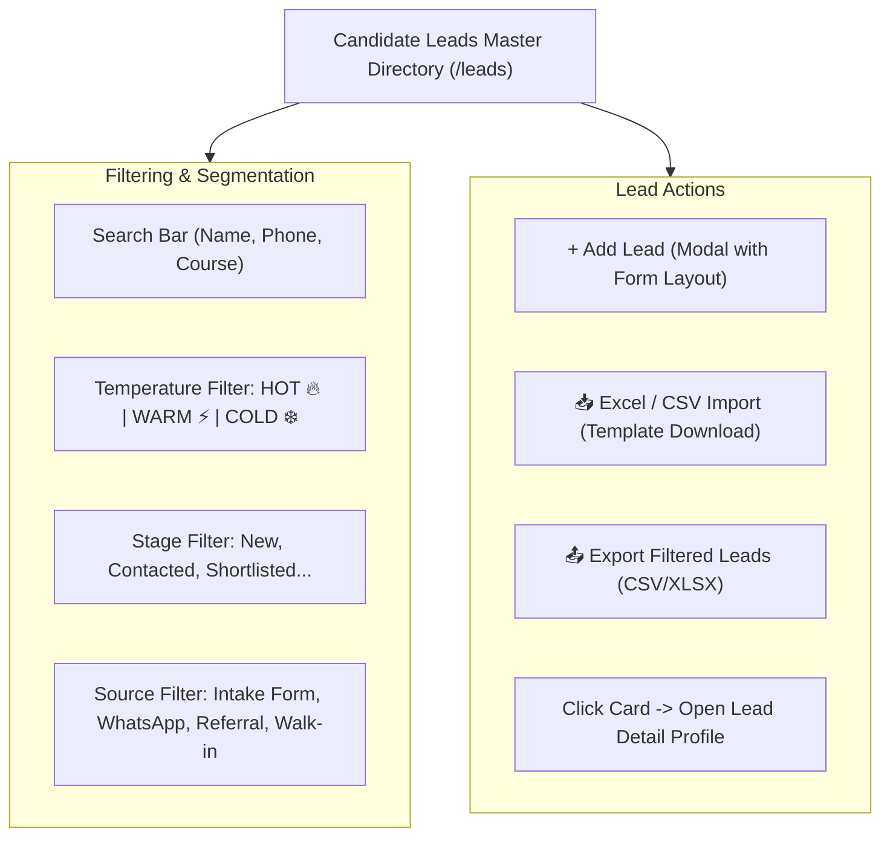

#### Detailed Interaction Logic:
1. **Search Behavior**: Instant debounced search querying across Student Name, Phone Number, Target Course, and Target Institution.
2. **Temperature Indicators**:
   - 🔥 **HOT**: High purchase intent, immediate admission required, budget secured.
   - ⚡ **WARM**: Interested, comparing two or three colleges, awaiting board/entrance results.
   - ❄️ **COLD**: Unresponsive, low budget, or inquiring for future academic sessions.
3. **The Add Lead Modal (`AddLeadModal`)**:
   - Adapts dynamically to the consultant's custom form schema saved in **Form Studio**.
   - Validates that mandatory fields (Name, Phone) are non-empty.
   - **"Show Follow-up on Create" Preference**: If enabled in Profile, displays an immediate datetime picker to schedule the first call. If disabled, creates the lead without cluttering the screen.
4. **Lead Detail View (`/leads/[id]`)**:
   - **Student Profile Header**: Contact info, source tag, stage badge, admission budget in ₹.
   - **Chronological Activity Timeline**: Displays every call note, follow-up reschedule, stage jump, and system event with precise author and timestamp.
   - **Document Vault**: Upload student 10th/12th marksheet, NEET/JEE scorecard, and ID proof.
   - **Quick Action Bar**: Schedule Follow-Up, Advance Stage, Send WhatsApp, Log Call Note.

---

### 3.4 Admissions Kanban Pipeline (`/pipeline`)

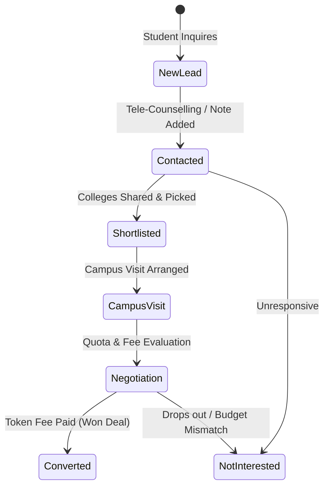

#### Pipeline Stages & Mathematical Probability:
| Stage Name | Business Meaning | Deal Probability | Visual Accent |
| :--- | :--- | :--- | :--- |
| **Lead Received** | Fresh uncontacted student | 15% | Indigo (`#6366f1`) |
| **Tele-Counselling** | Initial call completed, profile analyzed | 30% | Sky Blue (`#0ea5e9`) |
| **Colleges Shortlisted** | Degree programs & universities matched | 50% | Purple (`#8b5cf6`) |
| **Campus Visit Arranged**| Student scheduled for campus walkthrough | 70% | Amber (`#f59e0b`) |
| **Quota & Seat Booking**| Fee negotiation, management quota seat reserved | 85% | Pink (`#ec4899`) |
| **Admission Confirmed** | Seat finalized, invoice issued, deal won | 100% | Emerald (`#10b981`) |

#### Drag-and-Drop & Transition Rules:
1. **Interactive Stage Change**: Dragging a candidate card to a new column immediately updates the lead status and displays a confirmation toast.
2. **Auto-Advancement Trigger**: If a consultant logs a call note on a lead sitting in **Lead Received**, the system automatically advances it to **Tele-Counselling** without requiring manual dragging.
3. **Lost Deal Prompt**: Dragging a lead into **Not Interested** displays a modal requiring a **Lost Reason** (e.g., *Budget Too Low*, *Joined Other College*, *Failed Entrance Exam*). This data feeds directly into the Lost Reasons Chart in Analytics.
4. **Weighted Pipeline Forecast**: A toggle header switches the view from the Kanban board to the **Revenue Forecast**, calculating expected revenue:
   $$\text{Forecast Value} = \sum (\text{Lead Budget} \times \text{Stage Probability})$$

---

### 3.5 Follow-Up & The 2-Delay Alarm Engine (`/follow-ups`)

The alarm engine is the core productivity safety net of the CRM. Missing callbacks causes lost admissions. The system enforces strict accountability through a **finite 2-delay limit**.

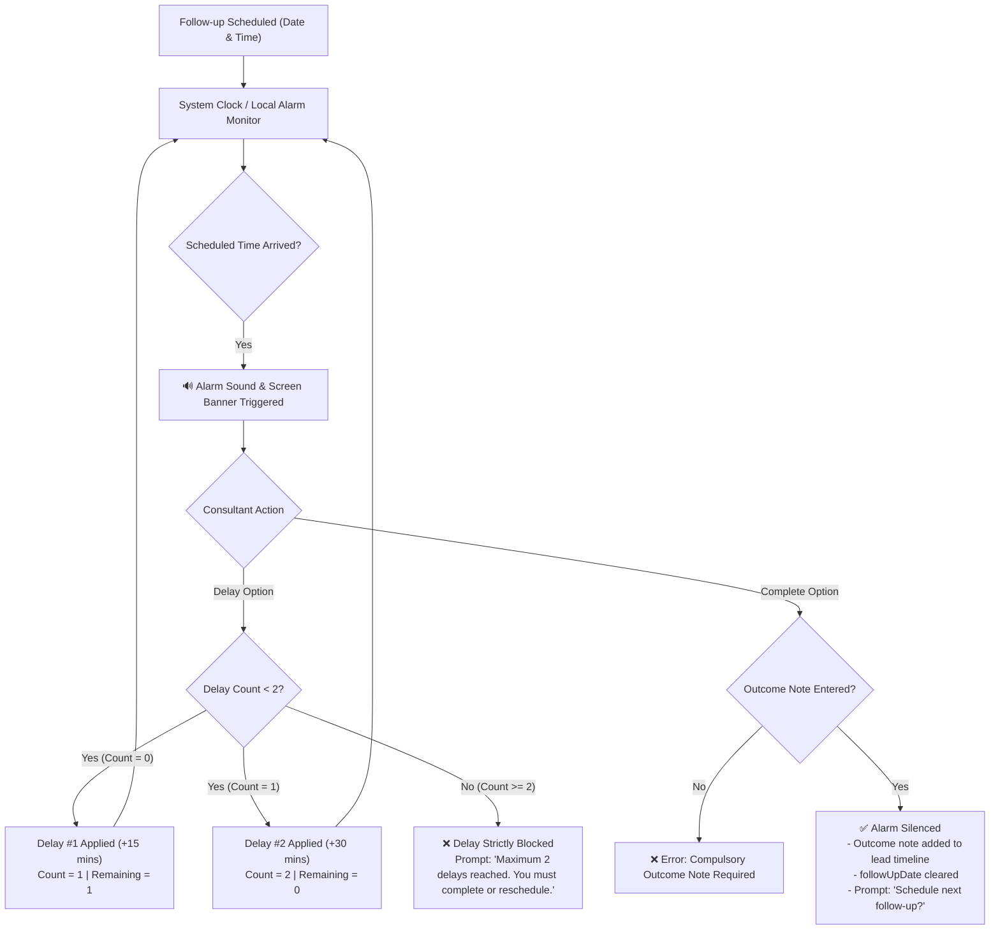

#### Detailed Rules of the Alarm Engine:
1. **Alarm Firing**: When `followUpDate <= CurrentTime` and `followUpNotified == false`, the alarm triggers an audible ping and a high-priority screen toast.
2. **Delay #1**: Adds 15 minutes (or a custom 5–60 min offset). Increments `delayCount` to 1.
3. **Delay #2**: Adds 30 minutes. Increments `delayCount` to 2.
4. **Delay #3 (Hard Wall)**: The delay button is locked. An alert informs the consultant: *"Maximum 2 delays reached for this follow-up cycle."*
5. **Mandatory Outcome Note**: The follow-up cannot be resolved by merely clicking "Done". The consultant must enter an outcome note explaining what occurred.
6. **Fresh Cycle Reset**: Once resolved, the consultant is prompted to schedule the next follow-up. Scheduling a new date resets `delayCount` back to 0 for the fresh cycle.

---

### 3.6 Hybrid College Catalogue & Custom Builder (`/catalogue`, `/colleges/[id]`)

Education consultants work with two categories of institutions:
1. Top national universities (which every consultant needs).
2. Specialized local colleges or niche tie-ups unique to their agency.

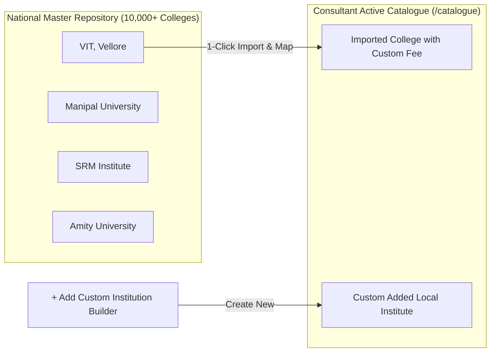

#### UI Logic & Controls:
1. **Master Explore Tab (`master_explore`)**:
   - Search across 10,000+ colleges by City, State, College Type (Deemed, State Govt, Private), and Degree.
   - **1-Click Import**: Clicking **"Import to My Catalogue"** clones the institution profile into the consultant's private workspace, pre-mapping all recognized degree programs and specializations.
2. **My Catalogue Tab (`my_catalogue`)**:
   - Displays the consultant's active partner institutions.
   - Shows badge indicators for seat availability:
     - 🟢 **Admissions Open**
     - 🔥 **Seats Fast Filling**
     - ⚡ **Merit Closed / Management Open**
     - 🔴 **Admissions Closed**
3. **Custom Institution Builder Modal**:
   - Allows consultants to add unlisted local colleges.
   - Multi-select accreditation chips: `NAAC A++`, `NAAC A+`, `NIRF Top 50`, `UGC Approved`, `AICTE Approved`, `MCI/NMC Approved`.
   - Pre-selects common degrees (`B.Tech`, `MBBS`, `MBA`, `BBA`, `BCA`).
4. **Specialization & Commercial Fee Matrix**:
   - Under each college, consultants can drill down into specific streams (e.g. *B.Tech Computer Science* vs *B.Tech Mechanical*).
   - Enter **Annual Tuition Fee (₹)**, **Management Quota Donation (₹)**, and **Consultant Commission Percentage (%)**.

---

### 3.7 Public Shareable College Profiles (`/share/[token]`)

#### Intent & Flow:
Consultants need to send college options to students and parents over WhatsApp without giving them access to the internal CRM or exposing commission margins.

1. **Generation**: The consultant clicks **"Share Prospectus"** on any college in their catalogue.
2. **Secure Token**: The system generates a public, read-only URL (`/share/{token}`).
3. **Parent View**:
   - Clean, branded mobile microsite displaying campus photos, location map, approved accreditations, and available degree courses.
   - **Financial Transparency**: Displays only the official student tuition fee (commission percentages and private margins are strictly stripped).
   - **Direct Inquiry**: Includes a **"Connect with Academic Counselor"** button that routes the student directly to the consultant's WhatsApp.

---

### 3.8 Form Studio & Dynamic Lead Intake (`/forms`)

#### Intent & Customization Engine:
Every admission consultancy specializes in different fields (e.g. Study Abroad needs Passport Number & IELTS score; Medical admissions need NEET Rank & Category).

```
+--------------------------------------------------------------------------+
| 📋 FORM STUDIO & INTAKE BUILDER                                          |
+--------------------------------------------------------------------------+
| [ + Add Field ]  [ 👁️ Live Preview ]  [ 🔗 Copy Public Link ] [ 💾 Save ]|
+--------------------------------------------------------------------------+
| FIELD LIST (Drag to re-order)                                            |
| ------------------------------------------------------------------------ |
| 1. [::] Student Full Name         | Type: Text       | Required: [x]     |
| 2. [::] Mobile / WhatsApp Number  | Type: Phone      | Required: [x]     |
| 3. [::] Target Degree / Course    | Type: Dropdown   | Required: [x]     |
| 4. [::] Entrance Exam & Score     | Type: Text       | Required: [ ]     |
| 5. [::] Budget Range (₹)          | Type: Currency   | Required: [ ]     |
| 6. [::] Location Preference       | Type: Text       | Required: [ ]     |
+--------------------------------------------------------------------------+
```

#### UI Logic:
1. **Drag-and-Drop Ordering**: Reorder fields to prioritize critical questions.
2. **Field Types Supported**: Text, Phone, Email, Number, Currency (₹), Date/Time, Dropdown, Multi-select Chips, and Long Textarea.
3. **Public Lead Form Generation**:
   - Generates a lightweight, fast-loading public link for student self-registration.
   - Submissions automatically appear in `/leads` with source tagged as `"Public Intake Form"`.

---

### 3.9 WhatsApp Communication Hub (`/whatsapp`, `/templates`)

#### Interaction Flow:
1. **Device Pairing**:
   - **Pairing Code Tab**: Enter consultant phone number -> receive 8-digit pairing code to enter in WhatsApp.
   - **QR Code Tab**: Displays live-updating QR code for instant scanning via WhatsApp Linked Devices.
2. **Two-Pane Chat Interface**:
   - Left pane: Searchable chat list of all student leads with unread badges.
   - Right pane: Chronological message history with double-tick delivery indicators (`✓✓`).
3. **Canned Template Launcher**:
   - Consultants click **"Templates"** to insert pre-approved responses:
     - *Document Submission Checklist*
     - *Fee Payment Bank Details*
     - *College Selection Counseling Guide*
     - *Campus Visit Confirmation*

---

### 3.10 Broadcast Campaigns & Targeted Groups (`/campaigns`, `/groups`)

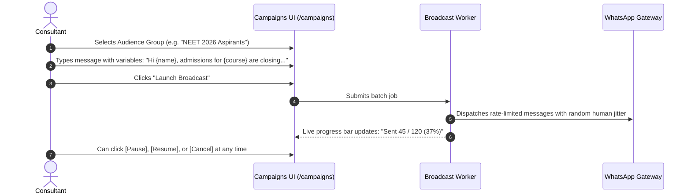

#### Safety & Compliance Features:
- **Rate-Limiting & Jitter**: Messages are queued with randomized intervals (3–8 seconds) between dispatches to prevent WhatsApp number bans.
- **Audience Filters**: Filter students by target degree, budget, or admission year before dispatching.

---

### 3.11 Deals & Commission Reconciliation (`/deals`, `/commission`)

#### The Financial Closing Journey:
1. **Won Deals Ledger (`/deals`)**:
   - When a student completes admission payment, the lead is moved to **Admission Confirmed**.
   - The total tuition value and agreed token fee are locked in the deal record.
2. **University Commission Tracker (`/commission`)**:
   - Displays all pending commission payouts owed by partner universities.
   - **Status Badges**:
     - 🟡 `PENDING`: Student admitted, college invoice submitted, payout awaited.
     - 🟢 `PAID`: University commission received and settled.
   - **Summary Cards**: Displays **Total Invoiced Commission (₹)** vs **Received Payouts (₹)**.

---

### 3.12 Analytics & Funnel Intelligence (`/analytics`)

#### Visual Metrics:
1. **Admissions Funnel**: Bar chart showing drop-off at each stage (Lead Received -> Contacted -> Shortlisted -> Visit -> Won).
2. **Lead Source Attribution**: Pie chart showing percentage of conversions from *Intake Forms*, *WhatsApp*, *Referrals*, and *Walk-ins*.
3. **Lost Reasons Breakdown**: Donut chart detailing why deals fell through (*Budget Mismatch*, *Distance/Hostel Issue*, *Opted for Govt Seat*).
4. **Monthly Revenue Trajectory**: Area chart tracking completed admissions and total revenue across the academic calendar year.

---

### 3.13 Consultant Profile & Workspace Customization (`/profile`)

#### Configurable Options:
1. **Consultancy Profile**: Business Name, Contact Email, Phone, Office Address, Registration Number.
2. **Pipeline Customizer**: Add or rename pipeline stages to match agency terminology.
3. **Follow-Up Behavior Switch**:
   - `[x] Show follow-up date picker when creating leads`: Toggle on/off depending on whether the consultant schedules follow-ups immediately or triages later.
4. **Super Admin Access**: If the account holds `role: "superadmin"`, an elevated golden crown card appears directing the user to `/admin`.

---

## 4. Persona 2: The Super Admin Control Center (`/admin`)

The Super Admin section is the **platform owner's command cockpit**. It provides complete governance over the SaaS platform.

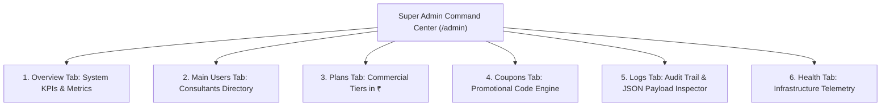

---

### 4.1 Security Barrier & Access Control
- **Role Verification**: Access to `/admin` requires a verified JWT with `role: "superadmin"`.
- **Unauthorized Handling**: Non-admin users attempting to open `/admin` are immediately intercepted and forwarded to `/profile` with an error toast: *"Super Admin privileges required"*.
- **Self-Preservation Safeguard**: A Super Admin cannot disable or delete their own user account.

---

### 4.2 Tab 1: Overview Command Center
- **KPI Metrics Grid**:
  - **Total Consultants**: Count of registered admission agencies.
  - **Active Subscriptions**: Consultants on active paid plans.
  - **Active Plans Catalog**: Number of published pricing tiers.
  - **Active Promotional Coupons**: Current active discount campaigns.
  - **System Health Status**: Overall operational score (e.g. `98% - Healthy`).
- **Quick Action Launchpad**: Instant jump buttons to *Manage Users*, *Add Plan*, *Create Coupon*, or *Inspect Logs*.

---

### 4.3 Tab 2: Main Users Management
A complete registry of every consultant operating on the platform.

```
+-----------------------------------------------------------------------------------------+
| MAIN USERS DIRECTORY                                                                    |
| [ Search name, email, phone... ]  [ Status: All ▼ ]  [ Plan: All ▼ ]                    |
+-----------------------------------------------------------------------------------------+
| CONSULTANT            | PHONE         | PLAN TIER     | CANDIDATES | STATUS   | ACTIONS |
| --------------------------------------------------------------------------------------- |
| Apex Education Delhi  | +91 98110 223 | Pro (₹2,999)  | 218 Leads  | 🟢 Active| [Plan]  |
| Global Medical Study  | +91 94220 551 | Starter (₹999)| 64 Leads   | 🟢 Active| [Plan]  |
| EduVision Bangalore   | +91 99001 884 | Free Tier     | 10 Leads   | 🔴 Frozen| [Plan]  |
+-----------------------------------------------------------------------------------------+
```

#### Functional Logic:
1. **Candidate Lead Count Telemetry**: Shows the exact number of student leads created by each consultant.
2. **Change Plan Modal**:
   - Super Admin can upgrade, downgrade, or assign custom trial plans to any consultant.
   - Updates entitlements immediately without requiring consultant re-login.
3. **Account Status Toggle (`active` vs `disabled`)**:
   - Freezing an account immediately invalidates the consultant's API session.
   - Unfreezing restores complete access.
4. **Safe User Deletion**:
   - Displays a dual-confirmation modal with warning: *"This action permanently deletes the consultant and cascades across their leads."*
   - Logs the deletion event in the system audit log.

---

### 4.4 Tab 3: Subscription Plans Catalog (INR ₹)
Complete control over commercial SaaS plans.

#### Commercial Tier Matrix:
| Plan Name | Monthly Price (₹) | Yearly Price (₹) | Candidate Quota | WhatsApp Credits | Storage |
| :--- | :--- | :--- | :--- | :--- | :--- |
| **Free Tier** | ₹0 | ₹0 | 10 Leads | 50 Msgs | 500 MB |
| **Starter** | ₹999 | ₹9,999 | 250 Leads | 1,000 Msgs | 5 GB |
| **Pro Counselor**| ₹2,499 | ₹24,999 | 1,500 Leads | 5,000 Msgs | 25 GB |
| **Enterprise** | ₹5,999 | ₹59,999 | Unlimited | 25,000 Msgs | 100 GB |

#### Add & Edit Plan Modal:
- Edit monthly and yearly pricing in Indian Rupees (₹).
- Configure numeric limits (Candidate Leads, WhatsApp Broadcast Credits, File Storage GB).
- Manage feature switches (e.g. *Custom Form Studio*, *Export to Excel*, *Broadcast Scheduler*, *Priority Support*).
- Delete or archive obsolete tiers.

---

### 4.5 Tab 4: Coupons & Promotional Discounts
Create and manage promo codes for consultant subscriptions.

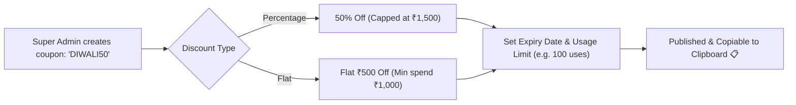

#### Fields & Validations:
1. **Coupon Code**: Auto-uppercased string (e.g. `WELCOME2026`).
2. **Discount Type**: Percentage (`%`) or Flat Currency (`₹`).
3. **Discount Value**: Validated numeric amount.
4. **Safety Guards**:
   - `maxDiscountAmount`: Maximum rupee cap for percentage discounts.
   - `minOrderValue`: Minimum cart value required to apply.
   - `usageLimit`: Total times the coupon can be redeemed platform-wide.
   - `validUntil`: Automatic expiration date.
5. **1-Click Copy**: Clicking the copy icon copies the code for instant distribution.

---

### 4.6 Tab 5: Unified Activity & Audit Logs
Complete audit stream tracking all platform operations.

```
+-----------------------------------------------------------------------------------------+
| AUDIT & ACTIVITY LOGS STREAM                                                            |
| [ Search logs... ]  [ Category: All ▼ (Users, Plans, Coupons, Auth, Leads) ] [📥 CSV]  |
+-----------------------------------------------------------------------------------------+
| TIMESTAMP           | ACTOR          | CATEGORY | ACTION          | DETAILS    | PAYLOAD|
| --------------------------------------------------------------------------------------- |
| 23 Oct 07:45:12 AM  | superadmin@... | Plan     | PLAN_ASSIGNED   | Apex -> Pro| [View] |
| 23 Oct 06:12:04 AM  | consultant@... | Auth     | LOGIN_SUCCESS   | IP: 103... | [View] |
| 22 Oct 11:30:00 PM  | superadmin@... | Coupon   | COUPON_CREATED  | DIWALI50   | [View] |
+-----------------------------------------------------------------------------------------+
```

#### Key Capabilities:
1. **Category Filtering**: Quickly isolate `Users`, `Plans`, `Coupons`, `Auth`, or `Leads` events.
2. **JSON Payload Inspector Modal**:
   - Clicking **"View Payload"** opens a formatted JSON inspection sheet showing request params and exact state diffs.
3. **1-Click CSV Export**: Downloads the filtered audit log for accounting and compliance records.

---

### 4.7 Tab 6: Platform Health & Telemetry
Real-time status indicators across the 6 platform components:
1. **Core API Server**: Response latency (ms), process uptime, memory RSS.
2. **MongoDB Database**: Replica set status, connection pool health, query latency.
3. **WhatsApp Gateway**: Multi-device socket connectivity and message throughput.
4. **File Storage Service**: Storage bucket connectivity and usage metrics.
5. **Payment Gateway**: Webhook responsiveness and gateway connectivity.
6. **Cron Workers**: Background follow-up reminder daemon and broadcast queue status.

---

## 5. Cross-Cutting Logic & State Machines

---

### 5.1 Candidate Lead Lifecycle State Machine

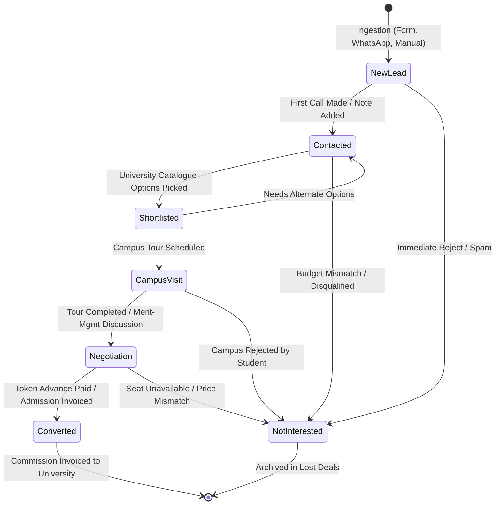

---

### 5.2 Follow-Up Alarm & 2-Delay State Machine

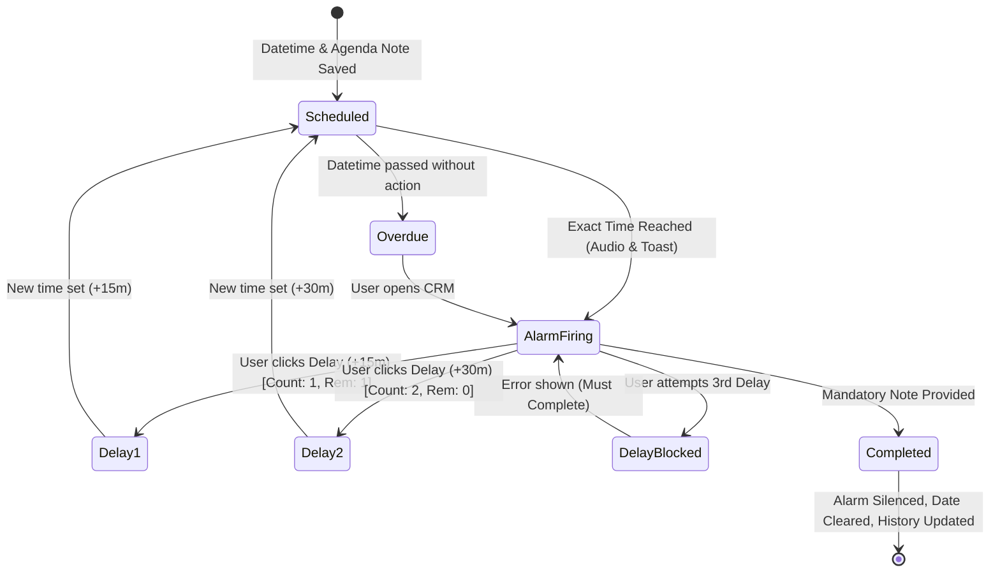

---

### 5.3 Hybrid Catalogue Matchmaking Flow

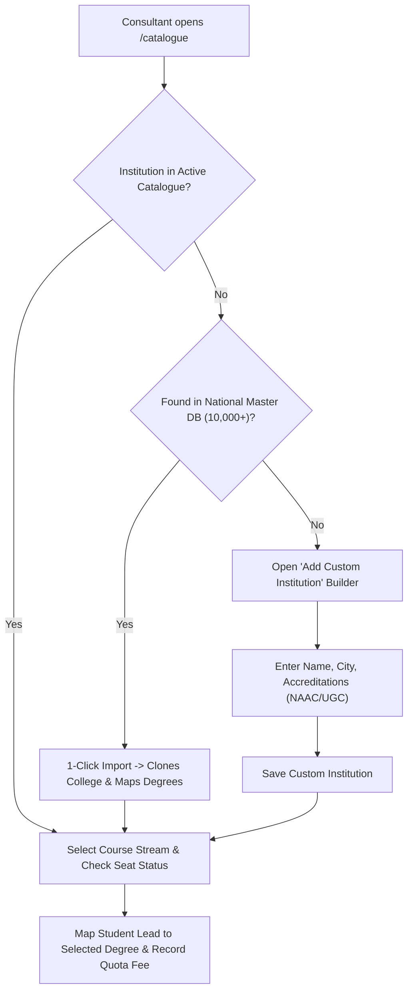

---

### 5.4 Public Ingestion & Auto-Advancing Pipeline Flow

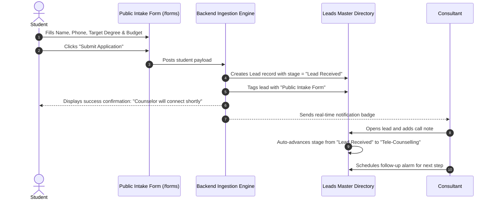

---

## 6. UI Feedback, Safeguards & Error Handling Standards

### 6.1 Real-Time User Feedback (Toasts)
All interactions provide immediate visual and haptic feedback via themed toasts:
- 🟢 **Success Toasts**: Lead created, follow-up resolved, plan updated, coupon copied (`#10b981`).
- 🔴 **Error Toasts**: Missing mandatory fields, delay limit reached, network failure (`#ef4444`).
- 🟡 **Warning Toasts**: Lead limit approaching, overdue reminders (`#f59e0b`).

### 6.2 Destructive Action Safeguards
- **Lead Deletion**: Requires confirmation dialog displaying the student's name.
- **Consultant Deletion (Super Admin)**: Displays a modal explaining that all associated student leads will be permanently deleted.
- **Super Admin Self-Protection**: The delete and disable buttons are permanently hidden and API-blocked on the Super Admin's own account.
- **Follow-Up Dismissal**: Prevented unless a non-empty interaction note is submitted.

### 6.3 Offline & Low-Bandwidth Optimizations
- **Static Asset Generation**: All core application routes pre-render as static HTML for instant mobile loading.
- **Import Optimization**: Barrel exports are tree-shaken, preventing mobile browsers from loading thousands of unused icons.
- **Decoupled Background Polling**: Network calls run on non-blocking intervals to ensure tab transitions happen instantaneously.

---
*End of Blueprint. Maintained and frozen for the Admission Consultants CRM platform.*
