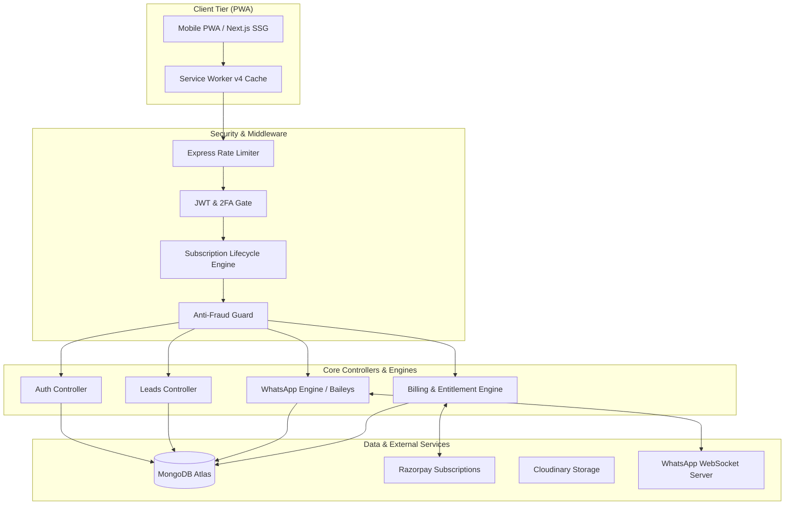
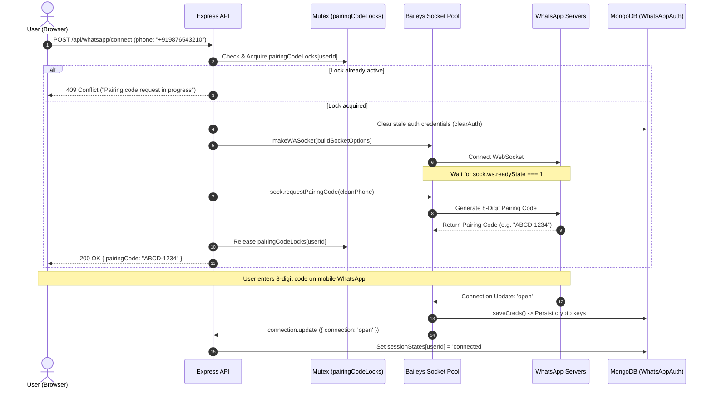

# CoreSetu SalesCRM — Master Developer & Architecture Documentation

> **Version:** 4.2.0 (Production-Ready)  
> **Target Audience:** Core Engineering Team, Senior Architects, Full-Stack Developers & System Integrators  
> **Last Updated:** August 2026  
> **Repository Root:** `mobile-crm-main/`

---

## 1. Product Vision & Architecture Goals

### 1.1 What is CoreSetu SalesCRM?
**CoreSetu SalesCRM** is an ultra-fast, mobile-first Progressive Web Application (PWA) and automated multi-tenant sales outreach engine. Designed specifically for field sales representatives, real estate consultants, agency teams, and enterprise sales organizations, CoreSetu bridges the gap between lead management, WhatsApp communication, team hierarchies, and subscription monetization.

```
+-----------------------------------------------------------------------------------+
|                                 CORESETU PLATFORM                                 |
|                                                                                   |
|  [ Mobile-First PWA ] <===> [ Secure REST API ] <===> [ WhatsApp Outreach Engine ] |
|  - Sub-100ms Nav            - JWT + 2FA Gating        - Baileys WebSocket Pool    |
|  - Offline-First SW         - Multi-Tenant Scoping    - E.164 Auto-Normalizer     |
|  - Dynamic Form Builder     - Anti-Fraud Engine       - Realtime Chat & Logs      |
+-----------------------------------------------------------------------------------+
```

### 1.2 The "Why": Why Was It Built This Way?
Traditional enterprise CRMs (e.g., Salesforce, HubSpot, Zoho) suffer from fundamental architectural flaws when applied to agile, mobile-driven field sales:
1. **Desktop-First Bloat:** Bulky UI bundles (5MB+ JavaScript), 3–5 second initial load times, and cluttered desktop layouts that fail on 4G/5G mobile connections.
2. **Disconnected Outreach:** Third-party WhatsApp extensions or unofficial browser plugins that frequently break, lack session persistence, and risk instant WhatsApp bans.
3. **Complex Form Overhead:** Rigid lead schemas requiring 40+ unnecessary fields before a sales rep can log a single phone call or lead visit.
4. **Subscription Churn Vulnerabilities:** Vulnerability to "churn-and-clone" fraud where malicious actors export full customer lists on trial or discounted annual plans before cancelling payments.

### 1.3 Core Architecture Objectives
* **Sub-100ms Navigation Speeds:** Achieved via Next.js Static Export (`output: 'export'`), Nginx gzip compression, pre-rendered route bundles, and a custom Service Worker v4 caching strategy.
* **100% Mobile Reliability:** Fully functional Progressive Web Application (PWA) with native install prompts, offline caching, and responsive touch-optimized viewports.
* **Persistent WhatsApp Gateway:** Headless multi-device WhatsApp integration powered by Baileys with MongoDB-backed cryptographic credential state, surviving server restarts and container recycles.
* **Zero-Trust Multi-Tenancy:** Hard cryptographic and database-level isolation between **INDIVIDUAL** (solo agents) and **ORGANIZATION** (company owner + agent hierarchy) accounts.
* **Resilient Billing & Anti-Fraud Engine:** Automated recurring billing via Razorpay e-Mandates, idempotent webhook processing, 90-day anti-churn export gating, and daily import velocity limits.

---

## 2. Complete Tech Stack & Infrastructure

### 2.1 System Stack Overview

| Layer | Technology | Version / Specification | Role / Purpose |
| :--- | :--- | :--- | :--- |
| **Frontend Framework** | **Next.js (App Router)** | `15.x / 16.x` (`output: 'export'`) | Static Site Generation (SSG), mobile-optimized React client |
| **Styling & UI** | **Tailwind CSS** | `v3.x / PostCSS` | High-performance utility CSS, custom design tokens, dark/light themes |
| **PWA & Offline** | **Custom Service Worker** | `v4` (`sw.js` + `manifest.json`) | Network-first with stale-while-revalidate fallback for offline routing |
| **Frontend Edge** | **Cloudflare Pages / Nginx** | Edge CDN & Reverse Proxy | SSL Termination, static asset caching (365d TTL), gzip compression |
| **Backend Runtime** | **Node.js** | `v20 LTS` | Event-driven asynchronous JavaScript runtime |
| **HTTP Server** | **Express.js** | `v4.19+` | RESTful API routing, middleware chaining, webhook ingestion |
| **Process Manager** | **PM2 Cluster** | Production daemon | Zero-downtime reloads, multi-core clustering, auto-restart |
| **Database** | **MongoDB Atlas** | `v7.0+` Enterprise | Document store, compound indexing, partial indexes, TTL indexes |
| **ODM Layer** | **Mongoose** | `v8.x` | Strongly typed schemas, pre/post hooks, validation, population |
| **WhatsApp Engine** | **@whiskeysockets/baileys**| `v6.7+` | Headless WebSocket connection to WhatsApp multi-device infrastructure |
| **Payment Gateway** | **Razorpay Node SDK** | `v2.9+` | Subscriptions, e-Mandates, payment orders, HMAC SHA256 webhooks |
| **Media & Storage** | **Cloudinary API** | v2 / Local Uploads fallback | Brochure hosting, audio recordings, property images, avatars |
| **Security & 2FA** | **Speakeasy + QRCode** | RFC 6238 TOTP | Time-Based One-Time Password 2-Factor Authentication |

---

### 2.2 Server Infrastructure & Reverse Proxy Architecture

```
                    [ Internet / Mobile Clients ]
                                  |
                                  v
                    [ Cloudflare Edge / DNS ]
                                  | (SSL / HTTPS)
                                  v
           +-----------------------------------------------+
           |         AWS EC2 Ubuntu 22.04 LTS Server       |
           |                  (13.51.219.53)               |
           |                                               |
           |  [ NGINX Reverse Proxy (Port 80/443) ]        |
           |    ├── /          --> /frontend/out (SSG)     |
           |    ├── /_next/    --> Static Cached Assets    |
           |    ├── /uploads/  --> Local Media Storage     |
           |    └── /api/      --> Reverse Proxy Pass      |
           |                            |                  |
           |                            v                  |
           |  [ Node.js Express API (Port 5000) ]          |
           |    ├── PM2 Cluster Daemon                     |
           |    ├── Baileys WhatsApp Sockets (In-Memory)   |
           |    └── Background Cron / Subscription Workers |
           +-----------------------------------------------+
                                  |
                                  v
                  [ MongoDB Atlas Replica Set ]
```

#### Production Nginx Configuration (`nginx.conf`)
```nginx
server {
    listen 80 default_server;
    listen [::]:80 default_server;

    server_name crm.coresetu.com 13.51.219.53 _;

    root /home/ubuntu/mobile-crm/frontend/out;
    index index.html;

    client_max_body_size 50M;

    # Gzip compression for blazing speed
    gzip on;
    gzip_types text/plain text/css application/json application/javascript text/xml application/xml application/xml+rss text/javascript image/svg+xml;

    # Backend API & Webhooks
    location /api/ {
        proxy_pass http://127.0.0.1:5000/api/;
        proxy_http_version 1.1;
        proxy_set_header Upgrade $http_upgrade;
        proxy_set_header Connection 'upgrade';
        proxy_set_header Host $host;
        proxy_set_header X-Real-IP $remote_addr;
        proxy_set_header X-Forwarded-For $proxy_add_x_forwarded_for;
        proxy_set_header X-Forwarded-Proto $scheme;
        proxy_read_timeout 120;
    }

    # Static file uploads
    location /uploads/ {
        proxy_pass http://127.0.0.1:5000/uploads/;
        proxy_http_version 1.1;
        proxy_set_header Host $host;
    }

    # Next.js Static Asset Caching (Immutable chunks cached 365 days)
    location /_next/static/ {
        alias /home/ubuntu/mobile-crm/frontend/out/_next/static/;
        expires 365d;
        access_log off;
    }

    # Frontend Single Page App / SSG Routing Fallback
    location / {
        try_files $uri $uri/ $uri.html /index.html =404;
    }
}
```

---

## 3. Core System Architecture & Logic



---

### 3.1 Authentication & Two-Factor (TOTP) Flow

The authentication layer implements multi-factor authentication, cryptographic token generation, and account status checking:

```
[User Login Request]
        │ (email / phone / username + password)
        ▼
[Validate Password (bcrypt)]
        ├── Invalid ──> Increment loginAttempts ──> Return 401
        ▼ Valid
[Check 2FA Enabled?]
        ├── YES ──> Issue Temporary JWT (pending2FA: true, 10-min TTL)
        │            │
        │            ▼
        │     [Client enters 6-Digit Authenticator Code]
        │            │
        │            ▼
        │     [Speakeasy TOTP Verification (window: 2)]
        │            ├── Invalid ──> Return 400
        │            ▼ Valid
        └── NO ──> [Issue Full 30-Day JWT Session Token]
                     │
                     ▼
             [Check Account Suspension Status]
                     ├── Suspended ──> Return 403 (SUSPENDED)
                     ▼ Active
             [Calculate Subscription Lifecycle]
                     ├── Locked ──> Block all mutating routes (403 PLAN_LOCKED)
                     └── Active/Grace ──> Allow full API access
```

#### Key Implementation Details:
* **Temporary Token Gating:** When a user with 2FA enabled logs in, the backend issues an ephemeral JWT signed with `{ id: user._id, pending2FA: true }` expiring in 10 minutes (`generateTemp2FAToken`).
* **Protected Middleware Guard (`auth.js`):** Any API route wrapped in `protect` rejects tokens containing `pending2FA: true` with `401 Unauthorized`.
* **Speakeasy TOTP Engine:** Validates the RFC 6238 time-step algorithm with a window of `±2` (allowing 60-second clock drift across client devices).
* **Subscription Lifecycle Calculation:** Embedded dynamically inside the `protect` middleware via `calculateSubscriptionLifecycle(user)`.

---

### 3.2 Multi-Tenant Isolation & Account Hierarchy

The system defines two tenant structures:

```
                        [ CORESETU TENANCY ]
                                 │
         ┌───────────────────────┴───────────────────────┐
         ▼                                               ▼
[ INDIVIDUAL ACCOUNT ]                         [ ORGANIZATION ACCOUNT ]
- Solo Sales Agent                             - Company Owner (Admin)
- usercode: REA-XXXXXX                         - usercode: CMP-XXXXXX
- Owns leads directly                          - Manages Sub-Agents
- Direct Billing & Plans                       - Lead Sharing Modes:
                                                 ├── Common Pool (All agents)
                                                 └── Assigned (Scoped per agent)
                                               - Sub-Agents inherit Owner's Plan
```

#### Multi-Tenant Security Rules:
1. **WorkStatus Immutability:** `workStatus` (`company_owner` vs `independent_agent`) and `industryType` are permanently locked at registration.
2. **Scoped Query Enforcements:**
   * **Individual Agent:** Queries filter by `{ userId: req.user._id }`.
   * **Organization Owner:** Queries filter by `{ $or: [{ userId: ownerId }, { companyId: ownerId }] }`.
   * **Organization Sub-Agent:**
     * In `common_pool` mode: Reads company leads `{ companyId: user.companyId }`.
     * In `assigned` mode: Strictly filtered to `{ assignedTo: user._id, companyId: user.companyId }`.
3. **Compound Database Phone Isolation:**
   ```javascript
   // Multi-tenant phone uniqueness: unique within the company when linked, or unique per solo user when unlinked
   leadSchema.index(
     { companyId: 1, phone: 1 },
     { unique: true, partialFilterExpression: { companyId: { $exists: true, $type: 'objectId' } } }
   );
   leadSchema.index(
     { userId: 1, phone: 1 },
     { unique: true, partialFilterExpression: { companyId: { $eq: null } } }
   );
   ```
4. **Subscription Inheritance:** When a sub-agent executes actions, their entitlement and plan lock status are derived dynamically from their parent `companyId` owner.

---

### 3.3 The WhatsApp Engine (Baileys Multi-Device)

The WhatsApp outreach engine allows users to connect their personal or business WhatsApp accounts directly to the CRM without third-party API markup fees.



#### 1. Concurrency Mutex Lock (`pairingCodeLocks`)
To prevent race conditions where rapid user button clicks spawn duplicate competing WebSockets, the engine utilizes an in-memory lock:

```javascript
// Guard: prevent concurrent pairing code requests for the same user
if (pairingCodeLocks[userId]) {
  throw new Error('A pairing code request is already in progress. Please wait a few seconds.');
}
pairingCodeLocks[userId] = true;
```

#### 2. WhatsApp Session Persistence (`mongoAuthState.js`)
Rather than storing multi-device cryptographic keys in ephemeral local files (which are wiped during Docker/EC2 redeployments), CoreSetu implements a custom **MongoDB Auth State Adapter**:
* Serializes Baileys buffers and cryptographic key pairs using `BufferJSON.replacer`.
* Writes session keys into the `WhatsAppAuth` MongoDB collection with `upsert: true`.
* Restores active sessions automatically on server startup via `waSession.initSessions()`.

#### 3. Automatic Session Healing Heartbeat
Every 45 seconds, a resilient background timer iterates across all registered MongoDB credentials:
```javascript
setInterval(async () => {
  try {
    const sessionsWithCreds = await WhatsAppAuth.distinct('sessionId', { key: 'creds' });
    for (const uId of sessionsWithCreds) {
      if (pairingInProgress[uId]) continue;
      const st = getStatus(uId);
      if (st.status !== 'connected' && st.status !== 'connecting') {
        const user = await User.findById(uId).select('phone').lean();
        console.log(`[WA-Heartbeat] Auto-healing offline WhatsApp session for user ${uId}...`);
        await restoreSession(uId, user?.phone || 'whatsapp');
      }
    }
  } catch (e) { /* Non-blocking background recovery */ }
}, 45000);
```

#### 4. Outbound Payload Formatting & Resolution
The engine supports intelligent media resolution for images, videos, voice recordings, and PDF brochures:
```javascript
// E.164 phone formatting and JID mapping
const { jid } = normalizePhoneAndJid(to, defaultCountryCode);

// Formats payload based on media type
if (mediaType === 'image') {
  payload = { image: mediaSource, caption: captionText };
} else if (mediaType === 'video') {
  payload = { video: mediaSource, caption: captionText };
} else if (mediaType === 'audio') {
  payload = { audio: mediaSource, mimetype: 'audio/mp4' };
} else {
  payload = { document: mediaSource, mimetype: 'application/pdf', fileName: 'brochure.pdf', caption: captionText };
}

await sock.sendMessage(jid, payload);
```

---

### 3.4 The Billing & Entitlement Engine

The billing architecture enforces strict separation of concerns across four discrete domain models:

```
+-------------------------------------------------------------------------------+
|                             BILLING DOMAIN MODEL                              |
|                                                                               |
|  [ Plan ]               --> Immutable product catalog (price, tier, limits)   |
|     │                                                                         |
|     ▼                                                                         |
|  [ Subscription ]       --> Recurring relationship state machine & e-Mandate  |
|     │                                                                         |
|     ├── [ PaymentAttempt ] --> Immutable ledger of webhook charges & debits   |
|     │                                                                         |
|     ▼                                                                         |
|  [ Entitlement ]        --> Live permissions, seats, drip accumulator, gates |
+-------------------------------------------------------------------------------+
```

#### 1. Subscription State Machine

```
              ┌───────────────┐
              │    CREATED    │ (e-Mandate created on Razorpay)
              └───────┬───────┘
                      │ subscription.authenticated
                      ▼
              ┌───────────────┐
              │ AUTHENTICATED │ (Bank mandate authorized)
              └───────┬───────┘
                      │ subscription.charged / subscription.activated
                      ▼
              ┌───────────────┐
       ┌─────>│    ACTIVE     │<────┐ (Renewal Succeeded)
       │      └───────┬───────┘     │
       │              │ payment.failed / subscription.pending
       │              ▼
       │      ┌───────────────┐
       │      │ GRACE_PERIOD  │ (3-Day Recovery Window, warnings displayed)
       │      └───────┬───────┘
       │              │ 3 Days Elapsed (subscription.halted)
       │              ▼
       │      ┌───────────────┐
       │      │  PLAN_LOCKED  │ (Mutations, WA messaging & exports locked)
       │      └───────┬───────┘
       │              │ 60 Days Inactive
       │              ▼
       │      ┌───────────────┐
       └──────┤   CANCELLED   │
              └───────────────┘
```

#### 2. Razorpay Webhook Idempotency & HMAC SHA256 Signature Verification

All webhooks from Razorpay must pass cryptographic non-repudiation verification and deterministic idempotency checks:

```javascript
exports.handleSubscriptionWebhook = async (req, res) => {
  const signature = req.headers['x-razorpay-signature'];
  const secret = RAZORPAY_WEBHOOK_SECRET;

  // 1. Mandatory Raw Body Buffer HMAC SHA-256 Verification
  if (!signature || !req.rawBody) {
    return res.status(400).json({ status: 'error', message: 'Missing webhook signature' });
  }

  const expectedSignature = crypto
    .createHmac('sha256', secret)
    .update(req.rawBody)
    .digest('hex');

  if (expectedSignature !== signature) {
    console.error('[Webhook Engine] 🚨 Invalid Razorpay signature attempt!');
    return res.status(400).json({ status: 'error', message: 'Invalid webhook signature' });
  }

  const event = req.body.event;
  const payload = req.body.payload;

  // 2. Deterministic Idempotency Key Construction
  const subEntity = payload?.subscription?.entity;
  const paymentEntity = payload?.payment?.entity;
  const invoiceEntity = payload?.invoice?.entity;

  const rzpSubId = subEntity?.id || paymentEntity?.subscription_id || invoiceEntity?.subscription_id;
  const paymentId = paymentEntity?.id || (invoiceEntity?.payment_id || null);

  const idempotencyKey = `wh_${event}_${paymentId || invoiceEntity?.id || rzpSubId || Date.now()}`;

  // Check if this exact webhook execution has already been recorded
  const existingAttempt = await PaymentAttempt.findOne({ idempotencyKey });
  if (existingAttempt) {
    console.log(`[Webhook Engine] Idempotent skip: Event "${idempotencyKey}" already processed.`);
    return res.status(200).json({ status: 'ok', message: 'Already processed' });
  }

  // 3. Process Business Logic & Provision Entitlements...
  // (Records PaymentAttempt and syncs Entitlement schema)
};
```

#### 3. Proration vs. Scheduled Downgrades
* **Upgrades (Immediate Proration):**
  Calculates the unused monetary value of the active period:
  $$\text{Unused Value} = \text{Current Total Price} \times \left(\frac{\text{Remaining Milliseconds}}{\text{Total Period Milliseconds}}\right)$$
  The customer is credited this unused balance against the new plan, the Razorpay mandate schedule is updated immediately (`schedule_change_at: 'now'`), and entitlements are refreshed in real time.
* **Downgrades (End-of-Cycle):**
  Downgrades never take effect immediately. The change is scheduled via `pendingChange` and set on Razorpay as `schedule_change_at: 'cycle_end'`. Entitlements remain at current tier until the period expires.

---

## 4. Security & Anti-Fraud Mechanisms

```
+-------------------------------------------------------------------------------+
|                         ANTI-FRAUD DEFENSE MATRIX                             |
|                                                                               |
|  [ Layer 1: Churn & Clone Gate ] --> 90-day data export restriction           |
|  [ Layer 2: Import Velocity ]    --> 500 leads/day cap on new accounts        |
|  [ Layer 3: WA Fingerprinting ]  --> 90-day cooldown on defaulted WA numbers  |
|  [ Layer 4: Abuse Scoring ]      --> Progressive tier-based suspensions       |
|  [ Layer 5: Rate Limiting ]      --> Express rate limiters & bulk spam guard  |
+-------------------------------------------------------------------------------+
```

### 4.1 Churn & Clone Protections
To prevent malicious users from purchasing discounted annual plans, exporting proprietary lead databases, and immediately triggering payment chargebacks:
* **90-Day Export Gating (`antiFraud.js`):**
  Users on annual plans or accounts under 90 days of continuous active tenure are prohibited from downloading CSV/Excel lead exports (`exportGating.canExportData = false`). Blocked attempts trigger high-risk security audit logs (`FRAUD_EXPORT_GATE_PREVENTED`).
* **Import Velocity Limits (`checkImportVelocity`):**
  New tenant accounts (<30 days old) are capped at ingesting a maximum of **500 leads per calendar day**. Excess ingestion requests are rejected with code `IMPORT_VELOCITY_EXCEEDED` to block bulk spam list ingestion.

### 4.2 WhatsApp Fingerprinting (`WAFingerprint`)
When an account enters default, chargeback, or permanent suspension, its connected WhatsApp phone number is permanently recorded in the `WAFingerprint` collection:
* Applies a mandatory **90-day cooldown lock** (`cooldownUntil = now + 90 days`).
* When any user attempts `waSession.connect()` with a fingerprinted phone number, the connection is aborted immediately:
  ```javascript
  const bannedFingerprint = await WAFingerprint.findOne({
    phone: cleanPhone,
    cooldownUntil: { $gt: new Date() },
    unbannedAt: null,
  });

  if (bannedFingerprint) {
    throw new Error(`Anti-Fraud Security Lock: WhatsApp number +${cleanPhone} is under a 90-day cooldown until ${bannedFingerprint.cooldownUntil.toLocaleDateString()}.`);
  }
  ```

### 4.3 Rate Limiting & Progressive Abuse Suspension (`AbuseLog`)

| Limiter Scope | Window | Threshold | Action on Breach |
| :--- | :--- | :--- | :--- |
| **API Endpoints (`apiLimiter`)** | 15 Minutes | 400 Requests | 429 Too Many Requests + Increment Abuse Score |
| **Auth Endpoints (`authLimiter`)** | 15 Minutes | 15 Requests (Prod) | 429 Limit Exceeded + Record Failed Login Abuse |
| **WhatsApp Bulk Send (`bulkSendGuard`)** | 10 Minutes | 100 Messages | 429 Cooldown Guard + Block Outbound Sockets |

#### Automated Suspension Matrix:
* **Abuse Score $\ge 3$:** Tier 1 Suspension (24-hour temporary lockout).
* **Abuse Score $\ge 5$:** Tier 2 Suspension (7-day lockout).
* **Abuse Score $\ge 8$:** Tier 4 Suspension (Permanent account ban + automatic WhatsApp socket disconnection).
* **Self-Cleaning Audit TTL:** `AbuseLog` documents auto-expire after **90 days** using MongoDB native TTL indexing (`expireAfterSeconds: 7776000`).

---

## 5. Database Schema Overview

```
+------------------------------------------------------------------------------------+
|                               DATABASE RELATIONSHIPS                               |
|                                                                                    |
|  [ User ] ──────────1:N──────────> [ Lead ]                                        |
|     │                                │                                             |
|     ├── 1:1 ──> [ Subscription ]     └── 1:N ──> [ ChatMessage ]                   |
|     │                 │                                                            |
|     ├── 1:1 ──> [ Entitlement ]      [ Plan ] ──1:N──> [ Subscription ]            |
|     │                 │                                                            |
|     ├── 1:N ──> [ PaymentAttempt ]   [ User ] ──1:N──> [ WAFingerprint ]           |
|     │                                                                              |
|     └── 1:N ──> [ AuditLog / AbuseLog ]                                            |
+------------------------------------------------------------------------------------+
```

### 5.1 Core Collections Reference

#### 1. `Users` (`backend/src/models/User.js`)
* **Primary Key:** `_id` (ObjectId)
* **Unique Fields:** `email` (sparse), `phone` (sparse), `username` (immutable), `usercode` (e.g. `CMP-849201`, `REA-102934`)
* **Core Enums:**
  * `workStatus`: `['company_owner', 'independent_agent']` (Immutable)
  * `companyRole`: `['owner', 'agent', 'solo']`
  * `role`: `['user', 'superadmin']`
* **Subdocuments:** `companyInfo`, `companySettings`, `leadFormSchema`, `localization`, `suspension`, `billing`

#### 2. `Leads` (`backend/src/models/Lead.js`)
* **Primary Key:** `_id` (ObjectId)
* **Tenant Scoping:** `userId` (Owner/Creator), `companyId` (Associated Organization), `assignedTo` (Assigned Agent)
* **Compound Unique Indexes:**
  * `{ companyId: 1, phone: 1 }` (Unique within organization)
  * `{ userId: 1, phone: 1 }` (Unique per solo agent when `companyId == null`)
* **Subdocuments:** `notes`, `leadActivities` (Audit trail), `editHistory`, `customData` (Dynamic industry form fields)

#### 3. `Subscriptions` (`backend/src/models/Subscription.js`)
* **Primary Key:** `_id` (ObjectId)
* **Foreign Keys:** `userId` (ref: User), `companyId` (ref: User), `planId` (ref: Plan)
* **Lifecycle Status:** `['CREATED', 'AUTHENTICATED', 'ACTIVE', 'GRACE_PERIOD', 'PLAN_LOCKED', 'PAST_DUE', 'CANCELLED', 'ARCHIVED']`
* **Concurrency Lock:** `billingLock` (Boolean), `billingLockAcquiredAt` (Date)
* **Proration & State:** `pendingChange` (Target plan, quantity, change type, effective date)

#### 4. `Entitlements` (`backend/src/models/Entitlement.js`)
* **Primary Key:** `_id` (ObjectId)
* **Foreign Keys:** `userId` (ref: User), `subscriptionId` (ref: Subscription)
* **Quotas & Guards:**
  * `seats`: `{ maxAllowed, currentUsed }`
  * `leads`: `{ maxAllowed, currentCount }`
  * `whatsapp`: `{ monthlyLimit, messagesSentThisPeriod, quotaResetDate, isDripEnabled, totalAnnualQuota, drippedQuotaAccumulator, nextDripDate }`
  * `exportGating`: `{ canExportData, exportUnlockedAt, gatingReason }`
  * `importVelocity`: `{ dailyLimit, importedToday, lastResetAt }`

#### 5. `Plans` (`backend/src/models/Plan.js`)
* **Primary Key:** `_id` (ObjectId)
* **Unique Code:** `code` (e.g. `IND_TIER1_MONTHLY_V1`, `ORG_TIER2_YEARLY_V1`)
* **Pricing:** `priceInPaise` (e.g. 199900 = ₹1,999), `perSeatPriceInPaise`, `currency`
* **Isolation:** `accountType` (`'INDIVIDUAL'` vs `'ORGANIZATION'`), `tier` (1 to 3), `interval` (`'monthly'` vs `'yearly'`)

#### 6. `PaymentAttempts` (`backend/src/models/PaymentAttempt.js`)
* **Primary Key:** `_id` (ObjectId)
* **Idempotency Key:** `idempotencyKey` (Unique string index, e.g. `wh_subscription.charged_pay_0000000001`)
* **Gateway Details:** `razorpayPaymentId`, `razorpayOrderId`, `razorpaySubscriptionId`, `razorpayInvoiceId`, `rawGatewayResponse`

#### 7. `WAFingerprints` (`backend/src/models/WAFingerprint.js`)
* **Primary Key:** `_id` (ObjectId)
* **Unique Field:** `phone` (Normalized E.164 digits)
* **Lock Attributes:** `bannedFromUserId`, `reason`, `cooldownUntil` (Date), `isPermabanned` (Boolean), `riskScore` (0–100)

#### 8. `AbuseLogs` (`backend/src/models/AbuseLog.js`)
* **TTL Auto-Deletion:** Indexed on `timestamp` with `expireAfterSeconds: 7776000` (90 days).
* **Violation Types:** `['too_many_requests', 'bulk_spam', 'invalid_login', 'suspicious_activity']`

---

## 6. QA, Testing Framework & Verification

The project includes an end-to-end and integration testing framework across three complementary test environments:

```
+---------------------------------------------------------------------------------+
|                               QA & TEST SUITE                                   |
|                                                                                 |
|  [ 1. Playwright E2E ]      --> Browser automation, routing, JWT auth, SPA tests|
|  [ 2. Postman Collection ]  --> Master API integration & RBAC assertions        |
|  [ 3. Verification Suites ] --> 50-condition automated DB & payment tests      |
+---------------------------------------------------------------------------------+
```

### 6.1 Playwright E2E Automation (`tests/e2e/core-flows.spec.js`)
Tests real-world browser execution, LocalStorage token persistence, SPA routing without full-page reloads, and access control redirects.

#### Key Test Scenarios:
* `TC-AUTH-01`: Valid Login stores JWT token in `localStorage` and redirects to `/dashboard/` in under 15 seconds.
* `TC-AUTH-02`: Invalid password triggers toast error without redirecting away from `/login/`.
* `TC-AUTH-03`: Logout purges `token` and `user` keys from storage; blocks subsequent unauthenticated navigation to `/dashboard/`.
* `TC-NAV-01`: Client-side SPA navigation seamlessly transitions between `/projects/`, `/templates/`, and `/profile/`.
* `TC-NAV-02`: Direct URL hit on dynamic routes returns valid HTML without synthesizing 404s.
* `TC-SEC-01`: Unauthenticated request to `/superadmin-dashboard/` instantly redirects to `/login/`.

#### Running Playwright E2E Tests:
```bash
# Run headless browser test suite
npx playwright test tests/e2e/core-flows.spec.js

# Run with interactive UI mode
npx playwright test --ui

# View HTML Test Report
npx playwright show-report
```

---

### 6.2 Postman Master API Collection (`tests/postman/SalesCRM_Master_API_Collection.json`)
A complete Postman v2.1 collection covering:
1. **Authentication & 2FA:** Registration, login, TOTP verification, token introspection (`/auth/me`).
2. **Leads Management:** CRUD operations, phone normalization, duplicate prevention, pagination.
3. **Multi-Tenancy & RBAC:** Organization creation, agent invitations, role permission isolation.
4. **WhatsApp Sockets:** Session status checking, pairing code generation, outbound messaging.
5. **Subscription & Webhook Simulation:** Creating subscriptions, testing Razorpay signature verification, proration calculations.

---

### 6.3 50-Condition Automated Verification Suites

The backend includes standalone verification scripts that test business rules directly against a live or test database:

#### 1. CRM Core Engine Verification (`backend/src/verify-crm.js`)
Tests phone normalization, duplicate lead blocking, free plan limits, and coupon applications:
```bash
node backend/src/verify-crm.js
```
* **Test 1 & 2:** User registration and login phone normalization (e.g. `+91 (123) 456-7890` $\rightarrow$ `911234567890`).
* **Test 3 & 4:** Lead phone normalization and duplicate prevention within the same tenant.
* **Test 5:** Free tier lead capacity enforcement (rejects lead #11 on free tier).
* **Test 6:** Profile updates and dynamic pipeline stage adjustments.
* **Test 7 & 8:** Coupon validation, percentage discounts, and price recalculations.

#### 2. Hybrid Payment & Subscription Verification (`backend/src/verify-payments.js`)
Tests the payment and subscription lifecycle:
```bash
node backend/src/verify-payments.js
```
* **Condition 1:** UTR minimum length validation (rejects strings $< 10$ characters).
* **Condition 2:** Successful payment request submission and screenshot linking.
* **Condition 3:** Concurrency guard enforcing maximum 1 pending payment request per tenant.
* **Condition 4:** Cross-tenant duplicate UTR prevention.
* **Condition 5:** Admin approval processing and exact 30-day subscription activation calculations (`planEndDate = planStartDate + 30 days`).

---

## 7. Developer Onboarding & Local Development Setup

### 7.1 Prerequisites
* **Node.js:** `v20.x` or higher
* **npm:** `v10.x` or higher
* **MongoDB:** Local instance or MongoDB Atlas URI
* **Git:** Installed and configured

### 7.2 Step-by-Step Local Setup

#### 1. Clone & Environment Configuration
```bash
# Clone the repository
git clone <repo-url>
cd mobile-crm-main

# Setup Backend Environment
cp backend/.env.example backend/.env
```

Ensure your `backend/.env` contains the required keys:
```ini
PORT=5000
NODE_ENV=development
MONGO_URI=mongodb://localhost:27017/mobile-crm
JWT_SECRET=your_super_secret_jwt_key_here
FRONTEND_URL=http://localhost:3000

# Razorpay Test Credentials
RAZORPAY_KEY_ID=rzp_test_YourKeyIdHere
RAZORPAY_KEY_SECRET=YourRazorpayKeySecretHere
RAZORPAY_WEBHOOK_SECRET=YourWebhookSecretHere

# Cloudinary Credentials (Optional for local dev)
CLOUDINARY_CLOUD_NAME=your_cloud_name
CLOUDINARY_API_KEY=your_api_key
CLOUDINARY_API_SECRET=your_api_secret
```

#### 2. Install Dependencies
```bash
# Install root, backend, and frontend packages
npm install
cd backend && npm install && cd ..
cd frontend && npm install && cd ..
```

#### 3. Start Development Servers
```bash
# Terminal 1: Start Backend API (Port 5000)
cd backend
npm run dev

# Terminal 2: Start Frontend Next.js Dev Server (Port 3000)
cd frontend
npm run dev
```

#### 4. Default Seed Accounts
Upon first database connection, the backend automatically seeds:
* **SuperAdmin Account:**
  * **Email:** `admin@crm.com`
  * **Password:** `Admin@123`
  * **Role:** `superadmin`
* **Default Subscription Catalog:** Seeds Standard Individual and Organization plans into the `Plan` collection via `seedPlans()`.

---

## 8. Architectural Decision Records (ADR) Summary

| Decision ID | Decision Made | Rationale & Alternatives Considered |
| :--- | :--- | :--- |
| **ADR-001** | Next.js Static Export (`output: 'export'`) | Delivers sub-100ms PWA speeds by serving static HTML/JS directly through Nginx/CDN edge caching. Eliminated Node.js SSR server overhead. |
| **ADR-002** | MongoDB Auth State for Baileys | File-based session storage failed on container recycles. MongoDB adapter preserves multi-device cryptographic keys with zero disk dependency. |
| **ADR-003** | 90-Day Anti-Churn Export Gate | Blocks "churn-and-clone" fraud where bad actors subscribe to annual plans, extract full competitor databases, and issue instant chargebacks. |
| **ADR-004** | Raw Body Buffer Webhook Capture | Capturing `req.rawBody` before JSON parsing ensures exact byte-level HMAC SHA256 signature verification for Razorpay webhooks. |
| **ADR-005** | Speakeasy TOTP over SMS OTP | SMS OTP introduces vendor costs, delivery latency, and SIM-swap vulnerabilities. RFC 6238 TOTP Authenticator apps provide instant, free, and secure 2FA. |

---

*This document is maintained by the CoreSetu Engineering Team. For architectural questions or pull request reviews, contact the Lead Platform Architect.*
