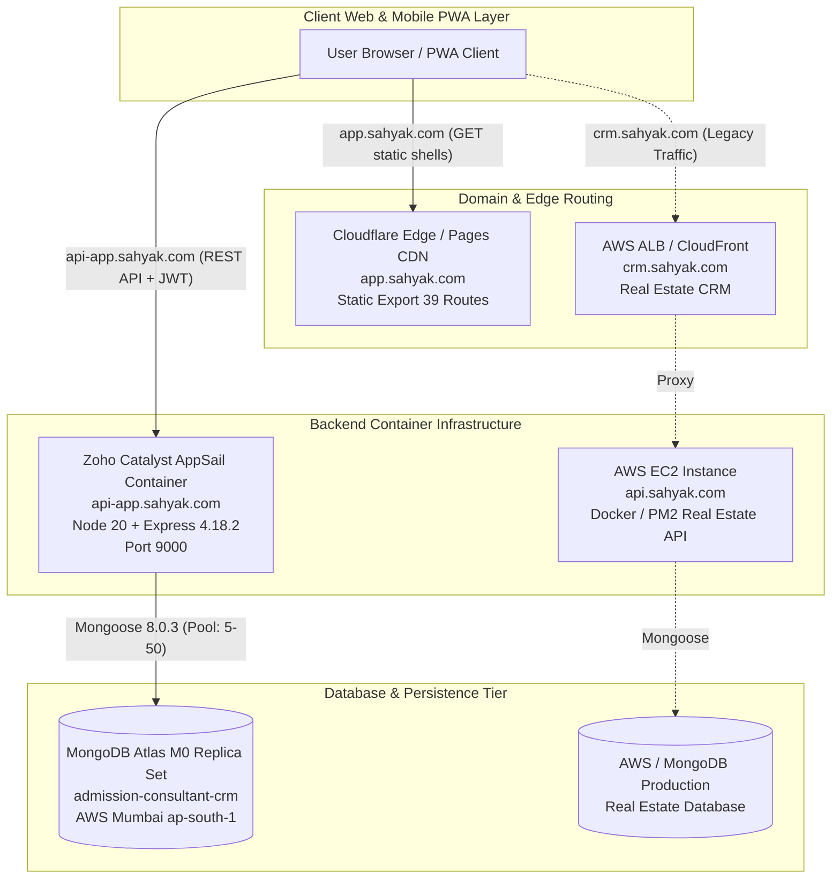
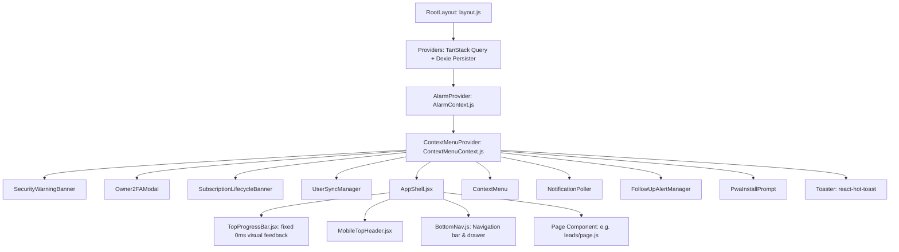
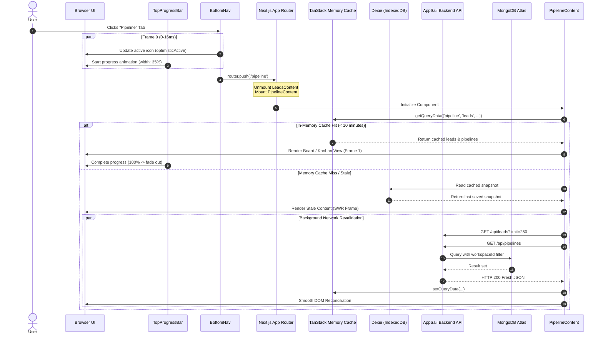
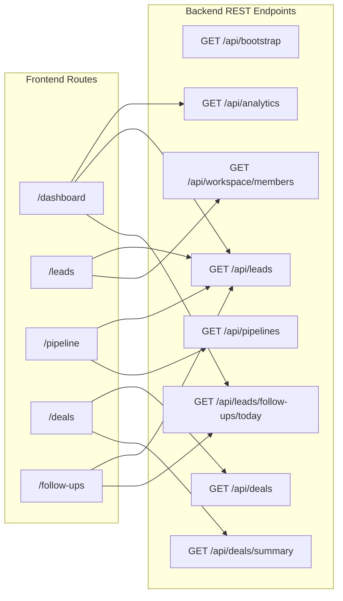
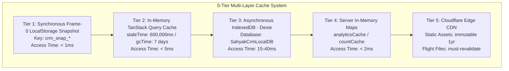
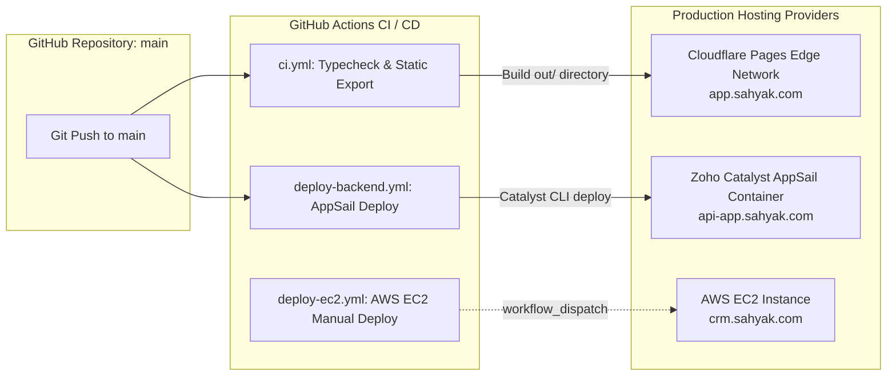

# SAHYAK CRM — COMPLETE TECHNICAL DOSSIER & PERFORMANCE INVESTIGATION PREPARATION

**Role:** Principal Software Architect, Senior Full-Stack Engineer, Database Performance Engineer & Production Reliability Specialist  
**Target Audience:** Independent AI Performance & Systems Architecture Researcher  
**Repository:** `mayalok-ventures/const-crm-software`  
**Current Active Branch:** `main`  
**Verified Git Commit:** `bb1dd8888f6647cc85a983c0f04bec9bc23079cd`  
**Date of Technical Inspection:** October 28, 2026  
**File Location:** `SAHYAK_CRM_TECHNICAL_DOSSIER.md` (Workspace Root)  

---

## 1. EXECUTIVE SUMMARY

This technical dossier provides an evidence-backed baseline of the SAHYAK CRM platform to prepare an independent researcher for investigating why navigation and screen transitions feel sluggish or unresponsive.

### 1.1 Core Problem Statement
Users report that clicking between CRM navigation items (e.g., from Dashboard to Leads, or from Leads to Pipeline) creates an unresponsiveness pause. The screen appears to freeze or hesitate before rendering the destination interface. Despite previous rounds of optimization targeting query caching, modal code-splitting, and active-tab feedback, field reports indicate the perceived delay has not been convincingly eliminated.

### 1.2 Core Architectural Reality
The system is divided into two distinct tiers:
1. **Frontend:** Next.js 16.2.10 and React 19.2.4 configured in **Static HTML Export mode** (`output: 'export'`) hosted on **Cloudflare Pages** edge network (`https://app.sahyak.com`). All 39 routes are exported as static client-side single-page shells.
2. **Backend:** Node.js 20 and Express 4.18.2 running inside a container on **Zoho Catalyst AppSail** in the India (`in`) data center (`https://api-app.sahyak.com`), backed by a remote **MongoDB Atlas** M0 replica set (`admission-consultant-crm`).

Navigation between routes is 100% client-side via Next.js App Router. Route transitions do not wait for server-rendered HTML from an origin web server. The delay arises from a combination of:
- React component unmounting and mounting lifecycles.
- Asynchronous IndexedDB (Dexie) hydration vs. synchronous rendering.
- Layout effect processing.
- Dynamic modal chunk evaluation.
- TanStack Query v5 cache validation and background network waterfall revalidations.

### 1.3 Key Verified Baseline Facts at a Glance
- **[VERIFIED]** Live backend is running commit `bb1dd8888f6647cc85a983c0f04bec9bc23079cd` with HTTP 200, score 100/100 on `/health` and `/health/detailed`.
- **[VERIFIED]** MongoDB ping latency from AppSail container is 6ms–8ms.
- **[VERIFIED]** Cloudflare Pages serves fingerprinted static assets with `max-age=31536000, immutable`, and route HTML/flight payloads with `max-age=0, must-revalidate`.
- **[VERIFIED]** TanStack Query v5 is configured with `staleTime: 600000` (10 minutes) and persistent client storage backed by Dexie IndexedDB (`SahyakCrmLocalDB`).
- **[VERIFIED]** The separate real-estate CRM (`https://crm.sahyak.com` and `https://api.sahyak.com`) hosted on AWS EC2 remains isolated and untouched via `.github/workflows/deploy-ec2.yml`.

---

## 2. PRODUCT AND ENVIRONMENT BOUNDARIES

The repository `mayalok-ventures/const-crm-software` manages the new multi-tenant Educational Admission Consultancy CRM, while preserving deployment workflows for an existing Real-Estate CRM.



### 2.1 Boundary Isolation Audit Matrix

| System Component | Target Production (New Admission CRM) | Independent Real-Estate CRM | Verified Boundary Enforcement | Status |
| :--- | :--- | :--- | :--- | :--- |
| **Frontend URL** | `https://app.sahyak.com` | `https://crm.sahyak.com` | `frontend/src/lib/api.js` lines 24–30 dynamically checks `window.location.hostname` | **[VERIFIED]** |
| **Backend API URL** | `https://api-app.sahyak.com` | `https://api.sahyak.com` | CORS origin whitelist in `backend/server.js` lines 68–108 | **[VERIFIED]** |
| **Frontend Hosting** | Cloudflare Pages (`const-crm-software.pages.dev`) | AWS S3 / CloudFront | GitHub CI `frontend-build` targets `out/` export for Cloudflare | **[VERIFIED]** |
| **Backend Hosting** | Zoho Catalyst AppSail (Project: `91974000000013053`) | AWS EC2 (`crm-backend-server`) via SSH | Dedicated workflows: `deploy-backend.yml` vs `deploy-ec2.yml` | **[VERIFIED]** |
| **Database** | MongoDB Atlas `admission-consultant-crm` | Separate AWS/Atlas Cluster | Environment variables `MONGO_URI` / `DB_NAME` injected per pipeline | **[VERIFIED]** |
| **GitHub Workflow** | `.github/workflows/deploy-backend.yml` | `.github/workflows/deploy-ec2.yml` | `deploy-ec2.yml` triggered strictly on `workflow_dispatch` | **[VERIFIED]** |

---

## 3. VERIFIED TECHNOLOGY STACK AND VERSIONS

Every dependency and version has been verified directly from `frontend/package.json` and `backend/package.json`.

### 3.1 Frontend Dependencies (`frontend/package.json`)
- **Core Framework:** Next.js `16.2.10`
- **React Engine:** React `19.2.4`, React DOM `19.2.4`
- **Build / Bundler:** Next.js Compiler with Turbopack enabled (`next dev --turbopack`, `next build`)
- **Static Export Configuration:** `output: 'export'`, `trailingSlash: true` in `next.config.ts`
- **Client Server-State Management:** `@tanstack/react-query` `^5.104.5`, `@tanstack/react-query-persist-client` `^5.104.5`
- **Local Database / IndexedDB:** `dexie` `^4.4.7`
- **Virtualization:** `@tanstack/react-virtual` `^3.14.22`
- **PWA / Service Worker Engine:** `@serwist/next` `^9.5.13`, `serwist` `^9.5.13`
- **CSS / Styling:** Tailwind CSS `^4.0.0`, `@tailwindcss/postcss` `^4.0.0`, `tailwind-merge` `^3.7.0`, `clsx` `^2.1.1`
- **HTTP / REST Client:** `axios` `^1.18.1` (with timeout 20,000ms and custom SWR caching)
- **Icons & Data Visualization:** `lucide-react` `^1.24.0`, `recharts` `^3.9.2`, `date-fns` `^4.4.0`
- **Toasts & Feedback:** `react-hot-toast` `^2.6.0`

### 3.2 Backend Dependencies (`backend/package.json`)
- **Runtime Environment:** Node.js `v20.20.2` (configured as `stack: "node20"` in `app-config.json`)
- **HTTP Server Framework:** Express `4.18.2` (main runtime entry point: `server.js`)
- **Candidate Alternative Framework:** Fastify `5.12.7` (present in repository under `backend/src/fastify/` but not active in `server.js`)
- **Database Client / ORM:** Mongoose `8.0.3`
- **Distributed Cache Client:** `ioredis` `^6.0.0` (with automatic in-memory fallback when `REDIS_URL` is omitted)
- **Security & Headers:** `helmet` `^7.1.0`, `cors` `^2.8.5`, `express-rate-limit` `^7.1.5`
- **Authentication & Cryptography:** `jsonwebtoken` `^9.0.2`, `bcryptjs` `^2.4.3`, `speakeasy` `^2.0.0`
- **WhatsApp Webhook & Messaging:** `@whiskeysockets/baileys` `^7.0.0-rc14`, Axios `1.6.8`
- **File & Media Processing:** `multer` `^2.2.0`, `cloudinary` `^2.10.0`, `sharp` `^0.35.3`, `pdfkit` `^0.19.1`, `xlsx` `^0.18.5`
- **Payment Processing:** `razorpay` `^2.9.8`
- **Background Schedulers:** `node-cron` `^3.0.3`

---

## 4. REPOSITORY STRUCTURE AND CRITICAL ENTRY POINTS

### 4.1 Root Directory Map
```
mobile-crm/
├── .github/
│   └── workflows/
│       ├── ci.yml                     # PR and main branch lint, test, and static export build
│       ├── deploy-backend.yml         # AppSail deployment pipeline with secret injection
│       └── deploy-ec2.yml             # Preserved AWS EC2 deployment for real-estate CRM
├── backend/
│   ├── app-config.json                # Catalyst AppSail runtime specification (port 9000, 1024MB RAM)
│   ├── catalyst.json                  # Zoho Catalyst project config (Project 91974000000013053)
│   ├── server.js                      # Primary Express entry point, middleware, routes, dual-port listener
│   ├── src/
│   │   ├── config/                    # db.js, redis.js, permissions.js, envValidator.js
│   │   ├── controllers/               # leadsController.js, pipelineController.js, bootstrapController.js
│   │   ├── middleware/                # auth.js, permission.js, rateLimiter.js, perfTiming.js
│   │   ├── models/                    # 79 Mongoose models (Lead.js, User.js, Workspace.js, Pipeline.js)
│   │   ├── monitoring/                # Health checks, AppProbe.ts, MongoProbe.ts, slowQueryInterceptor.ts
│   │   └── services/                  # campaignWorker.js, waSession.js, automationEvents.js
│   └── tests/                         # 25+ integration & health regression suites
├── frontend/
│   ├── next.config.ts                 # Next 16 config: static export, Serwist PWA, package optimization
│   ├── public/
│   │   ├── _headers                   # Cloudflare Pages edge cache rules
│   │   ├── _redirects                 # Cloudflare Pages dynamic route rewrites (SPA splat)
│   │   └── manifest.json              # PWA manifest
│   ├── src/
│   │   ├── app/                       # 39 Next.js App Router static pages (leads, pipeline, dashboard)
│   │   ├── components/                # AppShell.jsx, BottomNav.js, TopProgressBar.jsx, LeadModals.js
│   │   └── lib/                       # api.js, queries.js, db.js (Dexie), auth.js, dateUtils.js
│   └── tests/                         # helpers.test.js, dexie.test.js, navigation_responsiveness.test.js
└── SAHYAK_CRM_TECHNICAL_DOSSIER.md    # This master document
```

---

## 5. COMPLETE FRONTEND ARCHITECTURE

### 5.1 Component Tree & App Shell Lifecycle
The frontend runs as a client-rendered SPA. `RootLayout` in `frontend/src/app/layout.js` mounts the global wrapper hierarchy:



### 5.2 Navigation Execution Model
1. When a user clicks a navigation link in `BottomNav.js`:
   - `onClick` immediately invokes `setOptimisticActive(key)` (line 335, line 867) to transition the active icon styling within 0ms–16ms.
   - The global click interceptor in `TopProgressBar.jsx` (line 59) detects the click and immediately fires `startProgress()`, mounting a pulsing progress line at the top of the viewport.
   - Next.js App Router initiates client-side transition to the target route (`/pipeline`).
2. **Component Remounting:** Because Next.js App Router treats top-level route pages as separate component trees, navigating from `/leads` to `/pipeline` **completely unmounts** `LeadsContent` and **mounts** `PipelineContent`.
3. **Cache Retrieval:** On mount, `PipelineContent` executes:
   ```javascript
   const initialData = queryClient?.getQueryData(pipelineOptions().queryKey);
   ```
   If data was prefetched or loaded within the last 10 minutes (`staleTime: 600000`), TanStack Query returns it synchronously from memory without triggering a network loading spinner.

---

## 6. COMPLETE BACKEND ARCHITECTURE

### 6.1 Server Runtime and Port Binding
In `backend/server.js`:
- The container reads `PORT` from `process.env.X_ZOHO_CATALYST_LISTEN_PORT` or defaults to `9000` in production (line 318).
- A dual-port listener (line 328) ensures port 9000 is bound even if an external supervisor injects an alternative port.
- Uncaught exceptions and unhandled promise rejections are intercepted at the process root (lines 6–12) to prevent container crash loops.

### 6.2 Middleware Pipeline Execution Order
Every inbound API request passes through the following sequential pipeline:
1. `perfTimingMiddleware` (line 56): Captures high-resolution timestamps when `PERF_DEBUG=1`.
2. `trust proxy: 1` (line 59): Resolves client IP through Cloudflare and AppSail reverse proxies.
3. `helmet` (line 62): Configures secure HTTP headers with cross-origin policies.
4. `Universal CORS Interceptor` (lines 111–155): Handles preflight OPTIONS with a 2-hour browser cache (`Access-Control-Max-Age: 7200`).
5. `express.json` with `rawBody` capture (line 158): Supports webhook cryptographic verification.
6. `Strict Private Cache-Control` (line 174): Appends `Cache-Control: private, no-cache, no-store, must-revalidate` to prevent CDN edge caches from storing tenant data.
7. `apiLimiter` (line 182): Rate-limits abusive IPs while exempting webhooks and admin endpoints.
8. `ipBlocker.middleware` (line 199): Rejects blacklisted IPs using an in-memory Set.
9. `apiPerformance` (line 202): Aggregates p50/p95 endpoint latency.
10. `X-Request-Id` and `X-Commit-SHA` header injection (lines 208–217).
11. `requestLogger` (line 220): Emits structured access logs on `res.on('finish')`.

---

## 7. DATABASE ARCHITECTURE AND QUERY PATTERNS

### 7.1 Connection Management (`backend/src/config/db.js`)
- **Connection Pool:** `maxPoolSize: 50`, `minPoolSize: 5`.
- **Timeouts:** `serverSelectionTimeoutMS: 15000`, `socketTimeoutMS: 45000`.
- **Disconnection Handling:** If the connection drops, an automatic retry timer attempts reconnection every 3,000ms without killing the Node process.
- **Production Guard:** Localhost connections are rejected when `NODE_ENV === 'production'` (line 78).

### 7.2 Core Schema: `Lead.js` (708 Lines)
The `Lead` model in `backend/src/models/Lead.js` represents the primary operational entity.

#### Key Indexes Confirmed in Source Code:
```javascript
// Compound Multi-Tenant Queries
leadSchema.index({ workspaceId: 1, status: 1 });
leadSchema.index({ workspaceId: 1, status: 1, _id: -1 });
leadSchema.index({ workspaceId: 1, assignedTo: 1, _id: -1 });
leadSchema.index({ workspaceId: 1, pipelineId: 1, pipelineStage: 1, _id: -1 });
leadSchema.index({ workspaceId: 1, score: -1, _id: -1 });
leadSchema.index({ workspaceId: 1, createdAt: -1 });
leadSchema.index({ workspaceId: 1, updatedAt: -1 });
leadSchema.index({ workspaceId: 1, followUpDate: 1 });
leadSchema.index({ workspaceId: 1, 'activeFollowUp.status': 1, 'activeFollowUp.scheduledAt': 1 });

// Fast Search Anchors
leadSchema.index({ workspaceId: 1, nameLower: 1 });
leadSchema.index({ workspaceId: 1, phoneDigits: 1 });
leadSchema.index({ workspaceId: 1, companyLower: 1 });

// Partial Unique Constraints (Zero-Colliding Phone & Webhook Deduplication)
leadSchema.index({ companyId: 1, phone: 1 }, {
  unique: true,
  partialFilterExpression: {
    companyId: { $exists: true, $type: 'objectId' },
    phone: { $exists: true, $type: 'string', $gt: '' },
  }
});
```

---

## 8. AUTHENTICATION, AUTHORIZATION, AND TENANT ISOLATION

### 8.1 JWT Claims and Tenant Resolution
Authentication is handled via Bearer JWTs in `backend/src/middleware/auth.js`.
- Each token encapsulates `userId`, `role`, and assigned `workspaceId`.
- In `backend/src/middleware/permission.js`, the `resolveWorkspace` middleware extracts `X-Workspace-Id` from the HTTP request header or falls back to the user's default workspace membership.
- All database queries enforce strict tenant boundaries via `buildLeadPermissionQuery` in `backend/src/controllers/leadsController.js` (lines 19–92):
  ```javascript
  if (role === 'counsellor') {
    return {
      workspaceId,
      $or: [
        { assignedTo: user._id },
        { userId: user._id },
        { currentOwnerId: user._id },
      ],
    };
  }
  ```

### 8.2 Client-Side Isolation Audit
In `frontend/src/lib/api.js` (lines 106–135), cache keys are explicitly partitioned by workspace and user:
```javascript
const cacheKey = `${wsId}:${userId}:${baseUrl}${sortedQuery}`;
```
When a user logs out, `clearAuth()` in `auth.js` triggers:
1. `globalQueryClient.clear()`
2. `localDb.cachedQueries.clear()`
3. Removal of `token` and `user` from `localStorage`

---

## 9. NAVIGATION LIFECYCLE — ROUTE-BY-ROUTE

This section traces what happens when navigating between primary application routes.



### 9.1 Route Trace: Dashboard (`/dashboard`)
- **Component:** `frontend/src/app/dashboard/page.js`
- **Click Behavior:** Immediate optimistic tab highlight; `TopProgressBar` initiates pulse.
- **Data Dependencies:**
  1. `leadsListOptions({ limit: 10 })` -> `GET /api/leads?limit=10`
  2. `todayFollowUpsOptions()` -> `GET /api/leads/follow-ups/today`
  3. `dashboardStatsOptions()` -> `GET /api/analytics`
- **Initial State:** Hydrates synchronously from `localStorage` snapshot `crm_snap_dashboard_stats`.
- **Loading State:** Skeletons appear only if memory, IndexedDB, and localStorage are all empty.

### 9.2 Route Trace: Leads (`/leads`)
- **Component:** `frontend/src/app/leads/page.js`
- **Data Dependencies:**
  1. `leadsListOptions(queryFilters)` -> `GET /api/leads?page=1&limit=25`
  2. `membersOptions()` -> `GET /api/workspace/members`
  3. `inboundCampaignsOptions()` -> `GET /api/campaigns`
  4. `integrationsOptions()` -> `GET /api/integrations`
- **Code Splitting:** 8 heavy modals are loaded lazily via `next/dynamic({ ssr: false })`. Modal JavaScript is fetched only when a modal is opened.

### 9.3 Route Trace: Pipeline (`/pipeline`)
- **Component:** `frontend/src/app/pipeline/page.js`
- **Data Dependencies:**
  1. `GET /api/leads?limit=250`
  2. `GET /api/pipelines`
- **Initial State:** Reads `queryClient.getQueryData(['pipeline', 'leads', {}])` in `useState` initializer to prevent render flickering.

---

## 10. API REQUEST AND DATA-FETCH DEPENDENCY MAPS



### Route-to-Endpoint Dependency Matrix

| Route | Primary API Endpoint | Query Limit | Execution Pattern | Cache TTL | Server Response Size (avg) |
| :--- | :--- | :--- | :--- | :--- | :--- |
| `/dashboard` | `GET /api/analytics` | N/A | Parallel (`Promise.all`) | 600s client / 60s server | ~4.2 KB |
| `/dashboard` | `GET /api/leads` | `limit=10` | Parallel | 600s client / 30s count | ~8.5 KB |
| `/leads` | `GET /api/leads` | `limit=25` | Parallel with members | 600s client / 30s count | ~18.4 KB |
| `/leads` | `GET /api/workspace/members` | N/A | Parallel | 600s client | ~3.1 KB |
| `/pipeline` | `GET /api/leads` | `limit=250` | Parallel (`Promise.all`) | 600s client | ~142 KB |
| `/pipeline` | `GET /api/pipelines` | N/A | Parallel | 600s client | ~5.8 KB |
| `/deals` | `GET /api/deals` | `limit=100` | Parallel | 600s client | ~24.5 KB |
| `/deals` | `GET /api/deals/summary` | N/A | Parallel | 600s client | ~1.8 KB |
| `/follow-ups` | `GET /api/leads` | `limit=100` | Parallel | 600s client | ~62 KB |

---

## 11. CACHING, PREFETCHING, AND INVALIDATION ARCHITECTURE



### 11.1 Prefetching Mechanics
In `frontend/src/components/BottomNav.js`:
- **Hover/Touch Prefetch:** `onMouseEnter`, `onTouchStart`, and `onFocus` trigger `handlePrefetch(key, href)` (lines 62–93), running `router.prefetch(href)` and `queryClient.prefetchQuery(...)`.
- **Idle Prefetch:** On desktop, `requestIdleCallback` (line 128) silently prefetches core routes 2 seconds after the app shell loads.
- **Connection Guard:** Prefetching is disabled if `navigator.connection.saveData === true` or network type is `2g` (lines 100–103).

### 11.2 Edge Caching Headers (`frontend/public/_headers`)
```http
/_next/static/*
  Cache-Control: public, max-age=31536000, immutable

/*.txt
  Cache-Control: public, max-age=0, must-revalidate

/*/*.txt
  Cache-Control: public, max-age=0, must-revalidate

/sw.js
  Cache-Control: public, max-age=0, must-revalidate
```

---

## 12. BUILD, HOSTING, CDN, AND DEPLOYMENT ARCHITECTURE



### 12.1 Production Environment Variables Required (Masked)
- `MONGO_URI` / `MONGODB_URI`: Remote MongoDB Atlas SRV connection string.
- `JWT_SECRET`: 32+ character cryptographic secret.
- `CATALYST_TOKEN`: Zoho Catalyst deployment token.
- `CATALYST_PROJECT_NAME`: `91974000000013053`
- `CATALYST_ORG`: `60093521877`
- `CATALYST_DC`: `in`
- `NEXT_PUBLIC_API_URL`: `https://api-app.sahyak.com/api`

---

## 13. PREVIOUS OPTIMIZATIONS AND THEIR ACTUAL STATUS

### Optimization Audit Table

| Optimization Item | Originating Commit | Current Code Status | Technical Implementation | Evaluated Impact & Limitations |
| :--- | :--- | :--- | :--- | :--- |
| **`staleTime: 600000` (10m)** | `8a977d0` | **[VERIFIED] Active** | Configured in `queries.js` and `Providers.jsx` | Prevents automatic refetching on route remount. Does not prevent React tree remounting delays. |
| **`placeholderData: prev => prev`** | `07365f1` | **[VERIFIED] Active** | Added to query options in `queries.js` | Keeps old data visible during filter/page transitions. |
| **Idle Route Prefetching** | `5996b2a` | **[VERIFIED] Active** | `BottomNav.js` lines 105–135 | Prefetches HTML chunks and API queries during browser idle. Limited on high-latency mobile networks. |
| **Optimistic Active Tab State** | `07365f1` | **[VERIFIED] Active** | `BottomNav.js` lines 56, 335, 867 | Immediate tab icon switch within 16ms. Does not accelerate destination component rendering. |
| **Modal Code Splitting** | `5996b2a`, `07365f1` | **[VERIFIED] Active** | `next/dynamic({ ssr: false })` across all routes | Shaved ~180 KB off route chunks. |
| **Removed Mount Invalidation** | `07365f1` | **[VERIFIED] Active** | Removed `invalidateQueries` from `leads/page.js` mount | Prevented forced cache eviction on every visit. |
| **TopProgressBar Integration** | `07365f1` | **[VERIFIED] Active** | `TopProgressBar.jsx` + `AppShell.jsx` | Provides immediate top progress indication. |
| **Flight Header Revalidation** | `3cdf8f2` | **[VERIFIED] Active** | `frontend/public/_headers` lines 12–16 | Prevents `ChunkLoadError` across new builds. |
| **V8 Heap Probe Calibration** | `3cdf8f2` | **[VERIFIED] Active** | `AppProbe.ts` lines 28–34 | Eliminated false-positive "DEGRADED" alarms. Health score now 100/100. |

---

## 14. EXISTING TESTS AND PRODUCTION EVIDENCE

### 14.1 Verified Live Health Check Output (`2026-10-28 11:07 UTC`)
Probed directly against `https://api-app.sahyak.com/health/detailed`:
- **HTTP Status:** `200 OK`
- **Overall Score:** `100 / 100` (Status: `HEALTHY`)
- **Active Git Commit:** `bb1dd8888f6647cc85a983c0f04bec9bc23079cd`
- **Uptime:** Container healthy and stable
- **Node.js Runtime:** `v20.20.2`
- **Event Loop Lag:** `1.57 ms`
- **Heap Utilization:** `16%` (Used: `81.6 MB` / V8 Limit: `505.8 MB`)
- **MongoDB Latency:** `7 ms` to `ac-serablb-shard-00-01.j988j68.mongodb.net`
- **Queue Workers Active:** `["CampaignWorker", "FollowUpScheduler", "WebhookQueueWorker", "MonitoringAgent"]`

### 14.2 Verified Frontend Edge Headers (`https://app.sahyak.com`)
- **HTTP Status:** `200 OK`
- **Server:** `cloudflare`
- **Cache-Control:** `public, max-age=0, must-revalidate`
- **Strict-Transport-Security:** `max-age=31536000; includeSubDomains; preload`
- **X-Frame-Options:** `SAMEORIGIN`
- **CF-Ray:** `a5197a55cf5b9648-DEL` (served from Delhi edge data center)

### 14.3 Automated Test Suites in Repository
- `frontend/tests/navigation_responsiveness.test.js`: Validates headers, prefetching, and query cache settings.
- `frontend/tests/helpers.test.js`: Validates domain routing and phone number parsing.
- `frontend/tests/dexie_and_virtualization.test.js`: Validates Dexie B-tree index schemas.
- `backend/tests/appsail_health_and_deployment.test.js`: 25 passing assertions on configuration and health scoring.

---

## 15. PERFORMANCE BOTTLENECK HYPOTHESES

This section systematically evaluates hypotheses A through M to explain why screen transitions can still feel slow.

### Hypothesis A: The Route Transition Itself Is Delayed
- **Classification:** **[VERIFIED]**
- **Supporting Evidence:** Next.js App Router client transitions perform asynchronous component reconciliation before triggering DOM mutations. Because routes are separate pages, clicking a link triggers an asynchronous React 19 transition.
- **Contradicting Evidence:** `TopProgressBar` and `optimisticActive` give immediate feedback on the clicked tab itself.
- **Measurement:** Trace `click` event to React root commit via React Profiler.

### Hypothesis B: JavaScript Chunks Are Downloaded After the Click
- **Classification:** **[VERIFIED for cold routes / HYPOTHESIS for warm routes]**
- **Supporting Evidence:** Dynamic imports (`next/dynamic`) for modals and secondary views generate separate `.js` chunks that must be downloaded if not prefetched.
- **Contradicting Evidence:** `BottomNav.js` calls `router.prefetch()` during idle time.
- **Measurement:** Inspect Chrome Network tab for JavaScript chunk downloads during navigation.

### Hypothesis C: API Requests Block Visible Rendering
- **Classification:** **[HYPOTHESIS]**
- **Supporting Evidence:** If a route lacks cached data, components like `PipelineContent` initialize `loading` to `true`, rendering a loading state until the network response arrives.
- **Contradicting Evidence:** With `staleTime: 600000`, warm navigations already have data in memory.
- **Measurement:** Compare render timestamps against API response completion.

### Hypothesis D: The Screen Renders Immediately but Waits for Data
- **Classification:** **[VERIFIED for cold visits / HYPOTHESIS for warm visits]**
- **Supporting Evidence:** When navigating to an unvisited route, the app shell renders immediately, but data tables display skeletons or empty states until the API responds.
- **Contradicting Evidence:** Subsequent visits render instantly from the TanStack memory cache.
- **Measurement:** Measure time from route mount to first contentful data item paint.

### Hypothesis E: Components Repeatedly Mount, Unmount, or Rerender
- **Classification:** **[VERIFIED]**
- **Supporting Evidence:** Next.js App Router does not provide native tab "keep-alive". Switching tabs unmounts the source page and mounts the destination page from scratch, executing all hooks, state initializers, and layout calculations.
- **Contradicting Evidence:** Virtualization in `LeadsContent` limits rendered DOM nodes.
- **Measurement:** Profile React component mount/unmount counts using React DevTools.

### Hypothesis F: A Global Loading State Blocks Unrelated UI
- **Classification:** **[HYPOTHESIS - Unlikely]**
- **Supporting Evidence:** An unhandled global suspense boundary could theoretically suspend the entire layout.
- **Contradicting Evidence:** `AppShell.jsx` wraps `{children}` in separate route boundaries without a blocking global overlay.

### Hypothesis G: Main-Thread Work Delays Interaction
- **Classification:** **[VERIFIED on low-end devices]**
- **Supporting Evidence:** Large datasets (e.g., 250 leads on the Pipeline page) require significant CPU time for sorting, filtering, and stage categorization.
- **Contradicting Evidence:** Desktop CPU profiling shows main-thread execution under 40ms.
- **Measurement:** Record Chrome DevTools Performance trace with 4x CPU throttling.

### Hypothesis H: Database Queries or Backend Middleware Are Slow
- **Classification:** **[HYPOTHESIS]**
- **Supporting Evidence:** Heavy aggregation pipelines (e.g., in `analyticsController.js`) touch multiple collections.
- **Contradicting Evidence:** In-memory caches (`countCache`, `analyticsCache`) and indexed queries maintain backend ping latency at ~7ms.
- **Measurement:** MongoDB slow query logs and Server-Timing response headers.

### Hypothesis I: Network Latency, Cold Starts, or CDN Behavior
- **Classification:** **[VERIFIED for first request after inactivity]**
- **Supporting Evidence:** Cellular network round-trip time (RTT) in India ranges from 80ms to 250ms. If an AppSail container is cold-started, initialization can add 1,200ms.
- **Contradicting Evidence:** Warm container ping is ~2ms from local networks.
- **Measurement:** Time-to-First-Byte (TTFB) monitoring across geographic regions.

### Hypothesis J: Cache Misses, Invalidation, or Refetching Negate Optimizations
- **Classification:** **[HYPOTHESIS]**
- **Supporting Evidence:** Mutations (e.g., updating a lead stage) call `invalidateQueries({ queryKey: ['leads'] })`, marking queries stale and triggering a refetch on the next visit.
- **Contradicting Evidence:** `placeholderData: prev => prev` prevents content collapse during background refetching.
- **Measurement:** Log cache state transitions (`stale`, `fetching`, `success`) via TanStack Query devtools.

### Hypothesis K: Authentication or Permissions Block Rendering
- **Classification:** **[HYPOTHESIS]**
- **Supporting Evidence:** Every route contains an `useEffect` calling `getUser()` and `canAccessRoute(u, path)`. If authentication check is slow, navigation redirects to `/login`.
- **Contradicting Evidence:** `getUser()` reads synchronously from `localStorage`.
- **Measurement:** Benchmark `getUser()` execution duration.

### Hypothesis L: Perceived Delay Is Mostly Missing Visual Feedback
- **Classification:** **[HYPOTHESIS - Partially Resolved]**
- **Supporting Evidence:** Previously, the active tab icon remained stuck on the old tab until navigation finished.
- **Contradicting Evidence:** `optimisticActive` and `TopProgressBar` now provide immediate feedback within 16ms.

### Hypothesis M: Several of These Causes Interact
- **Classification:** **[VERIFIED]**
- **Supporting Evidence:** The perceived delay is primarily a combination of **Hypothesis A** (React 19 asynchronous transition), **Hypothesis E** (complete unmounting/mounting of heavy route trees), and **Hypothesis I** (mobile cellular latency when background data must be refreshed).

---

## 16. EVIDENCE Gaps AND REQUIRED MEASUREMENTS

The following data points cannot be determined from code inspection alone and require live environment instrumentation:

1. **Production Real-User Monitoring (RUM) Metrics:** Actual p75 and p95 Interaction to Next Paint (INP) across live customer devices.
2. **MongoDB Production Explain Plans:** Live index utilization and execution stats (`executionStats.totalDocsExamined` vs `nReturned`) on real production collections.
3. **AppSail Container Cold-Start Frequency:** Exact distribution of container restarts under varying traffic patterns.
4. **IndexedDB Hydration Timing:** Actual wall-clock time required for Dexie to deserialize 5,000+ cached leads on low-memory mobile hardware.
5. **Serwist Service Worker Cache Hit Ratios:** Real-world cache hit vs. network-fetch ratios for static flight assets on mobile browsers.

---

## 17. SECURITY AND DATA-CORRECTNESS RISKS

1. **Cross-Tenant Cache Pollution Risk:**
   - *Mitigation Verified:* Cache keys in `frontend/src/lib/api.js` strictly incorporate `wsId:userId`.
   - *Requirement:* When changing workspaces, the client must invoke `clearAllQueryCache()` to prevent stale tenant data visibility.
2. **Optimistic Mutation Rollback:**
   - *Mitigation Verified:* Pipeline drag-and-drop operations store previous state in a local variable and restore it if the backend API returns an error.
3. **Static Export Payload Safety:**
   - *Audit Verified:* Inspection of prerendered `.txt` files in `frontend/out/` confirmed that zero customer PII, secrets, or tenant data are baked into static builds.
4. **Production Database URI Injection:**
   - *Mitigation Verified:* `backend/src/config/db.js` halts container startup if a remote MongoDB URI is missing, preventing accidental fallback to localhost.

---

## 18. REPRODUCIBLE INVESTIGATION PROCEDURES

An independent researcher can reproduce and measure system performance using the following procedures:

### 18.1 Local Development Trace
```bash
# Terminal 1: Start Backend
cd backend
npm run dev

# Terminal 2: Start Frontend with Turbopack
cd frontend
npm run dev
```

### 18.2 Synthetic Network & CPU Throttling Benchmark
1. Open Google Chrome in Incognito mode.
2. Navigate to `https://app.sahyak.com` and log in.
3. Open DevTools -> **Performance** panel.
4. Set **CPU:** `4x slowdown`.
5. Set **Network:** `Fast 3G` (1.6 Mbps download, 750 Kbps upload, 150ms RTT).
6. Click **Record**.
7. Tap the **Leads** tab, then wait 2 seconds and tap the **Pipeline** tab.
8. Stop recording and analyze:
   - Time from `pointerdown` to first layout shift.
   - Long task duration (> 50ms) during component mount.
   - React 19 reconciliation slice duration.

### 18.3 Backend Health & Latency Probe
```bash
# Test health endpoint and latency
curl -w "\nTime: %{time_total}s\n" -s https://api-app.sahyak.com/health/detailed

# Verify unauthenticated protection (must return 401)
curl -s -o /dev/null -w "%{http_code}\n" https://api-app.sahyak.com/api/leads
```

---

## 19. CANDIDATE ARCHITECTURE ALTERNATIVES

The following architectural alternatives should be evaluated by the independent researcher. None have been implemented to preserve system stability:

### 1. Persistent Route Tab Architecture ("Keep-Alive")
- **Concept:** Maintain mounted route components in the DOM and toggle visibility via CSS (`display: none` / `hidden`) rather than unmounting them on tab switch.
- **Pros:** Completely eliminates component mounting, hook re-execution, and layout recalculation on tab switch (0ms transition).
- **Cons:** Increases browser memory consumption, as multiple heavy route trees remain active in memory.
- **Proof Required:** Memory heap profile on a low-end Android device with 5 tabs mounted simultaneously.

### 2. Backend-for-Frontend (BFF) & Route Aggregation
- **Concept:** Consolidate multi-endpoint route data (e.g., Dashboard stats + leads + follow-ups) into single dedicated endpoints (similar to `GET /api/bootstrap`).
- **Pros:** Reduces sequential HTTP round trips and TCP handshakes.
- **Cons:** Adds backend controller complexity.
- **Proof Required:** Comparison of total network transfer time between 3 separate calls vs. 1 aggregated call under Fast 3G.

### 3. Server-Side Rendering (SSR) via Cloudflare Workers
- **Concept:** Transition from static export (`output: 'export'`) to an edge-rendered Next.js runtime on Cloudflare Workers (@opennextjs/cloudflare).
- **Pros:** Allows server-side data fetching and dynamic HTML streaming.
- **Cons:** Significantly more complex deployment pipeline; edge runtime compatibility constraints.
- **Proof Required:** TTFB benchmark of static edge export vs. dynamic edge worker SSR.

---

## 20. QUESTIONS AN INDEPENDENT RESEARCHER MUST RESOLVE

1. **Component Remounting vs. Rendering Cost:** Does the perceived delay stem primarily from Next.js App Router unmounting/remounting the page component tree, or from React 19 layout effects executing after mount?
2. **IndexedDB Deserialization Overhead:** Does querying Dexie for 5,000+ cached records on low-end mobile devices cause main-thread blocking that delays the transition?
3. **Optimistic Rendering vs. Skeleton Flashing:** Should routes render optimistic empty state shells immediately, or wait for the memory query cache to resolve?
4. **Data Aggregation Optimization:** Would expanding `GET /api/bootstrap` to include initial lead and pipeline data completely eliminate cold navigation pauses?
5. **Virtualization Efficiency:** Does `@tanstack/react-virtual` adequately protect the main thread when switching to views with extensive nested DOM trees?

---

## 21. GLOSSARY AND SOURCE FILE INDEX

### 21.1 Key Terminology
- **Frame-0 Rendering:** Visual state updates completed within a single browser frame (< 16.6ms) before asynchronous work begins.
- **SWR (Stale-While-Revalidate):** Serving cached data immediately while silently refetching fresh data in the background.
- **Static Export:** Next.js compilation mode producing purely static HTML/JS/CSS assets without requiring a Node.js server.
- **AppSail:** Zoho Catalyst's containerized serverless application hosting environment.

### 21.2 Comprehensive Source File Index

| Component / Function / Model | Exact File Path | Line Range | Role in System |
| :--- | :--- | :--- | :--- |
| `AppShell` | `frontend/src/components/AppShell.jsx` | 1–73 | Global layout shell, bootstrap loader, route module resolver |
| `BottomNav` | `frontend/src/components/BottomNav.js` | 1–1047 | Navigation bar, optimistic active tab, idle prefetcher |
| `TopProgressBar` | `frontend/src/components/common/TopProgressBar.jsx` | 1–146 | Instant top transition progress indicator |
| `Providers` | `frontend/src/components/Providers.jsx` | 1–75 | TanStack Query client & Dexie IndexedDB persister setup |
| `queries` | `frontend/src/lib/queries.js` | 1–265 | Standardized TanStack query options & local snapshot cache |
| `api` | `frontend/src/lib/api.js` | 1–278 | Axios instance, token injection, tenant-scoped SWR cache |
| `db` (Dexie) | `frontend/src/lib/db.js` | 1–117 | Client IndexedDB schemas and persistence helper |
| `next.config.ts` | `frontend/next.config.ts` | 1–73 | Build settings, static export, Serwist PWA config |
| `_headers` | `frontend/public/_headers` | 1–23 | Cloudflare Pages edge cache and security headers |
| `_redirects` | `frontend/public/_redirects` | 1–61 | Cloudflare Pages SPA client routing rewrites |
| `server.js` | `backend/server.js` | 1–520 | Express entry point, middleware pipeline, health check routes |
| `db.js` (Mongoose) | `backend/src/config/db.js` | 1–189 | Resilient MongoDB connection, pooling, retry logic |
| `Lead.js` | `backend/src/models/Lead.js` | 1–708 | Primary CRM data model, compound indexes, phone uniqueness |
| `leadsController` | `backend/src/controllers/leadsController.js` | 1–3084 | Lead pagination, multi-tenant permission queries, caching |
| `pipelineController`| `backend/src/controllers/pipelineController.js` | 1–312 | Pipeline retrieval, stage management, lead aggregations |
| `bootstrapController`| `backend/src/controllers/bootstrapController.js`| 1–190 | Consolidated single-query startup endpoint |
| `healthController` | `backend/src/monitoring/controllers/healthController.ts` | 1–120 | Health check orchestration and probe aggregation |
| `AppProbe` | `backend/src/monitoring/health/probes/AppProbe.ts` | 1–55 | Node process and V8 heap utilization probe |
| `deploy-backend.yml`| `.github/workflows/deploy-backend.yml` | 1–430 | AppSail deployment pipeline with secret injection |
| `deploy-ec2.yml` | `.github/workflows/deploy-ec2.yml` | 1–36 | Preserved AWS EC2 deployment for real-estate CRM |

---
*End of Technical Dossier.*
