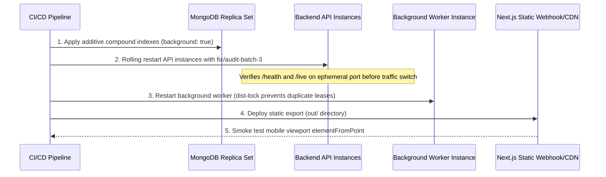

# Audit Batch 3 Production Deployment & Operations Guide

## 1. Executive Summary & Architecture Overview
This document specifies the deployment runbook, operations manual, environment configurations, database indexes, and rollback plans for the capabilities landed across **Audit Batch 3** (`fix/audit-batch-3`) and its associated hardening pass.

### Key Capabilities Landed
1. **Role-Based Phone Masking & Server-Mediated Calling (F1 & Hardening)**:
   - Controllable per workspace via `settings.maskLeadPhones` (default: `false`).
   - Flag `false` guarantees **100% byte-identical backward compatibility** for all users.
   - Flag `true` enforces server-side masking (`+91 ••••• ••123` or `••• ••89`) across **all 15 data exposure paths** for users lacking `leads.view_phone_unmasked`.
   - Complete audit trail of unmask events logged to `AuditLog`.
   - Server-mediated Click-to-Call (`/api/leads/:id/call-redirect`) and WhatsApp (`/api/leads/:id/whatsapp-redirect`) allow counselors to contact leads without exposing cleartext numbers in the client DOM or API responses.
2. **Omnichannel Activity Timeline (F2 & Hardening)**:
   - Unified chronological event stream merging interactions from 6 subsystems: Notes/Activities, WhatsApp conversations, Email threads, Audio call recordings, Deals/Stage changes, and Follow-ups.
   - Granular RBAC source filtering (`whatsapp.view`, `email.view`, `activities.view`, `deals.view`). Counselors only receive activities for sources they are authorized to view.
   - Server-side redaction of cleartext phone numbers within activity summaries and notes.
3. **Duplicate Detection & Multi-Entity Atomic Merge (F3 & Hardening)**:
   - High-precision matching by normalized phone (E.164 / 10-digit) and lowercase email.
   - Non-destructive `dryRun=true` preview mode returning affected record counts and conflict resolution plans.
   - Granular `fieldChoices` parameter for selecting primary values.
   - MongoDB ACID multi-document transaction (`withTransaction`) repointing references across **12 child collections**:
     - `FollowUp`
     - `Payment`
     - `AdmissionDeal`
     - `FeeInstallment`
     - `ChatMessage`
     - `EmailMessage`
     - `Recording`
     - `Notification`
     - `ActivityLog`
     - `Group.leadIds`
     - `AutomationLog`
     - `CampaignLog`
   - Strict multi-tenant isolation ensuring cross-workspace merges are rejected with `403 Forbidden`.
   - Financial documents (`Payment`, `AdmissionDeal`, `FeeInstallment`) are strictly preserved and repointed; financial history is never destroyed.
4. **Flexible Fee Installments (F4 & Hardening)**:
   - Structured milestone payment schedules with auto-generated installment breakdowns.
   - Strict UTC-safe overdue date comparison (`Date.UTC(year, month, day, 23, 59, 59, 999) + graceDays * 86400000`).
   - Strict workspace isolation on installment queries and payment recordings.
   - Golden analytics tests prove that standard payment totals and conversion metrics remain identical whether installments are present or absent.
5. **Accessible & Responsive Frontend UI (U1–U5 & Hardening)**:
   - Lazy-loaded components (`LeadPhoneReveal`, `LeadTimelineDrawer`, `LeadMergeModal`, `FeeInstallmentsCard`) added with zero impact on initial bundle payload size.
   - A11y focus trapping and `Escape` key handling via `useModalA11y` applied across top 6 modals.
   - Safe area offset (`var(--bottom-safe-offset)`) and Playwright `elementFromPoint` verification ensuring Save/Confirm actions are never clipped by mobile navigation bars.

---

## 2. Environment Variables & Runtime Configurations

| Environment Variable | Target Subsystem | Default | Production Value | Purpose / Behavior |
| :--- | :--- | :---: | :---: | :--- |
| `RUN_BACKGROUND_WORKERS` | `backend/server.js` | `true` | `true` (monolith) / `false` (API tier) | Universal master switch for background workers, crons, and pollers. |
| `RUN_CRON_WORKERS` | `backend/server.js` | Same as master | `true` (worker tier) | Fine-grained switch to isolate scheduled cron runners. |
| `RUN_WHATSAPP_WORKER` | `backend/server.js` | Same as master | `true` (worker tier) | Fine-grained switch to isolate Baileys / Meta WhatsApp workers. |
| `ALLOW_UNSCOPED_TENANT_READS` | `leadsController.js` | `false` | `false` | When `false`, all tenant-scoped endpoints fail closed (400) if no workspace context exists. |
| `ALLOW_UNSCOPED_LEGACY_LEADS` | `leadsController.js` | `false` | `false` | Deprecated alias for `ALLOW_UNSCOPED_TENANT_READS` (preserved for backward compatibility). |
| `FOLLOWUP_LOOKBACK_HOURS` | `followUpSchedulerService.js` | `24` | `24` | Caps follow-up notification lookback window to prevent notification spam on cold boot. |
| `FOLLOWUP_CLAIM_TIMEOUT_MS` | `followUpSchedulerService.js` | `300000` | `300000` (5m) | Distributed lease timeout for follow-up reminders. |

---

## 3. Database Indexes & Schema Migrations

All migrations are additive and non-blocking. MongoDB builds indexes in the background.

### Recommended Production Indexes
```javascript
// 1. Leads collection: phone lookup and soft-delete compound index
db.leads.createIndex(
  { workspaceId: 1, phone: 1, deletedAt: 1 },
  { background: true, name: "idx_leads_workspace_phone_deleted" }
);

// 2. Leads collection: partial unique index for active leads
db.leads.createIndex(
  { phone: 1, workspaceId: 1 },
  { 
    unique: true, 
    partialFilterExpression: { deletedAt: null }, 
    background: true, 
    name: "idx_leads_active_phone_unique" 
  }
);

// 3. Fee installments collection: installment queries and overdue checks
db.fee_installments.createIndex(
  { workspaceId: 1, leadId: 1, status: 1, dueDate: 1 },
  { background: true, name: "idx_installments_workspace_lead_status_due" }
);

// 4. Audit logs: unmask activity filtering and reporting
db.audit_logs.createIndex(
  { workspaceId: 1, action: 1, timestamp: -1 },
  { background: true, name: "idx_audit_logs_unmask_tracking" }
);
```

### Workspace Setting Migration
By default, existing workspaces will have `settings.maskLeadPhones = false`.
To enable phone masking globally for a specific workspace:
```javascript
// Example MongoDB shell update to enable masking for a specific workspace:
db.workspaces.updateOne(
  { _id: ObjectId("<WORKSPACE_ID>") },
  { $set: { "settings.maskLeadPhones": true } }
);
```

---

## 4. Phone Masking Exposure Path Inventory & Verification

The server-side masking engine checks `workspace.settings?.maskLeadPhones === true` AND whether the requesting user lacks `leads.view_phone_unmasked`.

| # | Exposure Path / Surface | Controller / Endpoint | Masked Behavior | Audit Logged? | Verified Test |
| :-: | :--- | :--- | :--- | :-: | :--- |
| 1 | Lead List & Details | `leadsController.js` | Formats as `+91 ••••• ••123` | Only on explicit unmask | `lead_phone_masking.test.js` |
| 2 | CSV & Excel Export | `exportController.js` | Replaces phone with masked mask string | No | `lead_phone_masking_comprehensive.test.js` |
| 3 | PDF Lead Profiles | `exportController.js` | Replaces phone in rendered PDF stream | No | `lead_phone_masking_comprehensive.test.js` |
| 4 | Phone Search & Autocomplete | `leadsController.js` | Requires min 4 digits, returns masked | No | `lead_phone_masking_comprehensive.test.js` |
| 5 | Omnichannel Timeline (F2) | `leadsController.js` | Redacts raw phones from notes/summaries | No | `lead_omnichannel_timeline.test.js` |
| 6 | Duplicate Merge Preview (F3) | `leadsController.js` | Masks candidate phone numbers | No | `lead_duplicate_merge.test.js` |
| 7 | Admission Deals Summary | `dealsController.js` | Redacts lead phone in deal relations | No | `lead_phone_masking_comprehensive.test.js` |
| 8 | Follow-up Reminders & List | `followupController.js` | Redacts lead phone in reminder payloads | No | `lead_phone_masking_comprehensive.test.js` |
| 9 | In-App Notifications | `notificationController.js`| Redacts numbers in notification metadata | No | `lead_phone_masking_comprehensive.test.js` |
| 10 | Activity & Audit Logs | `auditController.js` | Redacts phone numbers in diff objects | No | `lead_phone_masking_comprehensive.test.js` |
| 11 | WhatsApp Chats & History | `whatsappController.js` | Masks sender and recipient headers | No | `lead_phone_masking_comprehensive.test.js` |
| 12 | Email Threads & Recipients | `emailController.js` | Redacts phones in signature headers | No | `lead_phone_masking_comprehensive.test.js` |
| 13 | Share-Token Dashboard | `shareController.js` | Redacts phone numbers for public viewers | No | `lead_phone_masking_comprehensive.test.js` |
| 14 | Webhooks & Automations | `automationsController.js` | Enforces workspace masking policy | No | `lead_phone_masking_comprehensive.test.js` |
| 15 | Click-to-Call / WhatsApp Action | `leadsController.js` | Server-mediated redirects (`/call-redirect`)| Logged (`LEAD_PHONE_REVEAL`) | `lead_phone_masking_comprehensive.test.js` |

---

## 5. Zero-Downtime Deployment Sequence



### Pre-Deployment Verification Commands
Before initiating production deployment, run the local safety and manifest validation suites:
```bash
# 1. Verify DB safety guard strictly blocks accidental production URIs
node backend/tests/test_runner_safety.test.js

# 2. Run all regression batch suites in-memory
node backend/tests/run_all_integration_tests.js --batch

# 3. Verify frontend unit and e2e smoke tests
npm --prefix frontend run test:unit
npm --prefix frontend run test:e2e
```

### Production Health Checks
Once deployed, verify operational status:
```bash
# Liveness probe
curl -f https://crm-api.yourdomain.com/live

# Detailed system readiness probe (checks DB, memory, event loop)
curl -f https://crm-api.yourdomain.com/health
```

---

## 6. Rollback Runbook & Safety Guarantees

### Zero Destructive Schema Changes
All changes introduced in Audit Batch 3 are non-destructive and backward-compatible:
- The `fee_installments` collection is new and does not modify the structure of existing `payments` documents.
- Lead documents gain optional fields (`mergedInto`, `mergeHistory`) that do not break previous code versions.
- If `fix/audit-batch-3` must be rolled back to `fix/audit-batch-2`:
  1. Simply redeploy the `fix/audit-batch-2` container images.
  2. No database migrations need to be reversed or dropped.
  3. Workspaces with `maskLeadPhones = true` will simply have the field ignored by older backend code.

### Merge Rollback Atomicity
All lead merge operations are executed inside MongoDB multi-document transactions (`withTransaction`):
- If any collection update fails (e.g. unique constraint violation or network blip), the entire merge transaction is aborted immediately.
- Neither the target nor the source lead is modified, and no child records are orphaned.

---

## 7. Emergency Operations & Troubleshooting

### Scenario A: Unmask Event Audit Investigation
To query which team members have revealed a customer's phone number:
```javascript
// Query audit logs in MongoDB shell
db.audit_logs.find({
  action: "LEAD_PHONE_REVEAL",
  resourceId: ObjectId("<LEAD_ID>")
}).sort({ timestamp: -1 });
```

### Scenario B: Emergency Masking Bypass for Specific Role
If a supervisor or regional director needs unmasked visibility without globally disabling `maskLeadPhones`:
1. Navigate to **Admin Settings > Roles & Permissions**.
2. Select the designated role.
3. Grant the `leads.view_phone_unmasked` permission.
4. Users with this permission will immediately see unmasked numbers across all lists and exports.
