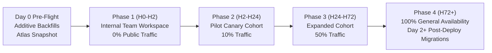
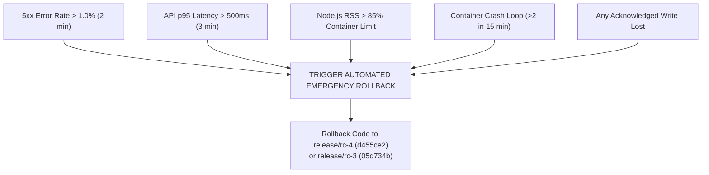

# Production Canary Rollout Plan & Operational Guardrails

**Target Release**: `release/rc-5`  
**Platform**: Render (Web Service), MongoDB Atlas (Replica Set), Redis (Optional / Single-Instance), Cloudflare Pages (Frontend PWA)  
**Deployment Model**: Single Unified Web+Worker Service (`RUN_BACKGROUND_WORKERS=true`, `INSTANCE_COUNT=1`)  
**Verdict**: `GO-TO-STAGING-SOAK` (Staging rehearsal required prior to production execution)

---

## 1. Overview & Strategy

This runbook defines the progressive canary rollout procedure for SAHYAK CRM `release/rc-5`. To maximize reliability, eliminate operational risk, and safeguard customer data, the rollout is structured into four sequential phases:
1. **Phase 1: Day-0 Internal Canary (Hours 0–2)** — 0% public traffic; internal team workspace testing only.
2. **Phase 2: Pilot Canary Cohort (Hours 2–24)** — 10% traffic; single designated consultancy workspace.
3. **Phase 3: Expanded Canary Cohort (Hours 24–72)** — 50% traffic across standard workspaces.
4. **Phase 4: Full General Availability (Hour 72+)** — 100% traffic cutover followed by Day 2+ index pruning and Baileys WhatsApp encryption migrations.

---

## 2. Day-0 Pre-Flight Deployment Checklist

Every checkbox below is a mandatory hard gate. If any check fails, do not proceed with deployment.

### Pre-Deployment Environment & Backup Verification
- [ ] **Atlas Snapshot Verified**: Execute an on-demand cluster snapshot in MongoDB Atlas Console (`Clusters` -> `Backup` -> `Take Snapshot Now`). Record Snapshot ID: `____________________`.
- [ ] **Secrets Vault Backup**: Confirm that production environment secrets (`MONGODB_URI`, `JWT_SECRET`, `WA_ENCRYPTION_KEY`, `RAZORPAY_KEY_SECRET`) are encrypted and archived in an external secure vault (e.g. 1Password / Bitwarden / AWS Secrets Manager).
- [ ] **Lead Phone Masking Disabled Initially**: Ensure `maskLeadPhones` is set to `false` in default workspace configs for Day 0 to prevent counselor operational disruption while verifying UI baseline.
- [ ] **WhatsApp Auth Encryption EXCLUDED from Day 0**: `migrateWaAuthEncryption.js` is strictly forbidden from executing on Day 0. It is scheduled only for Day 2+ after 24 hours of zero-incident operations.
- [ ] **Soft-Deleted Lead Purge EXCLUDED**: Confirm `purgeSoftDeletedLeads.js` is NOT included in release scripts (retention lifecycle job only).
- [ ] **Topology Enforced**: Verify container topology is set to `INSTANCE_COUNT=1` and `RUN_BACKGROUND_WORKERS=true`.
- [ ] **Proxy Hops Configured**: Verify `TRUST_PROXY_HOPS=1` in Render environment settings (or `2` if Cloudflare proxy terminates before Render).

### Pre-Deploy Additive Backfills (Render Shell)
Execute in Render Shell before deploying the new container image:
```bash
# 1. Validate environment configuration
node src/config/envValidator.js

# 2. Build model indexes with duplicate phone collision check
node src/scripts/syncIndexes.js --apply

# 3. Initialize user tokenVersion: 0 (backward-compatible)
node src/scripts/backfillTokenVersion.js --apply

# 4. Scope legacy leads to verified workspaces
node src/scripts/backfillLegacyLeadWorkspaceId.js --apply

# 5. Scope recordings and payments to verified workspaces
node src/scripts/backfillWorkspaceIdForRecordingsAndPayments.js --apply

# 6. Reconcile drifted snake_case and camelCase payment fields
node src/scripts/reconcilePaymentFieldPairs.js --apply
```

---

## 3. Rollout Schedule & Canary Scopes



### Phase 1: Internal Team Workspace (Hours 0–2)
- **Scope**: Exclusive internal QA and administrator test workspace (`workspaceId: 6af2b...internal`).
- **Traffic**: 0% customer traffic.
- **Activities**:
  - Live smoke verification against `/health/ready`, `/health/live`, `/health/detailed`.
  - Manual lead creation, edit, stage progression (`Won` status fee installment trigger).
  - WhatsApp Baileys QR-code pairing and test outbound message dispatch.
  - Razorpay payment order generation and webhook simulation.

### Phase 2: Pilot Canary Cohort (Hours 2–24)
- **Scope**: Exactly 1 high-activity production admission consultancy workspace.
- **Traffic**: ~10% of total platform traffic.
- **Activities**:
  - Real-time counselor usage: rapid lead switching, inline updates, follow-up scheduling.
  - Monitor socket connectivity and local in-memory event-loop lag.

### Phase 3: Expanded Canary Cohort (Hours 24–72)
- **Scope**: 50% of tenant workspaces.
- **Traffic**: ~50% of total platform traffic.
- **Activities**:
  - Multi-tenant query isolation observation.
  - Bulk CSV import/export performance monitoring.

### Phase 4: Full General Availability (Hour 72+)
- **Scope**: 100% of all tenant workspaces.
- **Post-Deploy Cutover (Off-Peak)**:
  1. `node src/scripts/pruneRedundantLeadIndexes.js --apply` (Day 2 off-peak, drops redundant indexes).
  2. Take fresh Atlas snapshot.
  3. `node src/scripts/migrateWaAuthEncryption.js --apply` (Re-encrypts historical WhatsApp session state).

---

## 4. Exact Numeric Success Metrics

The release must meet all numeric criteria below at each evaluation checkpoint:

| Metric | 2-Hour Gate (Phase 1) | 24-Hour Gate (Phase 2) | 72-Hour Gate (Phase 3) | Target Standard |
| :--- | :--- | :--- | :--- | :--- |
| **HTTP 5xx Error Rate** | < 0.10% | < 0.05% | < 0.01% | Zero unhandled exceptions |
| **API Latency (p95)** | < 250 ms | < 200 ms | < 200 ms | Sub-200ms responsiveness |
| **API Latency (p99)** | < 500 ms | < 350 ms | < 300 ms | Sub-300ms tail latency |
| **Event Loop Lag (p95)** | < 50 ms | < 50 ms | < 50 ms | Responsive Node.js loop |
| **Event Loop Lag (p99)** | < 100 ms | < 100 ms | < 100 ms | Non-blocking execution |
| **Memory RSS Stability** | < 60% limit | < 75% limit | < 75% limit (flat) | Zero monotonic leaks |
| **Write Durability** | 100.00% (0 lost) | 100.00% (0 lost) | 100.00% (0 lost) | Zero lost writes |
| **Token Auth Errors** | 0 false 401s | 0 false 401s | 0 false 401s | Zero mass logouts |
| **Phone Collisions** | 0 duplicate 500s | 0 duplicate 500s | 0 duplicate 500s | Clean 409 conflict responses |

---

## 5. Automated & Manual Rollback Triggers

If any of the following critical thresholds are breached, the rollout is immediately aborted:



### Numeric Rollback Triggers
1. **Critical Error Spike**: Total HTTP 5xx error rate exceeds **1.0%** over a 2-minute rolling window.
2. **Severe Latency Degradation**: API p95 response time exceeds **500 ms** for 3 consecutive minutes.
3. **Memory Saturation**: Container RSS exceeds **85%** of allocated RAM without recovery after V8 garbage collection.
4. **Crash Loop**: Process restarts more than **2 times** in a 15-minute window.
5. **Data Durability Breach**: Any discrepancy detected between acknowledged API write responses and MongoDB persistence.

### Emergency Rollback Action:
1. In Render Dashboard -> `crm-app` -> **Deploys**: Click **Rollback to this deploy** on commit `d455ce201287ab09f6c37819253a8f4a00cc40e5` (`release/rc-4`) or `05d734b13cf0566328c7ce7d66e41483d228e18e` (`release/rc-3`).
2. *Rollback completion SLA*: < 90 seconds.
3. *Database impact*: Pre-deploy Phase 1 backfills are purely additive and backward-compatible with `release/rc-4` and `release/rc-3`. No database rollback is required.

---

## 6. Mitigations for Unverified Cloud Items

| Cloud Component | Unverified Risk | Concrete Mitigation in Code / Topology |
| :--- | :--- | :--- |
| **Razorpay Webhooks** | Public IP address changes or spoofed webhook payloads | Strict HMAC-SHA256 signature verification over `req.rawBody` using `crypto.timingSafeEqual`; invalid/missing signatures return HTTP 400 immediately; webhook processing is idempotent via database transaction lookup on `transaction_id`. |
| **Cloudflare CDN** | Stale cache serving outdated API data or private student PII | `server.js` sends `Cache-Control: no-store, no-cache, must-revalidate, private` on all `/api/*` and `/health/*` routes. Cloudflare edge caching is restricted exclusively to immutable static frontend build assets (`/_next/static/*`). |
| **Meta WhatsApp API** | Meta Graph API template approval delays | Baileys multi-device direct WebSocket engine acts as the primary immediate driver; Cloud API template fallbacks remain isolated without blocking conversational messaging. |
| **Render Reverse Proxy** | Multi-proxy hop IP misattribution inducing rate limit false-positives | `TRUST_PROXY_HOPS` configurable environment variable (defaults to `1` on Render); user-keyed rate limiters prioritize `req.user._id`, ensuring proxy IP pooling does not trigger 429 throttling for legitimate counselors. |
