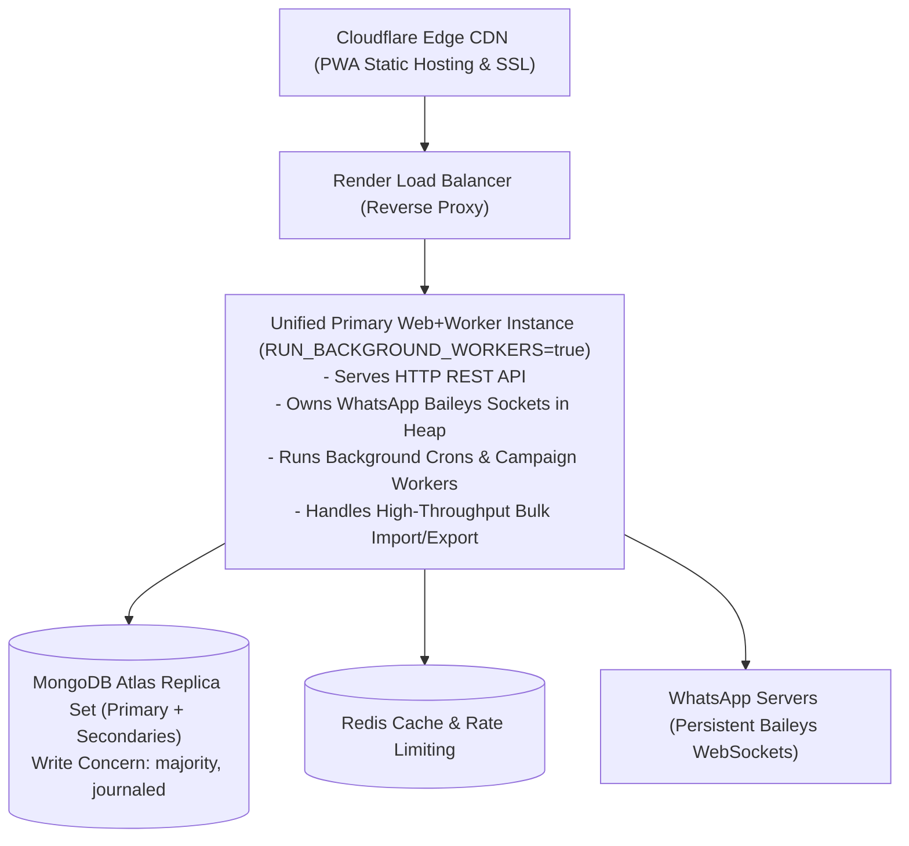
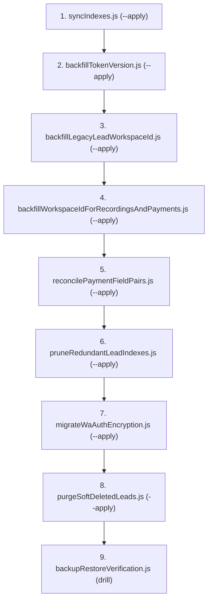

# Production Deployment, Operations & Disaster Recovery Runbook

**Target Release**: `release/rc-3`  
**Platform**: Render Web Service / MongoDB Atlas Replica Set / Redis / Cloudflare CDN  
**Verification Target**: Enterprise-grade CRM with strict financial durability, real-time counselor speed, and fail-safe configuration.

---

## 1. Production Topology & Architecture

### 1.1 Default Production Topology: Single Unified Web+Worker Instance
The production runtime requires an active WhatsApp Baileys engine where persistent in-memory WebSocket connections are tied to the local Node.js process heap memory.



- **Production Topology Rule**: A **single combined Web+Worker instance** (`RUN_BACKGROUND_WORKERS=true`).
  - Processes all inbound REST API requests, counselor saves, searches, and leads views.
  - Owns all active WhatsApp Baileys WebSocket sockets directly in process memory.
  - Runs all scheduled background cron jobs (`followUpReminders`, `campaignWorker`, `googleSheetsPollingService`, soft-delete purges).
  - Streams high-throughput CSV/XLSX imports and exports without blocking the main event loop.

### 1.2 Multi-Instance Scaling Limitation & Web/Worker Split Truth
> [!WARNING]
> **CRITICAL ARCHITECTURAL BOUNDARY — DO NOT SCALE BEYOND 1 INSTANCE UNTIL RPC EXISTS**:
> A decoupled web/worker multi-instance split or horizontal auto-scaling with cross-node WhatsApp sending is **NOT currently supported**.
> - In-memory Baileys WebSockets live exclusively in the heap of the single process that established the session.
> - There is currently **no inter-process RPC or distributed message bus** (e.g. BullMQ / Redis PubSub RPC) forwarding outbound sends from secondary API instances to the worker instance.
> - If secondary API instances are spun up with `RUN_BACKGROUND_WORKERS=false`, any outbound WhatsApp send request hitting those instances will receive an explicit HTTP 503:
>   ```json
>   {
>     "code": "WA_SESSION_OWNED_BY_ANOTHER_INSTANCE",
>     "message": "WhatsApp session is owned by another cluster worker (worker-node-id).",
>     "leaseOwner": "worker-node-id"
>   }
>   ```
> - **Operational Mandatory Policy**: Until a distributed RPC layer is implemented and verified, staging and production MUST run as **exactly ONE unified Web+Worker container** (e.g., Render Standard 2GB/1CPU or Pro tier) with `RUN_BACKGROUND_WORKERS=true`.

---

## 2. Production Environment Variable Matrix & Validation

All production nodes execute the strict environment validator (`node backend/src/config/envValidator.js`) during startup. If any critical variable is missing, malformed, or insecure, the process **fails closed immediately** before binding ports or accepting traffic.

| Variable | Scope | Type / Format | Default | Description & Operational Security Rules |
| :--- | :--- | :--- | :--- | :--- |
| `NODE_ENV` | Global | String (`production`) | `production` | Enforces production mode, disabling stack traces in API errors and enabling security headers. |
| `PORT` | API | Integer (e.g. `10000`) | `5000` | Injected dynamically by Render. Web process binds to `0.0.0.0:${PORT}`. |
| `MONGODB_URI` / `MONGO_URI` | Both | MongoDB URI (`mongodb+srv://...`) | *None* | Must point to MongoDB Atlas replica set. Connection-level write concern `{ w: 'majority', j: true }` is enforced by Mongoose. Cannot point to localhost in production. |
| `JWT_SECRET` | Both | Hex / Base64 (min 32 chars) | *None* | Primary cryptographic key for HMAC-SHA256 user authentication tokens. **Never regenerate on active deploy**. |
| `SESSION_SECRET` | Both | String (min 32 chars) | *Optional* | Secret for HTTP session cookies. |
| `ADMIN_JWT_SECRET` | Both | Hex / Base64 (min 32 chars) | *Optional* | Dedicated key for administrative token signatures. |
| `INTEGRATION_ENCRYPTION_KEY` / `ENCRYPTION_KEY` | Both | 64-char Hex (32 bytes) | *None* | AES-256-GCM symmetric key used to encrypt OAuth tokens and integration credentials in database. |
| `WA_ENCRYPTION_KEY` | Both | 64-char Hex or min 32 chars | *Required if WA enabled* | Dedicated AES-256-GCM symmetric key for encrypting Baileys auth credentials (`mongoAuthState.js`). Cannot match default dev key. |
| `WA_KEY_RING` | Worker | JSON string | *Optional* | JSON array of historical keys for zero-downtime WhatsApp key rotation (`[{"keyId":"v1","key":"..."},{"keyId":"v2","key":"..."}]`). |
| `WA_ACTIVE_KEY_ID` | Worker | String | *Optional* | Identifier of active encryption key in key ring (e.g., `v2`). |
| `REDIS_URL` | Both | Redis URI (`redis://...`) | *None* | Redis instance for multi-instance distributed rate limiting and token blacklists. Required if `INSTANCE_COUNT > 1`. |
| `RUN_BACKGROUND_WORKERS` | Global | Boolean (`true`/`false`) | `true` | Must be `true` for single-instance unified deployments (owns WhatsApp & crons). Set to `false` only for secondary read-only nodes. |
| `INSTANCE_COUNT` / `WEB_CONCURRENCY` | Global | Integer | `1` | Number of instances. Must be `1` until distributed WhatsApp RPC is deployed. |
| `TRUST_PROXY_HOPS` | API | Integer / Boolean | `1` | Reverse proxy hop depth (`1` for Render LB, `2` for Cloudflare + Render LB). Ensures `req.ip` reflects true client IP. |
| `ALLOWED_ORIGINS` / `CLIENT_URL` / `CORS_ORIGIN` | API | Comma-delimited URLs | *See server.js* | Permitted CORS origins (e.g., `https://crm.sahyak.com,https://app.sahyak.com`). Wildcard `*` is strictly forbidden in production. |
| `RAZORPAY_KEY_ID` | Both | String | *Optional* | Razorpay API key ID for payment link generation. |
| `RAZORPAY_KEY_SECRET` | Both | String | *Optional* | Razorpay API key secret. |
| `RAZORPAY_WEBHOOK_SECRET` | Both | String | *Optional* | Secret used to verify raw HMAC-SHA256 signatures on inbound webhook events (`/api/payments/webhook`). |
| `META_APP_SECRET` | Both | String | *Optional* | Meta App Secret for validating `X-Hub-Signature-256` on WhatsApp / Lead Ads webhooks. |
| `STRICT_ENV_EXIT` | Global | Boolean | `true` | When `true`, exits 1 immediately on configuration error. |
| `PERF_DEBUG` | Global | Boolean | `false` | Enables event loop lag and RSS sampling logs. |

### Verified Codebase Limits & Ceilings (Hardcoded in Engine)
- **Public Share Rate Limit**: Exactly 60 requests per 15-minute rolling window per unique token + client IP (`share:${token}:${ip}`).
- **Admin Daily Work Rate Limit**: Exactly 600 requests per 1-minute rolling window for authenticated managers/admins (`user:<id>`); 60 req/min unauthenticated.
- **SuperAdmin Bounded Rate Limit**: Exactly 120 requests per 15-minute rolling window for sensitive platform endpoints.
- **Global API Rate Limit**: Exactly 18,000 requests per 15-minute window (~1,200 req/min) for authenticated users (`user:<id>`); 400 req / 15 min for unauthenticated.
- **Auth Rate Limit**: Exactly 150 login attempts per 15-minute window per IP.
- **Import Upload Ceiling**: 15MB file size ceiling (`fileSize: 15 * 1024 * 1024`) via multer, with max 50,000 rows.
- **JSON Request Ceiling**: 10MB payload ceiling (`express.json({ limit: '10mb' })`).
- **XLSX Export Ceiling**: Max 10,000 rows (CSV exports are streaming and unbounded).

---

## 3. Pre-Flight Deployment Checklist

Before triggering a deployment to staging or production:

- [ ] **1. Secrets Backup**: Verify that `JWT_SECRET`, `INTEGRATION_ENCRYPTION_KEY`, and `WA_ENCRYPTION_KEY` are safely archived in team 1Password / HashiCorp Vault.
- [ ] **2. Database Connectivity & IP Access**: Ensure MongoDB Atlas Network Access whitelist contains Render outbound egress IPs or `0.0.0.0/0` with strong SCRAM-SHA-256 credentials.
- [ ] **3. Replica Set Health**: Confirm MongoDB Atlas cluster status is green with 0 replication lag and primary node healthy.
- [ ] **4. Backup Confirmation**: Verify Atlas automated continuous backup snapshot was completed within the last 15 minutes.
- [ ] **5. Environment Audit**: Run environment validator script locally against target environment variables:
  ```bash
  node backend/src/config/envValidator.js
  ```

---

## 4. Database Migration Sequencing

Database migrations in `release/rc-3` are strictly **idempotent**, supporting non-destructive dry-run previews before execution.



### Step 4.1: Synchronize Base Indexes
Executes model index declarations safely with duplicate pre-checks:
```bash
# Preview
node backend/src/scripts/syncIndexes.js
# Apply
node backend/src/scripts/syncIndexes.js --apply
```

### Step 4.2: Backfill User `tokenVersion`
Initializes `tokenVersion: 0` for all legacy user documents missing this field:
```bash
# Preview
node backend/src/scripts/backfillTokenVersion.js
# Apply
node backend/src/scripts/backfillTokenVersion.js --apply
```

### Step 4.3: Backfill Workspace Isolation Identifiers
Ensures all orphaned leads, recordings, and payments are scoped to valid workspaces:
```bash
# Preview
node backend/src/scripts/backfillLegacyLeadWorkspaceId.js
# Apply
node backend/src/scripts/backfillLegacyLeadWorkspaceId.js --apply

# Preview
node backend/src/scripts/backfillWorkspaceIdForRecordingsAndPayments.js
# Apply
node backend/src/scripts/backfillWorkspaceIdForRecordingsAndPayments.js --apply
```

### Step 4.4: Reconcile Payment Field Pairs
Normalizes camelCase and snake_case payment schema inconsistencies:
```bash
# Preview
node backend/src/scripts/reconcilePaymentFieldPairs.js
# Apply
node backend/src/scripts/reconcilePaymentFieldPairs.js --apply
```

### Step 4.5: Prune Redundant Indexes with Explain-Guard
Drops redundant indexes on `leads` collection while verifying that all top query shapes remain index-backed (`IXSCAN`):
```bash
# Preview
node backend/src/scripts/pruneRedundantLeadIndexes.js
# Apply
node backend/src/scripts/pruneRedundantLeadIndexes.js --apply
```

### Step 4.6: Migrate WhatsApp Auth State Encryption
Re-encrypts historical WhatsApp session credentials with dedicated `WA_ENCRYPTION_KEY`:
```bash
# Preview / Verify Only
node backend/src/scripts/migrateWaAuthEncryption.js --verify-only
# Apply
node backend/src/scripts/migrateWaAuthEncryption.js --apply
```

### Step 4.7: Purge Expired Soft-Deleted Leads
Purges leads soft-deleted >90 days ago inside an atomic transaction:
```bash
# Preview
node backend/src/scripts/purgeSoftDeletedLeads.js
# Apply
node backend/src/scripts/purgeSoftDeletedLeads.js --apply --retention-days 90
```

---

## 5. Step-by-Step Single-Instance Staging & Production Deployment

> [!IMPORTANT]
> Both Staging and Production MUST be deployed as a **single unified Web+Worker service** (`RUN_BACKGROUND_WORKERS=true`).
> Do NOT create separate `crm-worker` and `crm-api` services in Render until distributed RPC is implemented.

### Step 5.1: Configure Render Web Service
1. In Render Dashboard, create or select the Web Service (`crm-backend`).
2. Set Environment Variables:
   - `NODE_ENV`: `production`
   - `RUN_BACKGROUND_WORKERS`: `true`
   - `INSTANCE_COUNT`: `1`
   - `TRUST_PROXY_HOPS`: `1` (or `2` if behind Cloudflare)
   - `MONGODB_URI`: Atlas connection string
   - `JWT_SECRET`: Min 32-character secret
   - `INTEGRATION_ENCRYPTION_KEY`: 64-char hex key
   - `WA_ENCRYPTION_KEY`: Dedicated 64-char hex key
   - `ALLOWED_ORIGINS`: Frontend URL(s)
3. Configure Health Check:
   - Health Check Path: `/health/ready`
4. Build & Start Commands:
   - Build Command: `cd backend && npm install --production`
   - Start Command: `cd backend && node server.js`

### Step 5.2: Execute Pre-Flight Validation & Migrations
Before directing user traffic to the release:
```bash
# 1. Validate environment configuration
node backend/src/config/envValidator.js

# 2. Execute database migrations sequentially
node backend/src/scripts/syncIndexes.js --apply
node backend/src/scripts/backfillTokenVersion.js --apply
node backend/src/scripts/backfillLegacyLeadWorkspaceId.js --apply
node backend/src/scripts/backfillWorkspaceIdForRecordingsAndPayments.js --apply
node backend/src/scripts/reconcilePaymentFieldPairs.js --apply
node backend/src/scripts/pruneRedundantLeadIndexes.js --apply
node backend/src/scripts/migrateWaAuthEncryption.js --apply
```

### Step 5.3: Trigger Zero-Downtime Rolling Deploy
1. In Render Dashboard, click **Manual Deploy -> Deploy Latest Commit (`release/rc-3`)**.
2. Render starts the new container and performs readiness probes against `/health/ready`.
3. Once the instance responds with `HTTP 200 {"ready": true, "status": "HEALTHY", "checks": {"mongodb": {"status": "HEALTHY"}, "storage": {"status": "HEALTHY"}}}`, Render switches routing to the new container.
4. The previous container receives `SIGTERM`, flushes in-flight writes within the 10-second drain window, and terminates cleanly.

### Step 5.4: Deploy Frontend Static PWA (Cloudflare Pages / Vercel)
1. Build frontend static export:
   ```bash
   cd frontend
   npm run build
   ```
2. Deploy the `out/` directory to Cloudflare Pages.
3. Users reloading the PWA will receive the updated Serwist service worker, caching new static assets and invalidating obsolete bundles.

---

## 6. Post-Deployment Smoke Verification & Canary Checks

Execute these verification checks immediately following deployment:

### 6.1 Service Health & Readiness Probes
```bash
# Primary Readiness Probe (used by Render load balancer)
curl -f -s https://api.crm.sahyak.com/health/ready | jq .
# Expected: HTTP 200 {"status":"HEALTHY","ready":true,"checks":{"mongodb":{"status":"HEALTHY"},"storage":{"status":"HEALTHY"}}}

# Liveness Probe
curl -f -s https://api.crm.sahyak.com/health/live | jq .
# Expected: HTTP 200 {"status":"HEALTHY","uptime":...}

# Database Health Check
curl -f -s https://api.crm.sahyak.com/health/database | jq .
# Expected: HTTP 200 {"status":"healthy","database":"connected"}
```

### 6.2 Public Share Token Rate Limiting & Masking
```bash
# Request 1: Valid masked response
curl -s -i https://api.crm.sahyak.com/api/share/<validToken>
```
*Expected*: HTTP 200. Lead phone is masked (`+91 ••••• •1234`). Response headers include `X-RateLimit-Limit: 60` and `X-RateLimit-Remaining: 59`.
```bash
# Rapid burst (65 requests):
for i in {1..65}; do curl -s -o /dev/null -w "%{http_code}\n" https://api.crm.sahyak.com/api/share/<validToken>; done
```
*Expected*: Responses 1–60 return HTTP 200; responses 61–65 return HTTP 429 (`Too many requests to this shared dashboard`).

### 6.3 Fail-Closed Webhook Signature Verification
```bash
# Forged signature test on active webhook endpoint:
curl -X POST https://api.crm.sahyak.com/api/payments/webhook \
  -H "Content-Type: application/json" \
  -H "X-Razorpay-Signature: forged_bad_hex_signature" \
  -d '{"event":"payment.captured"}'
```
*Expected*: HTTP 400 Bad Request (`Invalid webhook signature`).

### 6.4 Administrative Rate Limiting Verification
```bash
# Daily operational admin endpoints (manager/admin): capacity >= 300 req/min (configured: 600 req/min)
for i in {1..50}; do curl -s -o /dev/null -w "%{http_code}\n" -H "Authorization: Bearer <MANAGER_TOKEN>" https://api.crm.sahyak.com/api/admin/leads; done
```
*Expected*: All 50 requests return HTTP 200 (zero 429s for normal rapid counselor/manager usage).

---

## 7. Operational Monitoring & Alerting Thresholds

Configure alerts in Render / Datadog / BetterStack with the following numeric triggers:

| Alert Metric | Warning Threshold | Critical Threshold | Action Required |
| :--- | :--- | :--- | :--- |
| **API p95 Latency** | > 200 ms for 5 min | > 300 ms for 3 min | Inspect MongoDB slow queries and slot connection contention. |
| **HTTP 5xx Error Rate**| > 0.5% for 5 min | > 1.0% for 2 min | Inspect application error logs; initiate rollback if spike follows deploy. |
| **Event Loop Lag** | > 50 ms for 2 min | > 100 ms for 1 min | Verify bulk imports/exports are streaming with setImmediate checkpoints. |
| **Node.js Memory RSS** | > 75% container limit | > 85% container limit | Inspect heap dump for memory leak; restart container if necessary. |
| **MongoDB Disk Usage** | > 75% allocated | > 85% allocated | Execute `purgeSoftDeletedLeads.js` or scale Atlas storage tier. |
| **Replication Lag** | > 2 seconds | > 5 seconds | Verify Atlas secondary health and network IOPS saturation. |

---

## 8. Emergency Rollback Procedures

In the event of an unrecoverable runtime regression or critical service degradation:

### 8.1 Application Code Rollback
Render supports instant one-click rollback to any prior release build:
1. Navigate to Render Dashboard -> `crm-backend` -> **Deploys**.
2. Select the previous stable commit (e.g. `release/rc-1` or `fix/audit-batch-3`).
3. Click **Rollback to this deploy**.
*Rollback execution time: < 90 seconds (zero downtime)*.

### 8.2 Database Migration Rollback (DOWN Execution)
If a schema or data migration requires reversal:
- **User `tokenVersion`**:
  ```bash
  # Reverts tokenVersion to uninitialized state
  node backend/src/scripts/backfillTokenVersion.js --rollback
  ```
- **Index Restoration**:
  If pruned indexes need to be recreated immediately:
  ```bash
  node backend/src/scripts/syncIndexes.js --apply
  ```

### 8.3 Disaster Recovery: Database Point-in-Time Restore (PITR)
- **Target RPO (Recovery Point Objective)**: < 1 Hour (staging target; continuous oplog streaming or hourly cloud snapshots).
- **Target RTO (Recovery Time Objective)**: < 30 Minutes (staging target; automated restore orchestration).

**Procedure for MongoDB Atlas**:
1. Log in to MongoDB Atlas Console -> Clusters -> Backup -> Point-in-Time Restore.
2. Select target timestamp (e.g. 5 minutes prior to incident).
3. Choose "Restore to a new cluster" or "Restore in-place".
4. If restoring to a new cluster, update `MONGODB_URI` in Render Environment Variables.

**Procedure for Local / Self-Hosted MongoDB**:
```bash
# Restore from daily compressed archive:
mongorestore --uri="${MONGODB_URI}" --archive=/backups/crm-backup-latest.archive.gz --gzip --drop
```
