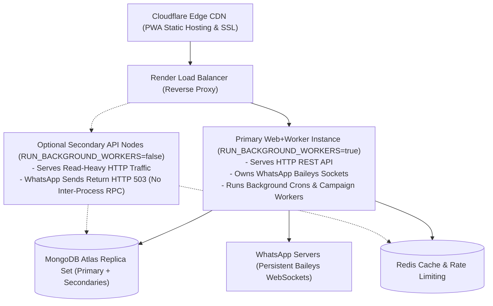
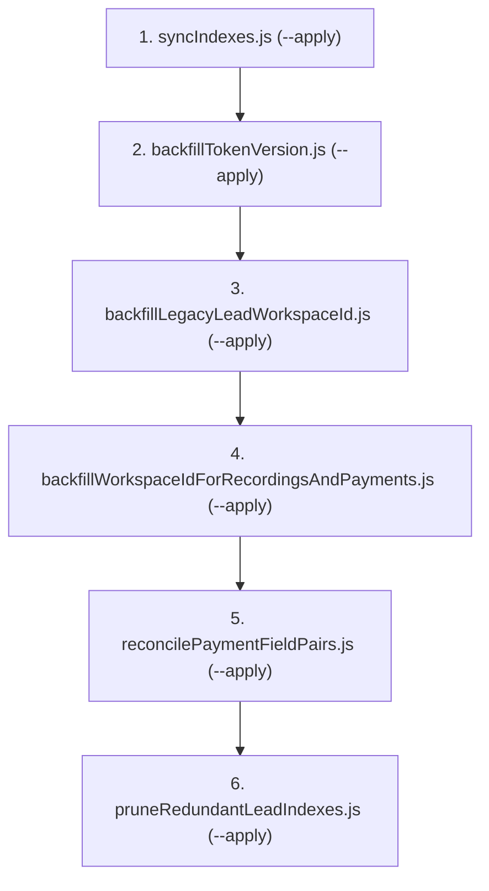

# Production Deployment, Operations & Disaster Recovery Runbook

**Target Release**: `release/rc-3`  
**Platform**: Render Web Service / MongoDB Atlas Replica Set / Redis / Cloudflare CDN  
**Verification Target**: Enterprise-grade CRM with strict financial durability, real-time counselor speed, and fail-safe configuration.

---

## 1. Production Topology & Architecture

### 1.1 Default Production Topology: Unified Web+Worker Process
The production runtime requires an active WhatsApp Baileys engine where persistent in-memory WebSocket connections are tied to the local Node.js process memory.



- **Default & Recommended Topology**: A **single combined Web+Worker instance** (`RUN_BACKGROUND_WORKERS=true`).
  - Processes all inbound REST API requests, counselor saves, searches, and leads views.
  - Owns all active WhatsApp Baileys WebSocket sockets directly in process memory.
  - Runs all scheduled background cron jobs (`followUpReminders`, `campaignWorker`, `googleSheetsPollingService`, soft-delete purges).

### 1.2 Multi-Instance Scaling Limitation & Web/Worker Split Truth
> [!WARNING]
> **CRITICAL ARCHITECTURAL BOUNDARY**:
> A decoupled web/worker multi-instance split with cross-node WhatsApp sending is **NOT currently supported**.
> - In-memory Baileys WebSockets live exclusively in the heap of the process that established the session.
> - There is currently **no inter-process RPC or distributed message bus** (e.g. BullMQ / Redis PubSub RPC) forwarding outbound sends from API instances to the worker instance.
> - If secondary API instances are spun up with `RUN_BACKGROUND_WORKERS=false`, any outbound WhatsApp send request hitting those instances will receive an explicit HTTP 503:
>   ```json
>   {
>     "code": "WA_SESSION_OWNED_BY_ANOTHER_INSTANCE",
>     "message": "WhatsApp session is owned by another cluster worker (worker-node-id).",
>     "leaseOwner": "worker-node-id"
>   }
>   ```
> - **Operational Requirement**: Until an RPC layer is implemented, any deployment requiring outbound WhatsApp must either:
>   1. Use sticky session routing directing WhatsApp callers to the socket-holding node, OR
>   2. Operate as a single high-spec Web+Worker container (e.g. Render Standard 2GB/1CPU).

---

## 2. Production Environment Variable Matrix & Validation

All production nodes execute the strict environment validator (`validateProductionEnv.js`) during startup. If any critical variable is missing, malformed, or insecure, the process **fails closed immediately** before binding ports or accepting traffic.

| Variable | Scope | Type / Format | Default | Description & Operational Security Rules |
| :--- | :--- | :--- | :--- | :--- |
| `NODE_ENV` | Global | String (`production`) | `production` | Enforces production mode, disabling stack traces in API errors and enabling security headers. |
| `PORT` | API | Integer (e.g. `10000`) | `5000` | Injected dynamically by Render. Web process binds to `0.0.0.0:${PORT}`. |
| `MONGODB_URI` / `MONGO_URI` | Both | MongoDB URI (`mongodb+srv://...`) | *None* | Must point to MongoDB Atlas replica set. Connection-level write concern `{ w: 'majority', j: true }` is enforced by Mongoose. |
| `JWT_SECRET` | Both | Hex / Base64 (min 32 chars) | *None* | Primary cryptographic key for HMAC-SHA256 user authentication tokens. **Never regenerate on active deploy**. |
| `INTEGRATION_ENCRYPTION_KEY` | Both | 64-char Hex (32 bytes) | *None* | AES-256-GCM symmetric key used to encrypt OAuth tokens and integration credentials in database. |
| `WA_ENCRYPTION_KEY` | Both | 64-char Hex (32 bytes) | *Required if WA enabled* | Dedicated AES-256-GCM symmetric key for encrypting Baileys auth credentials (`mongoAuthState.js`). |
| `REDIS_URL` | Both | Redis URI (`redis://...`) | *None* | Redis instance for multi-instance distributed rate limiting and token blacklists. |
| `RUN_BACKGROUND_WORKERS` | Global | Boolean (`true`/`false`) | `true` | Set to `true` on primary instance (owns WhatsApp & crons); set to `false` on secondary read-heavy API instances. |
| `TRUST_PROXY_HOPS` | API | Integer / Boolean | `1` | Reverse proxy hop depth (`1` for Render LB, `2` for Cloudflare + Render LB). |
| `ALLOWED_ORIGINS` | API | Comma-delimited URLs | *See db.js* | Permitted CORS origins (e.g., `https://crm.sahyak.com,https://app.sahyak.com`). |
| `RAZORPAY_KEY_ID` | Both | String | *Optional* | Razorpay API key ID for payment link generation. |
| `RAZORPAY_KEY_SECRET` | Both | String | *Optional* | Razorpay API key secret. |
| `RAZORPAY_WEBHOOK_SECRET` | Both | String | *Optional* | Secret used to verify raw HMAC SHA256 signatures on inbound webhook events. |
| `META_APP_SECRET` | Both | String | *Optional* | Meta App Secret for validating `X-Hub-Signature-256` on WhatsApp / Lead Ads webhooks. |
| `PUBLIC_SHARE_RATE_LIMIT_MAX` | API | Integer | `30` | Max public share link requests per token+IP per 15 minutes. |
| `ADMIN_RATE_LIMIT_MAX` | API | Integer | `120` | Max administrative operations per IP/user per 15 minutes. |
| `IMPORT_CONCURRENCY` | Worker | Integer | `4` | Max parallel chunks for background CSV/XLSX imports. |
| `MAX_IMPORT_FILE_SIZE_BYTES` | API | Integer | `52428800` | 50MB ceiling for uploaded import files. |

---


## 3. Pre-Flight Deployment Checklist

Before triggering a deployment to staging or production:

- [ ] **1. Secrets Backup**: Verify that `JWT_SECRET`, `INTEGRATION_ENCRYPTION_KEY`, and `WA_ENCRYPTION_KEY` are safely archived in team 1Password / HashiCorp Vault.
- [ ] **2. Database Connectivity & IP Access**: Ensure MongoDB Atlas Network Access whitelist contains Render outbound egress IPs or `0.0.0.0/0` with strong SCRAM-SHA-256 credentials.
- [ ] **3. Replica Set Health**: Confirm MongoDB Atlas cluster status is green with 0 replication lag and primary node healthy.
- [ ] **4. Backup Confirmation**: Verify Atlas automated continuous backup snapshot was completed within the last 15 minutes.
- [ ] **5. Environment Audit**: Run environment validator script locally against target environment variables:
  ```bash
  node backend/src/config/validateProductionEnv.js
  ```

---

## 4. Database Migration Sequencing

Database migrations in `release/rc-2` are strictly **idempotent**, supporting non-destructive dry-run previews before execution.



### Step 4.1: Synchronize Base Indexes
Executes model index declarations safely with duplicate pre-checks:
```bash
# Preview
node backend/src/scripts/syncIndexes.js
# Apply
node backend/src/scripts/syncIndexes.js --apply
```

### Step 4.2: Backfill User `tokenVersion`
Initializes `tokenVersion: 0` for all legacy user documents missing this field:
```bash
# Preview
node backend/src/scripts/backfillTokenVersion.js
# Apply
node backend/src/scripts/backfillTokenVersion.js --apply
```

### Step 4.3: Backfill Workspace Isolation Identifiers
Ensures all orphaned leads, recordings, and payments are scoped to valid workspaces:
```bash
# Preview
node backend/src/scripts/backfillLegacyLeadWorkspaceId.js
# Apply
node backend/src/scripts/backfillLegacyLeadWorkspaceId.js --apply

# Preview
node backend/src/scripts/backfillWorkspaceIdForRecordingsAndPayments.js
# Apply
node backend/src/scripts/backfillWorkspaceIdForRecordingsAndPayments.js --apply
```

### Step 4.4: Reconcile Payment Field Pairs
Normalizes camelCase and snake_case payment schema inconsistencies:
```bash
# Preview
node backend/src/scripts/reconcilePaymentFieldPairs.js
# Apply
node backend/src/scripts/reconcilePaymentFieldPairs.js --apply
```

### Step 4.5: Prune Redundant Indexes with Explain-Guard
Drops 13 redundant indexes on `leads` collection while verifying that all top 10 query shapes remain index-backed (`IXSCAN`):
```bash
# Preview
node backend/src/scripts/pruneRedundantLeadIndexes.js
# Apply
node backend/src/scripts/pruneRedundantLeadIndexes.js --apply
```

---

## 5. Render Zero-Downtime Deployment Sequence

### Step 5.1: Deploy Background Worker First (`crm-worker`)
1. In Render Dashboard, select `crm-worker` -> Deploy Latest Commit (`release/rc-2`).
2. Verify worker startup logs:
   - `[Config] Production environment configuration verified successfully.`
   - `✅ MongoDB Connected: ... (majority journaled write concern)`
   - `[Cron] Initializing background workers...`
3. Confirm worker is healthy and taking distributed locks.

### Step 5.2: Rolling Deploy Web Service (`crm-api`)
1. In Render Dashboard, select `crm-api` -> Manual Deploy -> Deploy Latest Commit.
2. Render starts a new container instance and waits for the Kubernetes readiness probe:
   - Healthcheck URL: `GET /health/ready`
   - Initial delay: 5s, timeout: 5s, interval: 10s.
3. Once the new instance responds with `HTTP 200 {"ready": true, "checks": {"mongodb": {"status": "HEALTHY"}}}`, Render switches inbound traffic to the new instance and gracefully terminates the old instance via `SIGTERM`.

### Step 5.3: Deploy Frontend Static PWA (Cloudflare Pages / Vercel)
1. Build frontend static bundle:
   ```bash
   cd frontend
   npm run build
   ```
2. Deploy the `out/` directory to Cloudflare Pages.
3. Clients reloading the PWA will receive the updated Serwist service worker, caching new assets and invalidating obsolete bundles.

---

## 6. 24-Hour Canary & Post-Deployment Smoke Verification

Execute these verification checks immediately following deployment:

### 6.1 Service Readiness & Liveness
```bash
curl -f -s https://api.crm.sahyak.com/health/ready | jq .
```
*Expected*: HTTP 200 `{"ready": true, "checks": {"mongodb": {"status": "HEALTHY"}}}`.

### 6.2 Public Share Token Rate Limiting & Masking
```bash
# Request 1: Valid masked response
curl -s -i https://api.crm.sahyak.com/api/share/<validToken>
```
*Expected*: HTTP 200. Lead phone is masked (`+91 ••••• •1234`). Response includes `X-RateLimit-Limit: 30` and `X-RateLimit-Remaining: 29`.
```bash
# Rapid burst (31 requests):
for i in {1..35}; do curl -s -o /dev/null -w "%{http_code}\n" https://api.crm.sahyak.com/api/share/<validToken>; done
```
*Expected*: Responses 1–30 return HTTP 200; responses 31–35 return HTTP 429 (`Too many requests`).

### 6.3 Fail-Closed Webhook Signature Verification
```bash
# Forged signature test:
curl -X POST https://api.crm.sahyak.com/api/payments/razorpay-webhook \
  -H "Content-Type: application/json" \
  -H "X-Razorpay-Signature: forged_bad_hex_signature" \
  -d '{"event":"payment.captured"}'
```
*Expected*: HTTP 400 Bad Request (`Invalid webhook signature`).

### 6.4 Administrative Rate Limiting
```bash
# Test administrative endpoint rate limiting
for i in {1..35}; do curl -s -o /dev/null -w "%{http_code}\n" -H "Authorization: Bearer <ADMIN_TOKEN>" https://api.crm.sahyak.com/api/admin/users; done
```
*Expected*: Requests 31+ receive HTTP 429.

---

## 7. Operational Monitoring & Alerting Thresholds

Configure alerts in Render / Datadog / BetterStack with the following numeric triggers:

| Alert Metric | Warning Threshold | Critical Threshold | Action Required |
| :--- | :--- | :--- | :--- |
| **API p95 Latency** | > 200 ms for 5 min | > 300 ms for 3 min | Inspect MongoDB slow queries and slot connection contention. |
| **HTTP 5xx Error Rate**| > 0.5% for 5 min | > 1.0% for 2 min | Inspect application error logs; initiate rollback if spike follows deploy. |
| **Event Loop Lag** | > 50 ms for 2 min | > 100 ms for 1 min | Verify bulk imports are running in worker threads, not API main thread. |
| **Node.js Memory RSS** | > 75% container limit | > 85% container limit | Inspect heap dump for memory leak; restart worker if necessary. |
| **MongoDB Disk Usage** | > 75% allocated | > 85% allocated | Execute `purgeSoftDeletedLeads.js` or scale Atlas storage tier. |
| **Replication Lag** | > 2 seconds | > 5 seconds | Verify Atlas secondary health and network IOPS saturation. |

---

## 8. Emergency Rollback Procedures (Rehearsed in Stage F1)

In the event of an unrecoverable runtime regression or critical service degradation:

### 8.1 Application Code Rollback
Render supports instant one-click rollback to any prior release build:
1. Navigate to Render Dashboard -> `crm-api` -> **Deploys**.
2. Select the previous stable commit (e.g. `release/rc-1` or `fix/audit-batch-3`).
3. Click **Rollback to this deploy**.
4. Repeat for `crm-worker`.
*Rollback execution time: < 90 seconds (zero downtime)*.

### 8.2 Database Migration Rollback (DOWN Execution)
If a schema or data migration requires reversal:
- **User `tokenVersion`**:
  ```bash
  # Reverts tokenVersion to uninitialized state
  node backend/src/scripts/backfillTokenVersion.js --rollback
  ```
- **Index Restoration**:
  If pruned indexes need to be recreated immediately:
  ```bash
  node backend/src/scripts/syncIndexes.js --apply
  ```

### 8.3 Disaster Recovery: Database Point-in-Time Restore (PITR)
- **Target RPO (Recovery Point Objective)**: < 15 minutes.
- **Target RTO (Recovery Time Objective)**: < 30 minutes.

**Procedure for MongoDB Atlas**:
1. Log in to MongoDB Atlas Console -> Clusters -> Backup -> Point-in-Time Restore.
2. Select target timestamp (e.g. 5 minutes prior to incident).
3. Choose "Restore to a new cluster" or "Restore in-place".
4. If restoring to a new cluster, update `MONGODB_URI` in Render Environment Variables.

**Procedure for Local / Self-Hosted MongoDB**:
```bash
# Restore from daily compressed archive:
mongorestore --uri="${MONGODB_URI}" --archive=/backups/crm-backup-latest.archive.gz --gzip --drop
```
