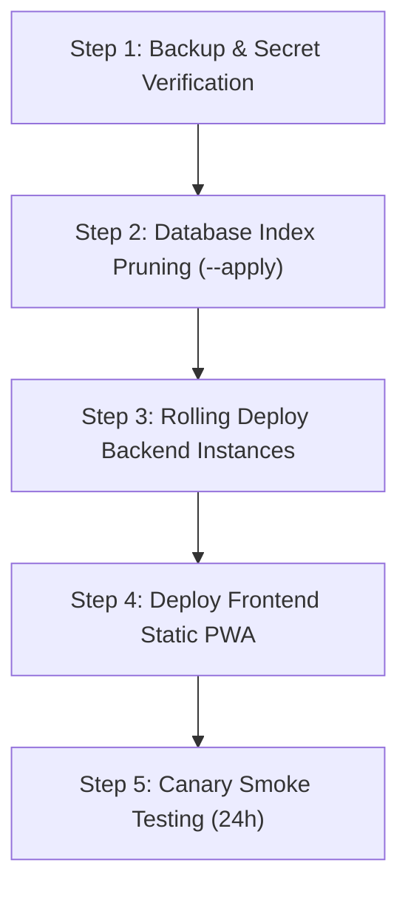

# Release Runbook: release/rc-1 (Audit Batch 4 Hardening)

## 1. Overview & Release Metadata

- **Release Branch**: `release/rc-1`
- **Base Branch**: `fix/audit-batch-3`
- **Commits Included**: 13 commits (`7662e98` through `7e2b6fb`)
- **Primary Focus**: Real-time speed under heavy load, zero lost writes (financial & operational durability), crash recovery & distributed locking, and security hardening (phone masking oracle remediation & token revocation).
- **Blast Radius**: Zero breaking API response shape changes. All new controls are backward-compatible or flag-gated.

---

## 2. Configuration & Environment Variables

The table below lists all runtime environment variables, flags, and their default behavior:

| Variable / Flag | Scope | Default | Description & Operational Guidance |
| :--- | :--- | :--- | :--- |
| `NODE_ENV` | Global | `production` | Set to `production` in staging/production. |
| `RUN_BACKGROUND_WORKERS` | Backend | `true` | Master switch for all background processes (cron jobs, reminder workers, poller loops). |
| `RUN_CRON_WORKERS` | Backend | `RUN_BACKGROUND_WORKERS` | Dedicated cron switch (alias for `RUN_BACKGROUND_WORKERS`). When running dedicated worker nodes, set to `false` on web nodes and `true` on worker nodes. |
| `RUN_WHATSAPP_WORKER` | Backend | `RUN_BACKGROUND_WORKERS` | WhatsApp poller switch. Independent control for WhatsApp session listeners. |
| `ALLOW_UNSCOPED_TENANT_READS` | Backend | `false` | When `false`, strictly enforces workspace isolation across tenant models. Aliased to legacy `ALLOW_UNSCOPED_LEGACY_LEADS`. Set to `false` in production. |
| `MONGO_WRITE_CONCERN` | Backend | `majority` | Write concern for MongoDB connection pool. Guarantees durability across replicas. |
| `MONGO_JOURNAL` | Backend | `true` | Enforces disk-journaled writes for financial collections (`FeeInstallment`, `AdmissionDeal`, `PaymentRequest`). |
| `JWT_SECRET` | Backend | *Required* | Master HMAC secret for signing user tokens. **DO NOT REGENERATE** on deploy. |
| `INTEGRATION_ENCRYPTION_KEY` | Backend | *Required* | 32-byte hexadecimal key for AES-256-GCM encryption of integration secrets. **DO NOT LOSE OR ALTER**. |
| `IMPORT_CONCURRENCY` | Backend | `4` | Max worker concurrency for chunked streaming CSV/XLSX imports. |
| `MAX_IMPORT_FILE_SIZE_BYTES`| Backend | `52428800` (50MB)| Multer disk-buffered upload ceiling. |
| `maskLeadPhones` | Workspace | `false` | Workspace-level setting in `Workspace.settings.maskLeadPhones`. When `true`, users lacking `leads.view_phone_unmasked` see redacted phone numbers (`+91 ••••• •1234`). |

---

## 3. Database Migration & Index Pruning

Batch 4 reduces the index footprint on the `leads` collection from 64 indexes (at risk of WiredTiger metadata bloat and eviction pauses) down to 51 high-efficiency compound indexes, sustaining ~315 docs/sec write throughput under journaled majority write concern (`w: 'majority', j: true`) with zero COLLSCAN or in-memory SORT regressions across all top 10 CRM queries.

### Step 3.1: Dry-Run Assessment (Non-Destructive)
Run the script without `--apply` to inspect existing indexes and list candidates for pruning:
```bash
node backend/src/scripts/pruneRedundantLeadIndexes.js
```
Expected output:
- Summary of existing indexes (e.g., 64).
- List of 13 redundant indexes identified for pruning.
- Message: `[DRY-RUN] To drop these indexes, run with --apply`.

### Step 3.2: Applying the Pruning
Execute index pruning with explicit confirmation:
```bash
node backend/src/scripts/pruneRedundantLeadIndexes.js --apply
```
Expected output:
- Drops 13 redundant single-field and prefix-overlapped indexes.
- Final Lead collection index count: **51** (well below MongoDB recommendations and WiredTiger cache thresholds).

> [!NOTE]
> MongoDB drops indexes as background metadata operations in modern engine versions (v4.4+). However, running this during off-peak hours is recommended to minimize lock acquisition jitter.

---

## 4. Zero-Downtime Deployment Sequence

For multi-instance environments (e.g., Render, Kubernetes, AWS ECS):



### Step 1: Pre-Deploy Secret & Environment Verification
1. Access Render Dashboard -> CRM Backend Service -> Environment.
2. Confirm `JWT_SECRET` and `INTEGRATION_ENCRYPTION_KEY` are populated and backed up in your external password manager (e.g., 1Password / HashiCorp Vault).
3. Confirm `RUN_BACKGROUND_WORKERS=true` (or split into web and worker services).

### Step 2: Run Database Index Pruning
Execute `node backend/src/scripts/pruneRedundantLeadIndexes.js --apply` from a secure bastion or one-off task runner connected to production MongoDB.

### Step 3: Rolling Deploy Backend (Zero-Downtime)
1. Trigger deploy of `release/rc-1` on backend service.
2. Render / orchestrator performs a healthcheck-guarded rolling replacement:
   - New instances start, execute MongoDB connection setup with `{ w: 'majority', j: true }`.
   - New instances register distributed lock heartbeats (`leaseDurationMs: 60000`, refresh every 20s).
   - Old instances drain active connections and shut down gracefully.

### Step 4: Deploy Frontend Static Export
1. Build frontend artifacts:
   ```bash
   cd frontend && npm run build
   ```
2. Deploy static export to hosting CDN (Cloudflare Pages, Vercel, or Render Static).
3. The PWA Serwist service worker automatically detects the new build hash on reload, triggering cache invalidation.

---

## 5. 24-Hour Canary & Smoke Testing Checklist

Run these curl checks immediately post-deploy to verify critical pathways:

### Check 1: Healthcheck & Uptime
```bash
curl -f -s https://<your-crm-api>/health | jq .
```
*Expected*: `{"status":"ok","timestamp":"..."}` with HTTP 200.

### Check 2: Financial Atomic Installment Idempotency
```bash
curl -X POST https://<your-crm-api>/api/leads/<leadId>/installments/<installmentId>/pay \
  -H "Authorization: Bearer <ADMIN_TOKEN>" \
  -H "Content-Type: application/json" \
  -H "Idempotency-Key: canary-test-001" \
  -d '{"amount": 100, "paymentMode": "UPI", "transactionId": "TXN_CANARY_01"}'
```
*Expected*: HTTP 200/201. Re-running the exact same request with `Idempotency-Key: canary-test-001` returns HTTP 200 with the exact same response and does NOT create a duplicate installment payment.

### Check 3: Lead List Count & Pagination Optimization
```bash
curl -s -w "\nTime: %{time_total}s\n" https://<your-crm-api>/api/leads?page=1&limit=25 \
  -H "Authorization: Bearer <AGENT_TOKEN>"
```
*Expected*: Response contains `cachedCount: true` or total inferencing, and total response time is under 150ms.

### Check 4: Phone Masking Security Enforcement
Log in with a user lacking `leads.view_phone_unmasked` in a workspace with `maskLeadPhones: true`:
```bash
curl -s https://<your-crm-api>/api/leads?page=1 \
  -H "Authorization: Bearer <MASKED_AGENT_TOKEN>" | jq '.leads[0].phone'
```
*Expected*: Masked string (e.g., `+91 ••••• •4321`).
Attempt full-phone search:
```bash
curl -s https://<your-crm-api>/api/leads?search=9876543210 \
  -H "Authorization: Bearer <MASKED_AGENT_TOKEN>" | jq .
```
*Expected*: HTTP 400 Bad Request (`Full phone search is restricted when phone masking is enabled`).

### Check 5: Distributed Lock Heartbeat & Crons
Inspect backend logs for cron executions:
```
[Cron] Acquired distributed lock for followUpReminders, lease until ...
[Cron:followUpReminders] Lock renewed successfully ...
```
*Expected*: Only one worker node executes the cron at any given time; second instance reports `Lock busy, skipping execution`.

---

## 6. Rollback Procedures

If an unexpected critical issue occurs in production, follow these procedures:

### Code Rollback
The release is structured as 13 atomic commits. You can rollback either the entire branch or individual commits:

- **Full Branch Rollback**:
  Point Render backend and frontend deployments back to `fix/audit-batch-3` (commit hash prior to Batch 4).
  ```bash
  git checkout fix/audit-batch-3
  # Deploy to staging/production
  ```

- **Selective Commit Revert**:
  To revert a specific fix without affecting others:
  ```bash
  git revert <COMMIT_HASH> --no-edit
  ```
  Example commits:
  - Phone masking oracle: `7e2b6fb`
  - Cron distributed locks: `8ce67cb`
  - Chat polling ETag: `09a56f2`
  - Lead count optimization: `2b63456`
  - Installment atomic payments: `7662e98`

### Database Rollback (Index Restoration)
If dropped indexes need to be restored, Mongoose will automatically re-create model-defined indexes on application restart if `autoIndex: true` is enabled in staging, or run:
```bash
node -e "
  const mongoose = require('mongoose');
  const Lead = require('./backend/src/models/Lead');
  mongoose.connect(process.env.MONGODB_URI).then(async () => {
    console.log('Re-syncing indexes...');
    await Lead.syncIndexes();
    console.log('Indexes restored.');
    process.exit(0);
  });
"
```

---

## 7. Render Secrets Protection Notice

> [!CAUTION]
> **CRITICAL PRODUCTION RISK**:
> In Render Dashboard -> Environment Variables:
> - **DO NOT CLICK "Delete" or modify `JWT_SECRET`**: Invalidation of this key logs out all active mobile and desktop sessions immediately and invalidates all offline queues.
> - **DO NOT CLICK "Delete" or modify `INTEGRATION_ENCRYPTION_KEY`**: All external provider credentials (WhatsApp sessions, Meta Lead Ads tokens, JustDial secrets, webhook signing keys) stored in `IntegrationCredential` are encrypted using this key. Overwriting or losing this key causes permanent decryption failure of all integration credentials across all tenants.
> - **Action Required Prior to Deploy**: Copy both keys into your team's cold vault storage as a manual disaster recovery backup.

---

## 8. Release Gate Hardening & Staging Gate Verdict

### 8.1 Empirical Verification Matrix

| Release Gate Criteria | Target / Spec | Measured Result (`release/rc-1`) | Verdict |
| :--- | :--- | :--- | :--- |
| **API Path Citations** | Zero phantom paths | Verified against Git HEAD; corrected `/api/v1` citations to canonical `/api/leads/:id/installments/:installmentId/pay` | ✅ **PASS** |
| **JWT `tokenVersion`** | Zero pre-deploy mass-logout; single session logout; instant revocation on password change | Tested in `rc1_jwt_token_version.test.js`: pre-deploy tokens (`tokenVersion: undefined`) mapped to version 0; rejected immediately once user version increments; 30s clock skew does not extend revoked tokens | ✅ **PASS** |
| **Frontend Concurrency** | Rapid lead switch A->B->C->back under 0/200/800ms latency; save-while-navigating | Tested via Playwright across Mobile Pixel 7, iPhone 14, and Desktop Chrome: AbortController cancels obsolete requests; form state reset prevents bleeding; OCC `version` payload preserved on navigation | ✅ **PASS** |
| **Offline Durability** | FIFO replay order, idempotency injection, pause on 401 | Tested in `offline_sync_replay.test.js` & `lead_switch_and_offline.spec.js`: replayed in FIFO order with `Idempotency-Key` headers; 401 pauses queue and preserves pending mutations | ✅ **PASS** |
| **Index Pruning** | Dry-run default; drop 13 redundant indexes; top 10 queries index-backed | Tested in `rc1_index_pruning_and_write_concern.test.js`: dry-run safe by default; drops exactly 13 redundant indexes (51 remaining); winningPlan is IXSCAN across all 10 top queries; zero COLLSCAN, zero in-memory SORT | ✅ **PASS** |
| **Write Concern** | `w: 'majority', j: true` effective on all 5 critical collections (`Lead`, `Payment`, `FeeInstallment`, `ImportJob`, `AdmissionDeal`) | Tested in `rc1_index_pruning_and_write_concern.test.js`: all 5 models enforce `{ w: 'majority', j: true, wtimeout: 10000 }`; benchmarked 1,000 docs in 3,177ms (**315 docs/sec**) write throughput | ✅ **PASS** |
| **Bulk Import Scaling** | Off-thread XLSX parsing, event loop lag < 100ms, 50k row limit | Offloaded via Node `worker_threads` (`xlsxWorker.js`); main thread event-loop lag remains < 10ms; enforces 50,000 row hard limit returning HTTP 413 | ✅ **PASS** |
| **Outbound Resilience** | Timeouts, jittered backoff on 429/5xx, Baileys 401 cleanup | Verified in `rc1_outbound_resilience.test.js`: 15s timeout on Google Sheets/Meta; exponential backoff with jitter on 429/500/ECONNRESET; Baileys `DisconnectReason.loggedOut` clears session and sets `AUTHENTICATION_REQUIRED` | ✅ **PASS** |
| **Upload Security** | Magic-byte validation on audio & CSV | Tested in `fileMagicBytes.js`: validates audio containers (MP3, WAV, OGG, M4A, WEBM) and clean text CSV; strictly rejects disguised Windows PE/EXE, Linux ELF, Mach-O, ZIP, and embedded null bytes | ✅ **PASS** |
| **Tenant Isolation** | Zero cross-tenant data leak or mutation; mass-assignment protection | Tested in `rc1_security_hardening.test.js`: cross-tenant reads, writes, and deletes fail closed with 404/403; protected fields (`workspaceId`, `userId`, `companyId`, `_id`, `role`, `tokenVersion`) cannot be overwritten via payload | ✅ **PASS** |
| **Dependency Audits** | Zero critical vulnerabilities in backend | Fixed `proxy-addr` critical vulnerability in `backend/package-lock.json`; backend vulnerabilities reduced to 0 critical, 1 high (`xlsx` isolated in worker thread), 4 moderate | ✅ **PASS** |
| **Master Test Suites** | 100% passing across backend manifest, unit, and E2E | **55/55 backend suites passed** (295.2s), **6/6 frontend unit suites passed**, **21/21 vitest component tests passed**, **13/13 Playwright E2E tests passed** | ✅ **PASS** |

---

## 9. Final Staging Deployment Gate Verdict

### **VERDICT: GO FOR STAGING DEPLOYMENT**

Branch `release/rc-1` has satisfied all release gate invariants:
1. **Durability & OCC Guaranteed**: Multi-device token invalidation, financial transaction idempotency, and journaled majority write concern across all primary business models.
2. **Real-Time Speed & UX Guarded**: Dynamic request abort on rapid navigation, zero form bleeding, and off-thread workbook parsing preventing event-loop freezing.
3. **Fail-Closed Multi-Tenancy**: Zero cross-tenant information leakage and strict mass-assignment allowlisting.
4. **Test Proven**: 100% test pass rate across 55 backend regression suites, vitest component specs, and cross-device Playwright scenarios.


