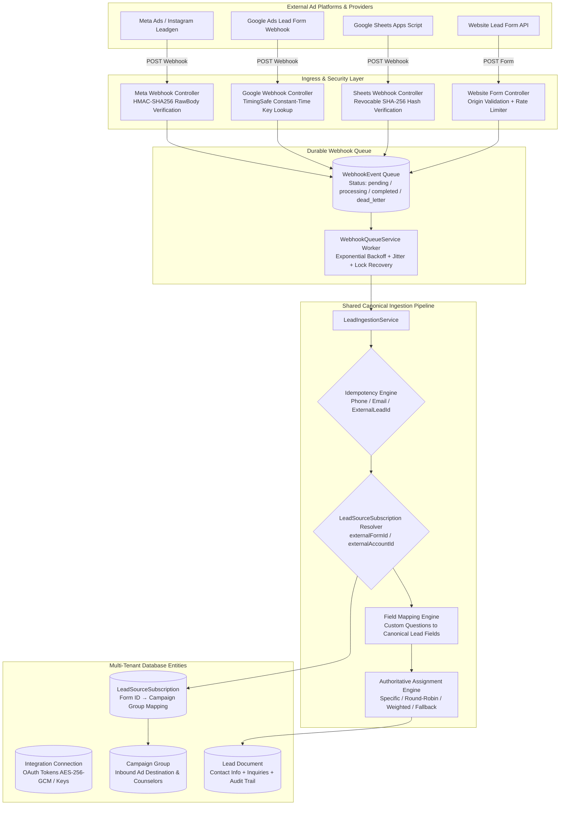

# SAHYAK CRM — Self-Service Lead Integration Architecture

**Document Version:** 1.0.0  
**Classification:** Enterprise Engineering Architecture & Design  
**Date:** October 2026  
**Audience:** Principal Architects, Engineering Leads, Security Auditors, Operators

---

## 1. Executive Summary & Core Business Requirement

Sahyak CRM is a multi-tenant SaaS CRM engineered for high-volume lead management across educational institutes, consultancies, real estate, and professional sales organizations.

Customers require full self-service capabilities to connect their own advertising accounts (Meta Ads, Google Ads, Google Sheets, Website Forms, Custom Webhooks) and independently route incoming leads into CRM Campaign Groups without manual configuration or engineering intervention by the Sahyak development team.

### Primary Supported Workflows
1. **Multi-Form Routing from Single Connection:**
   - One Meta account connection discovers Facebook Pages and multiple Lead Ads Forms.
   - Form 1 (*Property Buyers Form*) → Routes to **Property Buyers Group**.
   - Form 2 (*Property Sellers Form*) → Routes to **Seller Enquiries Group**.
   - Form 3 (*Rental Form*) → Routes to **Rental Leads Group**.
2. **Multi-Provider Aggregation into Single Campaign Group:**
   - Meta Lead Form A delivers leads into **Property Buyers Group**.
   - Google Ads Lead Form B delivers leads into the same **Property Buyers Group**.
   - Website Landing Page webhook delivers leads into the same **Property Buyers Group**.
3. **Independent Field Mapping & Assignment:**
   - Each source subscription defines custom field mappings and counselor assignment rules (or inherits from the destination Campaign Group).
4. **Full Attribution & Idempotency:**
   - Every lead record permanently tracks `provider`, `accountId`, `formId`, `formName`, `campaignId`, `campaignName`, and `externalLeadId`.
   - Repeated webhook deliveries are gracefully deduplicated and appended as distinct customer inquiries without duplicating the contact.

---

## 2. Target Component Architecture & Diagram



---

## 3. Entity Relationships & Domain Concepts

The platform separates 5 foundational concepts to prevent tight coupling and preserve flexibility:

### A. Integration Connection (`models/Integration.js`)
Represents the tenant's authenticated connection to an external provider.
- **Tenant Scoping:** Scoped to `companyId` and `userId`.
- **Credential Storage:** Stores OAuth tokens encrypted at rest via AES-256-GCM (`accessTokenEncrypted`).
- **Webhook Keys:** Inbound Google Ads keys and Sheets secrets stored exclusively as SHA-256 hashes (`googleKeyHash`, `sheetsSecretHash`), never in plaintext.
- **Single-Tenant Meta Page Constraint:** Partial compound index `{ provider: 1, pageId: 1 }` prevents concurrent hijacking of Facebook Pages across workspaces.

### B. Connected Assets
Resources discovered via provider APIs:
- Meta Facebook Pages (`pageId`, `pageName`).
- Meta Instant Lead Forms (`formIds`, `formNames`).
- Google Ads Customer ID and Lead Form extension assets.

### C. Lead Source Subscription (`models/LeadSourceSubscription.js`)
Represents a single active routing conduit delivering leads from a provider asset into Sahyak CRM.
- **Attributes:**
  - `workspaceId`, `companyId`, `userId`: Strict tenant isolation.
  - `integrationId`: Reference to parent `Integration`.
  - `provider`: `meta`, `google`, `sheets`, `website`, `custom`.
  - `sourceName`: Human-readable label (e.g. *"Property Buyers Instagram Form"*).
  - `externalAccountId`: External page/customer ID.
  - `externalFormId`: Provider form ID (e.g. Meta `109283746192`, Google `894719283719`).
  - `campaignGroupId`: Reference to destination `Campaign` group.
  - `fieldMapping`: Source-specific field translation overrides.
  - `assignmentRule`: Specific counselor, round-robin pool, or `inherit_campaign`.
  - `status`: `active`, `paused`, `error`.
  - `healthStatus`: `healthy`, `warning`, `error`.
  - `totalLeadsCount`: Operational metric tracking total leads ingested.
  - `lastLeadAt`: Timestamp of last successfully received lead.
- **Uniqueness Constraint:** Compound index `{ companyId: 1, provider: 1, externalFormId: 1 }` guarantees idempotent configuration within a workspace.

### D. CRM Campaign Group (`models/Campaign.js`)
Represents the CRM destination for leads, not the provider account itself.
- Separates inbound lead acquisition (`campaignType: 'inbound_ad'`) from outbound messaging broadcasts (`campaignType: 'outbound_broadcast'`).
- Supports multiple source subscriptions delivering simultaneously into one group.
- Houses campaign-level team assignments, counselor pools, and lead conversion reporting.

### E. Canonical Lead Record (`models/Lead.js`)
Stores the unified lead:
- Contact details (`name`, normalized `phone` e.g. `919876543210`, `email`).
- Direct campaign attribution (`campaignId`, `campaignName`).
- Multi-inquiry array (`inquiries[]`): If an existing lead submits another form or campaign, a new inquiry is appended without creating a duplicate contact.
- Complete activity timeline (`leadActivities[]`).

---

## 4. Shared Lead Ingestion Pipeline Lifecycle

Every supported provider follows a standardized, validated ingestion pipeline:

```
[Inbound Webhook HTTP POST]
             │
             ▼
[1. Cryptographic Authentication & Verification]
  - Meta: HMAC-SHA256 signature verification over raw request body using App Secret.
  - Google Ads: Constant-time comparison of per-integration SHA-256 key hash.
             │
             ▼
[2. Durable Ingestion & Fast 200 OK Response]
  - Event payload saved to WebhookEvent queue (Status: pending).
  - Fast HTTP 200 OK returned to external provider (< 150ms).
             │
             ▼
[3. Asynchronous Worker Processing (webhookQueueService)]
  - Atomic lock acquisition with crash-recovery heartbeat.
  - Payload parsed losslessly preserving 64-bit integer IDs.
             │
             ▼
[4. Tenant & Subscription Resolution (leadIngestionService)]
  - Step 4a: Check LeadSourceSubscription matching provider + externalFormId.
  - Step 4b: If subscription found, resolve target Campaign Group and metrics.
  - Step 4c: Fallback to Campaign routingRules and legacy registry if unconfigured.
             │
             ▼
[5. Deduplication & Idempotency Check]
  - Match existing lead by (tenant + externalLeadId) or (tenant + normalizedPhone).
  - If exact webhook retry: Return existing lead document immediately (Idempotent 200 OK).
  - If re-inquiry: Append inquiry item to lead.inquiries array.
             │
             ▼
[6. Field Mapping & Normalization Engine]
  - Normalize phone: Clean whitespace, prepend country code 91 for 10-digit numbers.
  - Clean email: Lowercase and trim.
  - Map custom questions to canonical CRM schema and customData fields.
             │
             ▼
[7. Authoritative Team Assignment (assignmentService)]
  - If subscription has dedicated assignment rule, apply it.
  - Otherwise inherit round-robin / counselor pool from destination Campaign Group.
  - Fallback counselor assigned if pool counselors are capped or inactive.
             │
             ▼
[8. Database Persistence & Event Emission]
  - Atomic lead upsert / insert with E11000 concurrency race handling.
  - Increment Campaign Group and LeadSourceSubscription total lead counters.
  - Emit CRM_EVENTS.LEAD_CREATED for automated WhatsApp / Email workflow execution.
  - Transition WebhookEvent to completed status.
```

---

## 5. Security & Multi-Tenant Isolation Architecture

### A. Tenant Isolation releasing gate
All endpoints derive tenant context exclusively from the verified server-side session (`req.user.companyId`, `req.user.workspaceId`, `req.user._id`). Client-supplied tenant identifiers in request bodies or query params are strictly rejected.

Every database read, update, delete, and lookup applies strict tenant scoping:
```javascript
const filter = getSubscriptionTenantFilter(req);
const subscription = await LeadSourceSubscription.findOne({ _id: req.params.id, ...filter });
if (!subscription) return res.status(404).json({ message: 'Not found' });
```

### B. Prevention of Cross-Tenant IDOR
- When creating a `LeadSourceSubscription`, the server verifies that both the `integrationId` and the `campaignGroupId` belong to the authenticated user's workspace before persisting.
- `campaignController.getCampaign` strictly applies tenant filters to eliminate unauthorized cross-tenant campaign reading.
- Campaign deletion routes distinguish between broadcast campaigns and inbound marketing campaigns to prevent accidental route collision.

### C. Secret Key Storage & Cryptographic Hardening
- **At-Rest Token Encryption:** AES-256-GCM authenticated encryption (`iv:authTag:ciphertext`).
- **No Plaintext Webhook Keys:** Inbound keys (Google Ads, Google Sheets) are hashed with SHA-256 before storage.
- **Fail-Closed Production Keys:** In `production` (`process.env.NODE_ENV === 'production'`), missing encryption keys or `META_APP_SECRET` throw startup errors and reject incoming webhook calls rather than falling back to insecure defaults.

---

## 6. Official Provider Specifications & Constraints

### Meta Lead Ads (Graph API v21.0+)
- **Required OAuth Scopes:** `pages_show_list`, `pages_read_engagement`, `pages_manage_metadata`, `leads_retrieval`, `ads_read`.
- **Token Exchange:** Short-lived user access token (2-hour expiry) exchanged via `grant_type: fb_exchange_token` for 60-day long-lived token.
- **Page Subscriptions:** The application must execute a POST to `/{page-id}/subscribed_apps` with `subscribed_fields: ['leadgen']` using the Page Access Token to activate webhook delivery.
- **Webhook Signature:** Verified using `x-hub-signature-256` computed as `sha256=` + HMAC-SHA256(rawBody, META_APP_SECRET).
- **Prerequisites for Production:**
  - Meta App Review approval for `leads_retrieval` and `pages_manage_metadata` for Live Mode access.
  - Meta Business Verification completed in Meta Business Manager.
  - Page Admin role required on the Facebook Page.

### Google Ads Lead Forms
- **Webhook Delivery Model:** Google Ads uses direct webhook delivery configured inside Google Ads Manager (Lead Form Assets / Extensions).
- **Validation Key:** A unique, high-entropy 32-character key generated per integration. Configured in Google Ads under "Key".
- **Lossless ID Handling:** Google Ads 64-bit integer IDs (`lead_id`, `form_id`, `campaign_id`) exceed JavaScript `Number.MAX_SAFE_INTEGER` ($2^{53} - 1$). Payloads must be parsed losslessly directly from `rawBody` using regex tokenization to preserve numerical precision.
- **HTTP Contract:** Google Ads requires an immediate HTTP 200 response upon receipt. Failure responses (4xx/5xx) trigger Google's automated retry schedule.

---

## 7. Migration & Backward Compatibility Strategy

1. **Zero Downtime Database Schema:**
   - Existing `Campaign` documents with `routingRules` remain fully operational.
   - Incoming leads first query `LeadSourceSubscription`. If no subscription exists for that form, the ingestion service automatically falls back to `Campaign.routingRules` and existing integration defaults.
2. **Safe Coexistence:**
   - Legacy `Integration.campaignOverrides` continue to work without breaking.
   - Disconnecting an integration disables future webhook ingestion while preserving all historical lead attribution and activity history.
